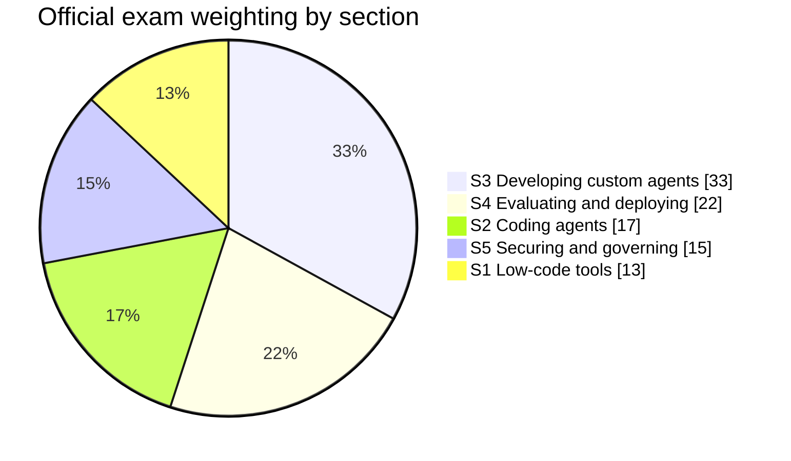
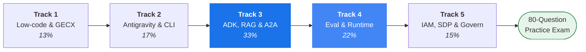

# Google Cloud Professional Agentic Architect — Exam Prep (Beta & Mid-November GA)

> [!IMPORTANT]
> **Personal, unofficial repository.** This is a personal study project. It is **not
> affiliated with, endorsed by, or maintained by Google or Google Cloud**. For official
> guidance — exam objectives, registration, policies, and the current exam guide — refer to
> **[cloud.google.com/learn/certification/agentic-architect](https://cloud.google.com/learn/certification/agentic-architect)**.
> Where anything here disagrees with the official source, **the official source is correct**.
> See [`DISCLAIMER.md`](DISCLAIMER.md) for the full disclaimer.

A hands-on, code-verified study course for the **Google Cloud Certified — Professional Agentic Architect** certification, built from the [official 4-page exam guide](https://services.google.com/fh/files/misc/professional_agentic_architect_exam_guide_english.pdf) (all 5 domains and all 28 in-scope tools) and calibrated against real-world **Beta exam** feedback.

Every lab runs **offline and free by default**, with an **opt-in `--live` path** on Google Cloud. Every SDK class, CLI flag, and model ID was machine-verified against live Google Cloud SDK installations — see [`docs/VERIFIED_FACTS.md`](docs/VERIFIED_FACTS.md).

> [!TIP]
> **Latest Update (October 30, 2026) — Passed the Beta Exam!**
> Passed the **Google Cloud Certified — Professional Agentic Architect** Beta exam using the study guides and 20 hands-on labs in this repository!
> - **Verified Digital Credential (Credly)**: **[View Official Badge on Credly](https://www.credly.com/badges/e380acf4-8bb0-4a39-8d7c-5d943115a901/public_url)** (`https://www.credly.com/badges/e380acf4-8bb0-4a39-8d7c-5d943115a901/public_url`)

---

## Exam Format, GA Launch Timeline & Test UI Notes

| Dimension | Details |
| :--- | :--- |
| **Beta vs. GA Timeline** | Real-world exam emphases in this course are grounded in **Beta exam** feedback plus the official Exam Guide. **The GA exam launches in mid-November.** |
| **Question Count & Format** | **Beta exam**: **~80 multiple-choice and multiple-select questions** (3 hours). **GA exam**: **question count will be lesser** (standard ~50–60 questions, 2 hours). |
| **Delivery Method** | **Online-proctored** (remote) or **onsite-proctored** (testing center). |
| **Test Interface Features** | **Mark for Review** and **Strike-through** are both available and work reliably — use **Strike-through** to cross out options with over-permissive IAM (`roles/editor`, static JSON keys) or wrong protocols. |

---

## Official Exam Weighting & Naming Hierarchy



### Naming hierarchy you must know cold

| Exam guide name | What public docs or exam scenarios mean by it |
| :--- | :--- |
| **Gemini Enterprise** (umbrella) vs. **Gemini Enterprise App (`GEApp`)** | **Gemini Enterprise** is the overarching umbrella brand; **Gemini Enterprise App (`GEApp`)** is the turn-key employee search & assistant web app (formerly Google Agentspace), whereas **Agent Platform (`GEAP`)** is the code-first developer platform (`adk`, Agent Runtime, Agent Registry, Memory Bank, Gen AI Evaluation Service) |
| **CX Agent Studio (`GECX`)** & **Agent Designer** | Low-code customer experience & enterprise agent builders supporting deterministic Flows (`Pages`, `Transition Routes`, `Event Handlers`) and probabilistic Generative Playbooks |
| **Agent Runtime** | Vertex AI Agent Engine (`adk deploy agent_engine`) |
| **Agent Search** | Vertex AI Search (`VertexAiSearchTool`, `DiscoveryEngineSearchTool`) |
| **Agent Registry** | Central discovery & governance catalog (`AgentRegistry`) for A2A Agent Cards and MCP servers |
| **Agent Gateway** | Policy-enforcing ingress/egress proxy for A2A & MCP traffic, OAuth propagation, and perimeter Model Armor |
| **GKE Inference Gateway** | Kubernetes Gateway API extension (`InferencePool`, `InferenceModel`) for KV-cache & LoRA aware GPU routing |
| **Code Mender** | Autonomous AI vulnerability-patching & root-cause repair agent (Objective 2.1) |

---

## The learning path



The arrows are a *suggested* order, not a dependency chain. **Every lab is self-contained** — jump straight to whichever section you are weakest in.

---

## All twenty labs

### Track 1 — Building agents using low-code tools · 13%
[`tracks/01_low_code_agents/`](tracks/01_low_code_agents/)

| Lab | Topic | Objectives |
| :--- | :--- | :--- |
| [01](tracks/01_low_code_agents/lab_01_agent_designer_workflows/) | Agent Designer workflows — prompt templates, customer support & HIPAA guardrails, probabilistic playbooks | 1.1 |
| [02](tracks/01_low_code_agents/lab_02_cx_agent_studio_state/) | GECX / CX Agent Studio — deterministic Pages, Form slots, Transition Routes, `sys.no-match-2` vs Hybrid Playbooks | 1.1 |
| [03](tracks/01_low_code_agents/lab_03_enterprise_data_and_multimodal/) | Gemini Enterprise (`GEApp`) connector auth (ACL-sync SA + WIF vs 3LO OAuth), HIPAA search, multimodal `gs://` input | 1.2 |

### Track 2 — Using coding agents for application development · 17%
[`tracks/02_coding_agents/`](tracks/02_coding_agents/)

| Lab | Topic | Objectives |
| :--- | :--- | :--- |
| [04](tracks/02_coding_agents/lab_04_mcp_and_tooling/) | MCP servers (`mcp_config.json`, Stdio vs SSE), Antigravity & Claude Code on GCP, least-privilege MCP IAM | 2.1 |
| [05](tracks/02_coding_agents/lab_05_secure_sandboxes/) | Secure sandboxes — GKE Agent Sandbox (`gVisor` vs `job`), Cloud Workstations, Antigravity OS sandbox, Code Mender | 2.1, 2.2 |
| [06](tracks/02_coding_agents/lab_06_antigravity_customization/) | Antigravity `hooks.json`, `SKILL.md` & `skills.json`, `GEMINI.md` vs `rules/*.md`, `plugin.json`, SDK `policy` & Agents CLI | 2.1, 2.2 |

### Track 3 — Developing custom agents · 33% ⭐
[`tracks/03_custom_agents/`](tracks/03_custom_agents/)

| Lab | Topic | Objectives |
| :--- | :--- | :--- |
| [07](tracks/03_custom_agents/lab_07_model_selection/) | Model selection — Gemini Pro/Flash/Lite vs Gemma 4 on GKE GPUs, `FallbackModel`, HIPAA/VPC-SC residency & IAM | 3.1 |
| [08](tracks/03_custom_agents/lab_08_adk_fundamentals/) | ADK fundamentals — `LlmAgent`, workflow agents vs graph `Workflow`, multi-agent latency math & `include_contents` | 3.1, 3.3 |
| [09](tracks/03_custom_agents/lab_09_sessions_and_memory/) | Managed `VertexAiSessionService` & `VertexAiMemoryBankService` (`preload_memory` vs `load_memory`), Redis/Cloud SQL, HIPAA TTL | 3.1, 3.2 |
| [10](tracks/03_custom_agents/lab_10_tools_and_skills/) | Function/MCP/BigQuery tools, HITL, `SkillRegistry` (`GCPSkillRegistry`), Agents CLI agent vs human mode & tool IAM | 3.1, 3.2 |
| [11](tracks/03_custom_agents/lab_11_rag_and_retrieval/) | RAG Engine (`RagCorpus`, `LayoutParserConfig`), Discovery Engine Ranking API (`RankServiceClient`), Vector Search 1.0 & Agent Search | 3.2 |
| [12](tracks/03_custom_agents/lab_12_multi_agent_and_a2a/) | Multi-agent patterns, cross-project A2A (`RemoteA2aAgent`, `roles/run.invoker`, OIDC), MCP & `AgentRegistry` | 3.2, 3.3 |

### Track 4 — Evaluating and deploying agentic workflows · 22%
[`tracks/04_evaluate_and_deploy/`](tracks/04_evaluate_and_deploy/)

| Lab | Topic | Objectives |
| :--- | :--- | :--- |
| [13](tracks/04_evaluate_and_deploy/lab_13_agent_evaluation/) | Agent evaluation — **Rubric vs. Metric**, `adk eval` (`evalset`), `trajectory_evaluator`, `hallucinations_v1` & Gen AI Eval Service | 4.1 |
| [14](tracks/04_evaluate_and_deploy/lab_14_deployment_runtimes/) | Managed `Agent Runtime` (`adk deploy agent_engine`) vs Cloud Run vs GKE, runtime IAM separation & scaling | 4.2 |
| [15](tracks/04_evaluate_and_deploy/lab_15_observability_and_troubleshooting/) | Cloud Logging & Cloud Trace (`trace_call_llm`, `trace_tool_call`), HIPAA zero-capture `ContentCapturingMode`, conformance replay | 4.1, 4.2 |
| [19](tracks/04_evaluate_and_deploy/lab_19_gke_inference_gateway_and_gpus/) | GKE Inference Gateway (`InferencePool`, `InferenceModel`), open-weight GPU serving (`vLLM`), GPU vs gVisor node pools | 3.1, 4.2 |

### Track 5 — Securing and governing agentic workflows · 15%
[`tracks/05_secure_and_govern/`](tracks/05_secure_and_govern/)

| Lab | Topic | Objectives |
| :--- | :--- | :--- |
| [16](tracks/05_secure_and_govern/lab_16_agent_identity_and_auth/) | Agent Identity (`GcpAuthProvider`), Principal Access Boundary (PAB), least-privilege IAM roles, OAuth 2.0 3LO & cross-project auth | 5.1 |
| [17](tracks/05_secure_and_govern/lab_17_model_armor_and_hitl/) | Model Armor + Sensitive Data Protection (`SdpAdvancedConfig` PHI redaction), Gateway vs Plugin screening, fail-closed & HITL | 5.2 |
| [18](tracks/05_secure_and_govern/lab_18_governance_gateway_registry/) | Agent Gateway traffic control, OAuth identity propagation, Agent Registry allowlisting & audit governance | 5.1, 5.2 |
| [20](tracks/05_secure_and_govern/lab_20_e2e_ai_threat_defense/) | End-to-End AI Threat Defense & HIPAA Customer Support Blueprint — Gateway, Registry, Model Armor + SDP & PAB | 5.1, 5.2 |

---

## Quickstart

### 1. Install

```bash
git clone https://github.com/cmanikandan/gcp-certification-professional-agentic-architect.git
cd gcp-certification-professional-agentic-architect

python3 -m venv .venv
source .venv/bin/activate
pip install -r requirements.txt
```

### 2. Run any lab, offline and free

```bash
./tracks/03_custom_agents/lab_08_adk_fundamentals/run_lab.sh
```

No credentials. No network. No cost. The offline path instantiates **real ADK / Cloud SDK objects** and validates the **real API surface**.

### 3. Optionally run it live on Google Cloud

```bash
cp .env.example .env     # fill in GOOGLE_CLOUD_PROJECT etc.
./tracks/03_custom_agents/lab_08_adk_fundamentals/run_lab.sh --live
```

### 4. Tear down

```bash
./tracks/03_custom_agents/lab_08_adk_fundamentals/cleanup.sh
```

---

## Repository layout

```
.
├── tracks/                  # all 20 self-contained labs across the 5 exam sections
│   └── NN_track_name/
│       └── lab_NN_topic/
│           ├── README.md        # 11 standardized sections + Mermaid diagrams
│           ├── lab.py           # runnable demo, offline by default
│           ├── run_lab.sh       # demo + pytest verification
│           ├── cleanup.sh       # idempotent teardown
│           └── tests/           # pytest assertions
├── common/                  # shared foundation (verified models, config gate, labkit)
├── docs/
│   ├── VERIFIED_FACTS.md        # ← ground-truth authority (SDKs, IAM matrix, Antigravity specs)
│   ├── EXAM_GUIDE.md            # verbatim objectives, Beta reality check, 28-tool map
│   └── LAB_AUTHORING_CONTRACT.md
├── STUDY_GUIDE.md           # complete architectural & IAM revision guide
├── PRACTICE_EXAM.md         # 80 scenario questions (matching Beta length) with full rationales
├── EXAM_READINESS.md        # capability self-assessment checklist
├── LAB_RUNBOOK.md           # environment, ADC & troubleshooting runbook
└── cli.py                   # interactive track/lab runner
```

---

## Suggested 4-week study plan

| Week | Focus | Deliverable |
| :--- | :--- | :--- |
| 1 | Track 3 (Labs 07–12) | Build ADK multi-agent, RAG + Reranking, Session/Memory Bank & cross-project A2A pipelines with least-privilege IAM |
| 2 | Track 4 (Labs 13–15, 19) | Master Rubric vs. Metric evals (`adk eval` & Gen AI Eval Service), Agent Runtime vs GKE Inference Gateway & zero-PHI telemetry |
| 3 | Track 5 (Labs 16–18, 20) + Track 2 (Labs 04–06) + Track 1 (Labs 01–03) | Master Agent Identity + PAB, Model Armor + SDP, Antigravity `hooks.json`/`SKILL.md`/`GEMINI.md`, Code Mender & GECX flows |
| 4 | [`PRACTICE_EXAM.md`](PRACTICE_EXAM.md) (80 questions timed) + [`EXAM_READINESS.md`](EXAM_READINESS.md) | Score ≥80% across every domain and verify zero blockers in `EXAM_READINESS.md` |
