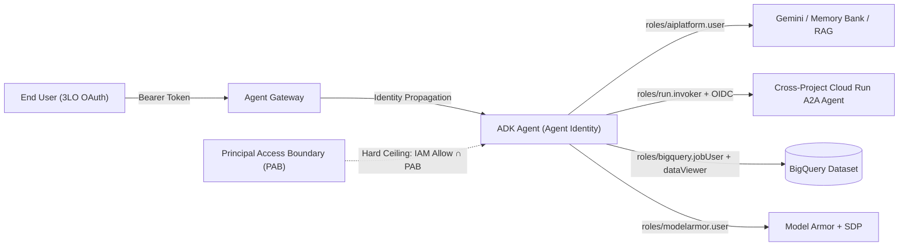
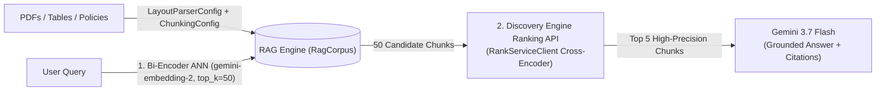
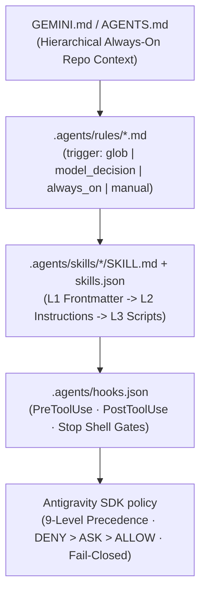
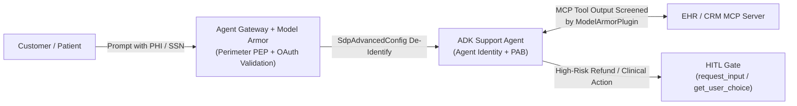

# Google Cloud Certified Professional Agentic Architect — Complete Study Guide

> [!IMPORTANT]
> **Personal, unofficial repository.** This is a personal study project. It is **not
> affiliated with, endorsed by, or maintained by Google or Google Cloud**. For official
> guidance — exam objectives, registration, policies, and the current exam guide — refer to
> **[cloud.google.com/learn/certification/agentic-architect](https://cloud.google.com/learn/certification/agentic-architect)**.
> Where anything here disagrees with the official source, **the official source is correct**.
> See [`DISCLAIMER.md`](DISCLAIMER.md) for the full disclaimer.

This study guide synthesizes every objective and all **28 in-scope tools** from the official 4-page Exam Guide alongside high-frequency architectural patterns reported from the **Beta exam**.

---

## Exam Format, GA Launch Timeline & Test-Taking Strategy

- **Beta Exam vs. Mid-November GA Launch**:
  - Practical topic weights and scenario patterns in this guide reflect the **Beta exam** alongside the official Exam Guide.
  - **The Generally Available (GA) exam launches in mid-November.**
  - **Question Count**: The **Beta exam has ~80 multiple-choice and multiple-select questions** (3-hour window). **The GA exam will have a lesser number of questions** (standard ~50–60 questions in a 2-hour window).
- **Delivery Method**: Available via **online-proctored** (remote) or **onsite-proctored** (testing center) delivery.
- **Test Interface Features**: Both **Mark for Review** and **Strike-through** are supported and responsive. On complex scenario questions, immediately **strike through** any option containing `roles/owner`, `roles/editor`, static JSON service account keys, `UnsafeLocalCodeExecutor`, prompt-only security against injection, or retired/floating model aliases.
- **Exam Archetype Profile**: Expect a heavy concentration of **enterprise customer support agents** and **regulated compliance scenarios (especially HIPAA / healthcare and financial services)**, minimal trivia on unrelated GCP infrastructure outside the 28-tool list, and **~30–35% of questions testing IAM roles, least-privilege permissions, credential provisioning, and identity boundaries**.

---

## Glossary of Renamed Products & Naming Hierarchy

- **Gemini Enterprise (Umbrella) vs. Gemini Enterprise App (`GEApp`) vs. Agent Platform (`GEAP`)**:
  - **Gemini Enterprise**: Overarching **umbrella brand** for Google Cloud's enterprise agentic stack.
  - **Gemini Enterprise App (`GEApp`)**: Formerly *Google Agentspace* / Enterprise Search web app. Turn-key employee web workspace with OOTB SaaS connectors and Document-Level ACL search (**Agent Search**). *(Exam stems frequently write "Gemini Enterprise" when referring to `GEApp`.)*
  - **Agent Platform (`GEAP` / Vertex AI Agent Platform)**: Code-first developer platform (`adk`, **Agent Runtime**, **Agent Registry**, **Memory Bank**, **Gen AI Evaluation Service**, **Agents CLI**).
- **CX Agent Studio (`GECX`) & Agent Designer**: Low-code agent builders under Gemini Enterprise supporting deterministic state machines (**Flows / Pages / Transition Routes / Event Handlers**) and probabilistic **Generative Playbooks**.
- **Agent Runtime**: Formerly *Vertex AI Agent Engine* / *Reasoning Engine* (`adk deploy agent_engine`).
- **Agent Search**: Formerly *Vertex AI Search* (`VertexAiSearchTool`, `DiscoveryEngineSearchTool`).
- **Agent Registry**: Central governance and discovery service (`AgentRegistry`) for A2A Agent Cards and approved MCP servers.
- **Agent Gateway**: Ingress/egress policy enforcement proxy (PEP) for A2A & MCP traffic, quotas, audit logging, OAuth identity propagation, and perimeter Model Armor screening.
- **GKE Inference Gateway**: Kubernetes Gateway API extension (`InferencePool`, `InferenceModel`) for KV-cache/prefix-cache affinity, LoRA multiplexing, and criticality load-shedding on GKE GPU pools.
- **Code Mender**: Autonomous AI security coding agent that localizes CVEs, synthesizes patches, and verifies fixes with fuzz/regression suites inside isolated sandboxes (Objective 2.1).

---

## Cross-Cutting Pillar (~30–35% of Beta Questions): IAM, Least-Privilege Roles, Agent Identity & Connector Auth

Never select broad primitive roles (`roles/owner`, `roles/editor`), project-wide admin roles (`roles/aiplatform.admin`, `roles/bigquery.admin`), or downloadable JSON Service Account keys (`iam.disableServiceAccountKeyCreation`). Memorize this exact least-privilege mapping:

### 1. Master Least-Privilege IAM Role Table

| Scenario / Resource Access | Exact Predefined IAM Role(s) & Scope | Classic Distractor to Strike Through |
| :--- | :--- | :--- |
| **Runtime ADK agent calling Gemini, Memory Bank, Managed Sessions, or RAG Engine** | `roles/aiplatform.user` on the Vertex AI project | `roles/aiplatform.admin` or `roles/editor` |
| **Cross-project A2A caller invoking a remote Cloud Run specialist agent** | Grant `roles/run.invoker` **on the specific Cloud Run service** in Project B to Project A's Agent Identity; attach an OIDC ID token (`audience` = Cloud Run URL) | `--allow-unauthenticated` (`allUsers`) or `roles/run.developer` |
| **Cross-project A2A caller invoking an agent hosted on Agent Runtime** | Grant `roles/aiplatform.user` (or Reasoning Engine query custom role) in Project B to Project A's Agent Identity + register in `AgentRegistry` | Exporting a JSON SA key from Project B into Project A's container |
| **Agent querying BigQuery tables via `BigQueryToolset` (read-only)** | `roles/bigquery.jobUser` (on the agent's execution project to run query jobs) **+** `roles/bigquery.dataViewer` (on the specific target dataset/table) | Only `roles/bigquery.dataViewer` (cannot start query jobs!) or `roles/bigquery.dataEditor` |
| **Agent querying Agent Search / `GEApp` data stores** | `roles/discoveryengine.viewer` | `roles/discoveryengine.admin` |
| **Agent reading a third-party API token from Secret Manager** | `roles/secretmanager.secretAccessor` **bound on the individual secret**, never project-wide | Storing tokens in `GEMINI.md`, prompt text, or `roles/secretmanager.admin` |
| **Agent connecting to Cloud SQL via MCP / `DatabaseSessionService`** | `roles/cloudsql.client` + `roles/cloudsql.instanceUser` (IAM DB Auth) | Static DB root password in container env vars |
| **Agent calling Model Armor (`ModelArmorPlugin`)** | `roles/modelarmor.user` (runtime agent) vs. `roles/modelarmor.admin` (security team authoring templates) | Granting `roles/modelarmor.admin` to the runtime agent |
| **Model Armor executing Advanced SDP (`SdpAdvancedConfig`)** | Grant **Model Armor Service Agent** `roles/dlp.user` + `roles/dlp.inspectTemplatesReader` + `roles/dlp.deidentifyTemplatesReader` | Expecting Cloud Armor WAF to de-identify unstructured PHI |
| **Agent exporting traces, logs, and metrics** | `roles/cloudtrace.agent` + `roles/logging.logWriter` + `roles/monitoring.metricWriter` | `roles/logging.admin` or `roles/monitoring.admin` |

### 2. Safe Credential Provisioning & Principal Access Boundary (PAB)
- **Agent Identity (`GcpAuthProvider`, `GcpAuthProviderScheme`, `AuthProviderCredentialsServiceClient`)**: Gives every agent a first-class, keyless workload identity that mints short-lived OAuth/OIDC credentials automatically.
- **Principal Access Boundary (PAB)**: Bound to the principal (Agent Identity), **not** to a network or resource.
  - **Formula**: $\text{Effective Access} = \text{IAM Allow Policies} \cap \text{PAB Eligible Resources}$.
  - A PAB **grants zero permissions on its own**; it caps the maximum resources the agent can ever touch—even if someone accidentally grants `roles/owner` at the Organization root!

### 3. Gemini Enterprise (`GEApp`) Connector Authentication Patterns
| Connector Pattern | Auth Mechanism | When to Use |
| :--- | :--- | :--- |
| **ACL-Aware Ingestion Sync** (SharePoint, Drive, Confluence → Agent Search) | Dedicated Connector Service Account + **Workforce Identity Federation** mapping corporate IdP groups/users to indexed document ACLs | Fast enterprise search across millions of docs where users must only see results their corporate identity is permitted to read |
| **Real-Time Federated / Action Connector** (Create Jira issue, update ServiceNow, send Gmail) | **3-Legged OAuth 2.0 (3LO)** via **Auth Manager** & `IAMConnectorCredentialsServiceClient` (`RetrieveCredentialsRequest` → `uri_consent_required`) | Write/transactional actions or live unindexed APIs that must execute strictly under the **human user's own identity and audit trail** |

---

## 1. Domain 3: Developing Custom Agents (~33%)

### Model Selection Matrix (`common/models.py`)
Never use floating aliases (`gemini-flash-latest`) in production. Match workload requirements to pinned models:

| Model ID | Architectural Role | Context (In / Out) |
| :--- | :--- | :--- |
| `gemini-3.7-flash` / `gemini-3.8-flash` | **Default Enterprise Agent Workhorse**: tool calling, multi-step planning, coding, native multimodal ingestion | 1M / 65K |
| `gemini-2.5-pro` | Complex legal/clinical synthesis, deep root-cause reasoning, **LLM-as-a-Judge autorater** (out-ranking the Flash agent) | 1M / 65K |
| `gemini-3.5-flash-lite` | High-QPS intent routing, lightweight classification, cheap guard/triage nodes | 1M / 65K |
| `gemma-4-26b-a4b-it` (MoE) / `gemma-4-31b-it` (Dense) | **Self-Hosted Open-Weight on GKE GPUs**: strict VPC-SC / air-gapped sovereignty, custom LoRA weights, MoE `a4b` (~4B active params) for max tokens/sec on L4 GPUs | 262K / 32K |
| `gemini-embedding-2` | Semantic embeddings for **RAG Engine** and **Vector Search 1.0** | 8,192 input tokens |
| `FallbackModel` (`google.adk.models`) | Automatic regional/model failover on `429 RESOURCE_EXHAUSTED` or `503` outages | Wraps primary + backup `BaseLlm` |

### Multi-Agent Orchestration & Latency Trade-Offs (ADK 2.9.0)
Exam scenarios heavily test **latency math** and **context-bloat control** across ADK coordination primitives:

| Pattern / Class | Total Latency Formula | Routing Overhead | Best Use Case & Critical Nuance |
| :--- | :--- | :--- | :--- |
| **Graph `Workflow`** (`Node`, `Edge`, `FunctionNode`, `JoinNode`) | Critical path of DAG | **0 ms** (deterministic Python edges) | Top-level deterministic pipelines & DAGs. *Cannot yet be passed inside `LlmAgent.sub_agents` in ADK 2.9.0.* |
| **`SequentialAgent`** | $\sum_{i=1}^{N} T_i$ | **0 ms** | Strict step-by-step pipelines (`Ingest → Redact → Summarize`) nested inside an `LlmAgent` (emits `DeprecationWarning`, still required for `sub_agents` nesting). |
| **`ParallelAgent`** | $\max_{i=1..N}(T_i)$ | **0 ms** | Independent fan-out research/checks (e.g., querying Order DB, Shipping API, and Policy RAG simultaneously) to cut p99 latency. |
| **`LoopAgent` + `exit_loop`** | $k \times T_{\text{iter}}$ ($k \le \text{max\_iterations}$) | **0 ms** | Iterative Generator–Critic refinement; **always** set `max_iterations` + `exit_loop` to prevent infinite token burn. |
| **`transfer_to_agent`** (`sub_agents` handoff) | $T_{\text{router}} + T_{\text{specialist}}$ | **1 LLM hop** | Customer support triage handing control directly to Billing or Technical Support specialist (`disallow_transfer_to_peers=True` prevents lateral loops). |
| **`AgentTool`** (wrapping child agent as tool) | $T_{\text{parent1}} + T_{\text{child}} + T_{\text{parent2}}$ | **2 parent LLM hops** | Supervisor needs structured output (`output_schema`) back from a specialist while retaining full conversational ownership. |
| **Cross-Project `RemoteA2aAgent` (A2A)** | $T_{\text{caller}} + \text{Net/Auth} + T_{\text{remote}}$ | HTTP/JSON-RPC + OIDC/OAuth | Crossing **process, runtime, VPC, project, or org boundaries** via attested **Agent Cards** (`/.well-known/agent.json`) discovered in `AgentRegistry`. |

> [!TIP]
> **Latency & Token Optimization Trick**: Set `include_contents='none'` on downstream worker agents in a `SequentialAgent` or `ParallelAgent` and pass only compact structured outputs via `output_key="summary"` (`{summary}` template interpolation) so downstream models do not re-prefill 50,000 tokens of prior chat transcripts!

### Managed Sessions vs. Memory Bank vs. Redis / Cloud SQL
- **Session State (`google.adk.sessions`)** = **Within one conversation** (scratchpad parameters, current cart/ticket ID; prefixes: plain session, `user:`, `app:`, `temp:`).
  - **Agent Runtime**: Use native zero-ops **`VertexAiSessionService`**.
  - **Cloud Run / GKE**: Use **`RedisSessionService`** (sub-ms latency + native `ttl_seconds` auto-expiry for HIPAA/ephemeral state) or **`DatabaseSessionService`** on **Cloud SQL** (ACID relational durability). Never use `InMemorySessionService` across horizontally scaled pods!
- **Long-Term Memory (`google.adk.memory`)** = **Across conversations**.
  - **`VertexAiMemoryBankService` (Agent Platform Memory Bank)**: Distills conversational episodes into structured user facts/preferences across sessions. Use **`preload_memory`** when personalization is needed on *every* turn (saves an extra tool-call LLM hop) vs. **`load_memory`** when recall is rarely needed (saves baseline input tokens).
  - **`VertexAiRagMemoryService`**: Semantic chunk retrieval over large static/reference corpora via RAG Engine.

### RAG Engine, Discovery Engine Ranking API & Vector Search 1.0

- **Why Two-Stage Retrieval + Reranking Wins**:
  - **Stage 1 (Bi-Encoder ANN Recall)**: Embeds query and documents independently using `gemini-embedding-2` (cosine/dot-product similarity, or `HybridSearch` combining dense semantic + sparse BM25 keyword matching for exact SKUs/ICD-10 medical codes) to retrieve `top_k=50` candidates in milliseconds.
  - **Stage 2 (Cross-Encoder Reranking)**: Uses **Discovery Engine Ranking API** (`google.cloud.discoveryengine_v1.RankServiceClient` with `semantic-ranker-default@latest`, or `rag.Ranking(rank_service=rag.RankService(...))`) to attend jointly across `[query, candidate_chunk]` tokens, filtering down to `top_n=5` chunks and slashing hallucinations and context cost. (`rag.LlmRanker` uses a generative LLM to rerank—more flexible but higher latency/cost than `RankServiceClient`.)
- **Service Choice**:
  - **Agent Search**: Turn-key OOTB SaaS connectors (SharePoint, Jira, Drive) + automatic Document-Level ACL enforcement.
  - **RAG Engine (`RagCorpus`)**: Developer-controlled custom chunking (`TransformationConfig`, `ChunkingConfig`, Document AI `LayoutParserConfig` for complex tables), `HybridSearch`, and native `RankService` integration for custom ADK agents.
  - **Vector Search 1.0**: Low-level custom-embedding HNSW/ScaNN ANN index at billion-vector scale (<10ms p99, metadata filtering), where you manage document storage and chunk hydration yourself.

*Covered in: [Track 3 / Labs 07–12](tracks/03_custom_agents)*

---

## 2. Domain 4: Evaluating and Deploying Agentic Workflows (~22%)

### Agent Evaluation: Rubric vs. Metric & Local `evalset` vs. Gen AI Evaluation Service

| Dimension | Deterministic / Reference **Metrics** | Reference-Free Autorater **Rubrics** |
| :--- | :--- | :--- |
| **ADK / SDK Classes** | `ToolTrajectoryCriterion` (`trajectory_evaluator`: `exact_match`, `in_order_match`, `any_order_match`), `final_response_match_v2`, `Rouge` | `Rubric` + `RubricsBasedCriterion`, `rubric_based_final_response_quality_v1`, `rubric_based_tool_use_quality_v1`, `hallucinations_v1` |
| **Requires Golden Reference Output?** | **Yes** — requires exact expected `tool_uses` trajectory or golden reference string in `.evalset.json` | **No** — evaluates open-ended responses against natural-language grading criteria (`RubricContent`) using a stronger judge model (`gemini-2.5-pro`) |
| **Best Exam Use Case** | Verifying mandatory tool order (e.g., `verify_hipaa_consent` called *before* `get_patient_chart`) and deterministic API arguments | Evaluating customer support tone, de-escalation empathy, multi-valid troubleshooting paths, or groundedness (`hallucinations_v1`) |

- **Local `adk eval` (`evalset`) vs. Cloud Agent Platform Gen AI Evaluation Service (`vertexai.evaluation`)**:
  - **Local `adk eval` + `adk conformance record/test`**: Fast developer inner-loop and deterministic CI/CD pull-request gating on `.evalset.json` files (`adk conformance test` replays recorded LLM/tool traces with zero live LLM non-determinism).
  - **Agent Platform Gen AI Evaluation Service (`EvalTask`, `PointwiseMetric`, `PairwiseMetric`, `CustomMetric`, `vertex_ai_eval_facade`)**: Managed cloud-scale batch evaluation, **Pairwise A/B model upgrades**, **Adaptive Rubrics** (dynamically tailored per prompt), and **continuous production sampling** over Cloud Logging traces to detect **agent drift**.

### Deployment Runtimes & GKE Inference Gateway

| Runtime | Choose When | Hard Architectural Boundaries |
| :--- | :--- | :--- |
| **Agent Runtime** (`adk deploy agent_engine`) | Default zero-ops managed Python ADK runtime with built-in `VertexAiSessionService`, `VertexAiMemoryBankService`, and Cloud Trace integration | Cannot attach custom GPU node pools (`vLLM` / `Gemma 4`), cannot run `GkeCodeExecutor(executor_type="sandbox")` gVisor pods, no `InferencePool` |
| **Cloud Run** (`adk deploy cloud_run`) | Scale-to-zero HTTP/MCP microservices, Eventarc event triggers, lightweight cross-project A2A services (`roles/run.invoker`) | Stateless ephemeral containers (must pair with `RedisSessionService` or `DatabaseSessionService`); adjust request `timeout` for slow tools |
| **GKE** (`adk deploy gke`) | Self-hosted open-weight GPUs (`Gemma 4`), **GKE Inference Gateway**, **GKE Agent Sandbox (`gVisor`)**, strict multi-tenant Kubernetes networking | Highest operational responsibility; **must use separate node pools** for GPUs (`--accelerator`) vs gVisor (`--sandbox=type=gvisor`) |

- **GKE Inference Gateway (`InferencePool` + `InferenceModel`)**: Replaces naive round-robin L7 load balancing in front of GPU `vLLM` pods with an Endpoint Picker (EPP) that routes by **KV-cache / prefix-cache hit affinity** (slashing multi-turn TTFT), **GPU HBM saturation**, **loaded LoRA adapters**, and **criticality tiers** (`Critical` live support vs. `Sheddable` batch evals).
- **Observability & HIPAA Privacy (`google.adk.telemetry`)**: Export OpenTelemetry spans (`trace_call_llm`, `trace_tool_call`, `trace_merged_tool_calls`) using `roles/cloudtrace.agent` + `roles/logging.logWriter`, while setting **`ContentCapturingMode`** to disable/redact prompt & tool payload capture in production so PHI/PII never leaks into Cloud Trace or Cloud Logging!

*Covered in: [Track 4 / Labs 13–15, 19](tracks/04_evaluate_and_deploy)*

---

## 3. Domain 2: Using Coding Agents for Application Development (~17%)

### Antigravity Customization Files & Governance Hierarchy

1. **`GEMINI.md` / `AGENTS.md` vs. `.agents/rules/*.md` vs. `SKILL.md`**:
   - **`GEMINI.md` / `AGENTS.md`**: Plain Markdown (no frontmatter), walked from current directory up to root. Always injected into context — keep concise!
   - **`.agents/rules/*.md`**: Scoped rules with YAML frontmatter `trigger: glob` (e.g., `**/*.tf`), `model_decision`, `always_on`, or `manual`. Saves tokens by loading rules only when matching files/topics are active.
   - **`.agents/skills/<name>/SKILL.md` (+ `skills.json`)**: Procedural capability packages using **3-level progressive disclosure** (L1 YAML `name`/`description` always visible → L2 `SKILL.md` body read on demand → L3 `scripts/` & `references/` executed/read as needed).
   - **`.agents/plugins/<name>/plugin.json`**: Packages `skills/`, `agents/`, `hooks/hooks.json`, `rules/`, and MCP configs for org-wide distribution.
   - **`mcp_config.json`**: Configures local **Stdio** (`command`, `args`) and remote **SSE / Streamable HTTP** (`serverUrl`, OAuth/Bearer headers) MCP servers, with lazy tool-schema loading to avoid bloating the prompt.
2. **`hooks.json` Lifecycle Enforcement**:
   - Events: **`PreToolUse`** (can return `permissionDecision`: `"allow"`, `"deny"`, `"ask"`, `"force_ask"`, or `"overwrite"` with `updatedInput` via camelCase JSON stdout), **`PostToolUse`** (auto-run `ruff`/`gofmt` formatter or secret scanner after file edits), **`PreInvocation`**, **`PostInvocation`**, and **`Stop`** (return `{"decision": "block", "reason": "Run pytest first"}` to force test verification before completion).
3. **Subagents & SDK `policy`**:
   - Subagents (`.agents/agents/<name>.md`) run in **isolated context windows** with restricted tools (e.g., `enable_write_tools: false` for a read-only security reviewer) and bounded recursion (`max_subagent_depth`, `allowed_subagents`).
   - Antigravity SDK `policy` evaluates 9 levels (`session_policies` down to `system_defaults`); within any level **`DENY` > `ASK` > `ALLOW`**, `confirm_run_command()` gates shell execution, and exceptions inside `when=` predicates **fail closed (`DENY`)**.
4. **Agents CLI (`adk` / `agents-cli`), Claude Code on GCP & Secure Sandboxes**:
   - **Agents CLI**: Use **headless Agent Mode** (structured JSON output, non-interactive flags, deterministic exit codes) when Antigravity or CI/CD invokes `adk eval`, `adk optimize` (GEPA prompt optimizer), or `adk deploy`, vs. **Human Mode** (`adk web`, interactive `adk run`) for developer debugging.
   - **Claude Code on Google Cloud**: Authenticates via Vertex AI ADC (`roles/aiplatform.user` — never external Anthropic API keys) inside **Cloud Workstations** (persistent human developer IDE inside a VPC-SC perimeter with zero source code on laptops).
   - **Execution Sandboxes & Code Mender**:
     - **GKE Agent Sandbox (`GkeCodeExecutor(executor_type="sandbox")`)**: Uses **gVisor (`runsc`)** user-space kernel syscall interception + default-deny egress `NetworkPolicy` (whereas `executor_type="job"` shares the host Linux kernel!).
     - **Code Mender**: Autonomous CVE/vulnerability repair agent that localizes flaws, synthesizes patches, and runs fuzzers + regression suites inside a GKE Agent Sandbox before opening a PR.

*Covered in: [Track 2 / Labs 04–06](tracks/02_coding_agents)*

---

## 4. Domain 5: Securing and Governing Agentic Workflows (~15%)

### Model Armor + Sensitive Data Protection (SDP) & Agent Gateway Defense-in-Depth

- **`google.cloud.modelarmor_v1.FilterConfig` + SDP**:
  - Combines `PiAndJailbreakFilterSettings`, `MaliciousUriFilterSettings`, `RaiFilterSettings`, and **`SdpFilterSettings`**:
    - **`SdpBasicConfig`**: Fast built-in sensitive data detection and blocking.
    - **`SdpAdvancedConfig(inspect_template=..., deidentify_template=...)`**: Invokes **Cloud Sensitive Data Protection (SDP)** templates to **redact, mask, or cryptographically tokenize PII/PHI** (names, SSNs, MRNs, credit cards) *before* prompts reach the LLM or downstream logs!
- **Centralized Agent Gateway vs. In-Agent `ModelArmorPlugin`**:
  - **Agent Gateway + Model Armor**: Enforces mandatory, centralized perimeter screening, rate limiting, audit logging, and user OAuth 2.0 identity propagation across *all* A2A/MCP traffic regardless of agent framework.
  - **In-Agent `ModelArmorPlugin(block_on_screening_failure=True)`**: Screens **internal mid-loop tool/RAG outputs** (`after_tool_callback` / `before_model_callback`) to stop *indirect prompt injections* embedded in retrieved support tickets or emails, and **fails closed** if the screening API errors.
- **HIPAA Customer Support Agent Reference Checklist**:
  1. Sign Google Cloud **BAA** and keep all 28-scope services inside a **VPC Service Controls (VPC-SC)** perimeter with **CMEK** encryption.
  2. Configure **Model Armor with `SdpAdvancedConfig`** (`inspect_template` + `deidentify_template`) to mask PHI in-flight.
  3. Set `TelemetryConfig` **`ContentCapturingMode`** to disable raw prompt/tool payload logging in Cloud Trace & Cloud Logging.
  4. Enforce **end-user OAuth 2.0 identity propagation** via Agent Gateway + **Agent Identity with PAB** (`roles/aiplatform.user`, zero static keys).
  5. Gate irreversible clinical/billing mutations behind deterministic **GECX Flows** or ADK **HITL** (`request_input` / `get_user_choice` / `LongRunningFunctionTool`).

*Covered in: [Track 5 / Labs 16–18, 20](tracks/05_secure_and_govern)*

---

## 5. Domain 1: Building Agents Using Low-Code Tools (~13%)

### GECX (CX Agent Studio) Deterministic vs. Probabilistic vs. Hybrid Flows

| Flow Architecture | Core Primitives | Determinism | Ideal Customer Support Scenario |
| :--- | :--- | :--- | :--- |
| **Deterministic Flow** (`GECX` State Machine) | **Flows**, **Pages**, **Required Form Parameters** (slot filling), **Intent/Condition Transition Routes** (`$session.params.verified == true`), **Event Handlers** (`sys.no-match-default`, `sys.no-match-2` → live human escalation) | **100% Auditable State Graph** | Regulated identity verification, HIPAA intake consent, PCI payment/refund workflows, strict retry limits |
| **Probabilistic Flow** (Agent Designer / Generative Playbooks) | Natural-language goal instructions, **in-console few-shot & chain-of-thought prompt templates**, tool & **Agent Search** bindings | **LLM-Driven / Dynamic** | Open-ended troubleshooting, multi-document FAQ synthesis, internal IT/HR knowledge assistants |
| **Hybrid Flow** *(Exam Favorite!)* | Generative Playbook handles open-ended intent discovery & empathy → transitions into a **Deterministic GECX Flow Page** for regulated slot collection & execution → **Generative Fallback** grounded on Agent Search | **Best of Both Worlds** | Enterprise omnichannel customer support center handling both unstructured troubleshooting and regulated account/order mutations |

- **Native Multimodal Ingestion (Objective 1.2)**: Store PDFs, claim photos, call recordings, and MP4 videos in **Cloud Storage** (`roles/storage.objectViewer`) and pass `gs://` URIs directly to **`gemini-3.7-flash`** in a single multimodal context window to preserve cross-modal temporal alignment without brittle OCR + STT stitching.

*Covered in: [Track 1 / Labs 01–03](tracks/01_low_code_agents)*

---

## Master Exam Scenario Decision Matrix

| If the exam scenario asks for... | Choose... | Why alternatives fail |
| :--- | :--- | :--- |
| Regulated customer support step that must collect 4 slots and escalate after 2 invalid inputs | **CX Agent Studio (`GECX`) Deterministic Flow** (`Pages` + Required `Form` params + `sys.no-match-2` Event Handler) | Prompt instructions in Playbooks count retries unreliably |
| Connecting SharePoint/Jira to `GEApp` so search respects user ACLs AND ticket creation runs as the user | **ACL-Sync Service Account + WIF** for search indexing **+** **3LO OAuth (`Auth Manager` / `IAMConnectorCredentialsServiceClient`)** for write actions | Shared SA on write actions breaks user audit attribution |
| Blocking `rm -rf` or running `pytest` deterministically in Antigravity before an agent finishes | **`.agents/hooks.json`** (`PreToolUse` `"deny"` + `Stop` `"block"` hook) | `GEMINI.md` and `SKILL.md` are advisory prompt text, not deterministic enforcement |
| Loading Terraform security rules in Antigravity *only* when `.tf` files are edited | **`.agents/rules/terraform.md`** with `trigger: glob` (`**/*.tf`) or **`SKILL.md`** L1/L2/L3 progressive disclosure | `GEMINI.md` is always-on and wastes context tokens on non-Terraform turns |
| Cutting latency of 4 independent tool/agent lookups in ADK | **`ParallelAgent`** ($\max T_i$) + `include_contents='none'` + `output_key` | `SequentialAgent` sums latencies ($\sum T_i$); full chat history bloats prefill |
| Calling a specialist ADK agent in **another GCP project** on Cloud Run | **`RemoteA2aAgent`** (via `AgentRegistry.get_remote_a2a_agent`) + **OIDC ID token** + **`roles/run.invoker`** on the target Cloud Run service | `MCPToolset` is for tools, not agents; static SA JSON keys violate security best practices |
| Improving RAG precision over complex PDF tables & exact medical/product codes | **RAG Engine** (`LayoutParserConfig` + `HybridSearch`) + **Discovery Engine Ranking API (`RankServiceClient`)** | Bi-encoder ANN alone misses fine-grained cross-attention & exact SKU codes |
| Grading open-ended support empathy vs. verifying mandatory tool call sequence | **Rubrics (`RubricsBasedCriterion`)** for open-ended quality **+** **Metrics (`ToolTrajectoryCriterion`)** for deterministic tool sequence | `Rouge` / `final_response_match_v2` fails on valid paraphrases and ignores skipped tools |
| Redacting patient PHI before prompts hit Gemini and blocking indirect prompt injection from MCP tools | **Agent Gateway + Model Armor (`SdpAdvancedConfig` inspect/deidentify templates)** + **`ModelArmorPlugin(block_on_screening_failure=True)`** | Cloud Armor WAF only inspects HTTP L7 signatures, not unstructured PHI or LLM jailbreaks |
| Preventing an agent from ever accessing non-sandbox projects even if granted `roles/editor` | **Agent Identity + Principal Access Boundary (PAB)** (`IAM Allow ∩ PAB`) | IAM Allow roles are purely additive without a PAB ceiling |
