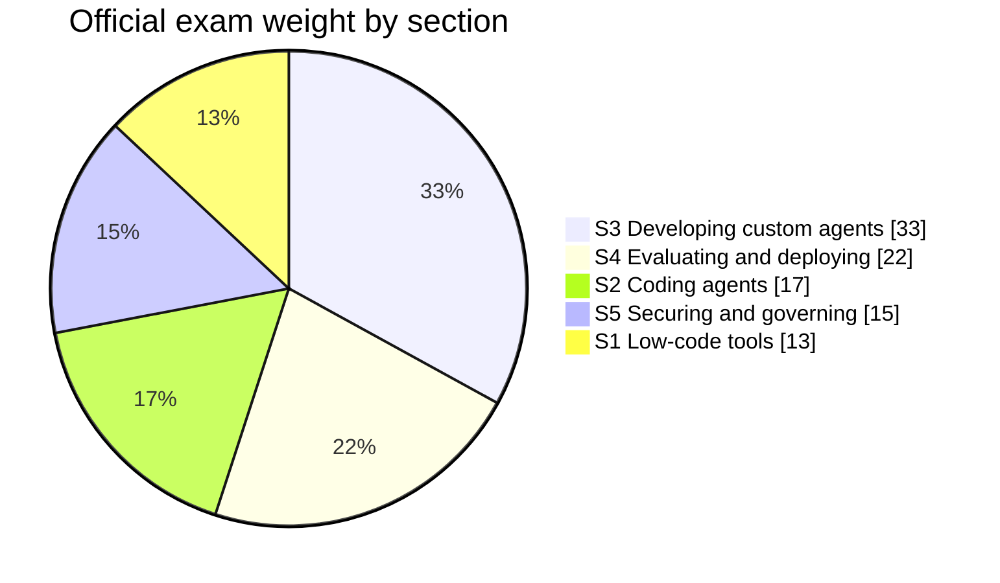

# Exam guide — objectives, weights, Beta exam reality, and lab mapping

> [!IMPORTANT]
> **Personal, unofficial repository.** This is a personal study project. It is **not
> affiliated with, endorsed by, or maintained by Google or Google Cloud**. The objectives
> below are quoted from the official [Professional Agentic Architect exam guide][guide].
> Always confirm the current guide, logistics, and registration details at
> **[cloud.google.com/learn/certification/agentic-architect](https://cloud.google.com/learn/certification/agentic-architect)**.
> Where anything here disagrees with the official source, **the official source is correct**.
> See [`DISCLAIMER.md`](../DISCLAIMER.md) for the full disclaimer.

[guide]: https://services.google.com/fh/files/misc/professional_agentic_architect_exam_guide_english.pdf

The raw text extracted from all 4 pages of the official PDF is preserved verbatim in
[`exam_guide_extracted.txt`](exam_guide_extracted.txt) so you can diff this
mapping against the source yourself.

---

## Exam format, timeline, and test-taking UI

> [!NOTE]
> **Beta Exam Context vs. Mid-November GA Launch**:
> - **Source of Practical Insights**: The real-world exam emphases throughout this repository are calibrated against both the **official 4-page Exam Guide** and extensive **Beta exam** feedback.
> - **GA Launch Timeline**: The **Generally Available (GA) exam launches in mid-November**.
> - **Question Count & Format**: The **Beta exam contains ~80 multiple-choice and multiple-select questions** (3-hour window). **The question count will be lesser for the GA exam** (typically ~50–60 questions in a 2-hour window).
> - **Delivery Method**: Offered both **online-proctored** (remote) and **onsite-proctored** (at an authorized testing center).
> - **Exam UI Tools**: Both **Mark for Review** and **Strike-through** are enabled and work smoothly. Use **Strike-through** aggressively on long scenario options to cross out distractors that violate least-privilege IAM (e.g., `roles/editor`, static JSON keys, `UnsafeLocalCodeExecutor`) or protocol boundaries (e.g., using MCP for agent-to-agent delegation).

---

## What Beta exam takers actually saw (and how to adjust your prep)

While the five official section weights remain **13% / 17% / 33% / 22% / 15%**, several cross-cutting themes appear across *every* section of the exam:

1. **Heavy IAM, Least-Privilege Roles & Identity Focus (~30–35% of questions)**:
   - Expect roughly a third of questions across Sections 1, 2, 3, 4, and 5 to hinge on choosing the **narrowest predefined IAM role** (`roles/aiplatform.user`, `roles/discoveryengine.viewer`, `roles/bigquery.jobUser` + `roles/bigquery.dataViewer`, `roles/secretmanager.secretAccessor`, `roles/run.invoker`, `roles/modelarmor.user`), **safe credential provisioning via Agent Identity** (zero static Service Account JSON keys), **Principal Access Boundary (PAB)** blast-radius ceilings (`Effective Access = IAM Allow ∩ PAB`), **Gemini Enterprise connector authentication** (ACL-sync Service Account + Workforce Identity Federation vs. 3-legged OAuth 2.0 user consent), and **cross-project A2A/MCP invocation**.
2. **Customer Support Agents & Regulated Industry Compliance (Especially HIPAA)**:
   - Many stems frame architectures around **enterprise customer support agents** and **regulated industries (healthcare/HIPAA, banking/PCI)**. Know how to combine **Sensitive Data Protection (SDP)** de-identification templates inside **Model Armor**, disable raw payload logging via `ContentCapturingMode`, enforce VPC Service Controls + CMEK, and gate write actions behind deterministic flows or HITL approvals.
   - **Low unrelated GCP trivia**: Unlike the general Professional Cloud Architect exam, there is very little trivia on unrelated GCP services (e.g., Cloud CDN, Cloud Interconnect BGP, Dataproc Hadoop tuning). Focus strictly on the **28 tools in scope** and how they secure, ground, evaluate, and run agents.
3. **Antigravity Customization Files (`hooks.json`, `SKILL.md`, `GEMINI.md`), Agents CLI & Code Mender**:
   - Do not treat Section 2 (17%) as generic "AI coding assistant" theory. Know the exact roles of **`hooks.json`** (`PreToolUse`, `PostToolUse`, `Stop`), **`SKILL.md` / `skills.json`** (L1/L2/L3 progressive disclosure), **`GEMINI.md` / `AGENTS.md`** vs **`rules/*.md`** (`glob` / `model_decision` triggers), **`plugin.json`**, **`mcp_config.json`**, **`adk` / `agents-cli`** (including **agent mode vs. human mode** and `adk optimize`), and **Code Mender** in GKE gVisor sandboxes.
4. **GECX Deterministic vs. Probabilistic Flows, RAG Reranking API, and Eval Rubric vs. Metric**:
   - Know when **CX Agent Studio (`GECX`)** requires **deterministic Flows/Pages/Transition Routes** vs **probabilistic Generative Playbooks** vs **Hybrid orchestration**.
   - Know two-stage RAG (**`RAG Engine` + Discovery Engine `RankServiceClient` cross-encoder reranking** vs **Vector Search 1.0** vs **Agent Search**).
   - Know **ADK Eval Rubrics** (`Rubric` / `RubricsBasedCriterion` reference-free autoraters) vs **Metrics** (`ToolTrajectoryCriterion`, `final_response_match_v2`) and local `adk eval` (`evalset`) vs cloud **Agent Platform Gen AI Evaluation Service**.

---

## Who the exam is for

> *"A Google Cloud Certified Professional Agentic Architect is a technical
> practitioner who designs and manages autonomous, AI-driven agentic workflows in
> Google Cloud. This individual is an experienced developer or architect who
> builds agentic solutions while considering reliability, performance, cost,
> security, and scalability. This individual has deep experience utilizing large
> language models (LLMs), applying agent design patterns, writing code, and
> integrating data sources in Google Cloud."*

---

## Weighting — and what it should do to your study plan

| Section | Title | Weight | Track |
| :---: | :--- | :---: | :--- |
| 1 | Building agents using low-code tools | ~13% | [Track 1](../tracks/01_low_code_agents) |
| 2 | Using coding agents for application development | ~17% | [Track 2](../tracks/02_coding_agents) |
| 3 | **Developing custom agents** | **~33%** | [Track 3](../tracks/03_custom_agents) |
| 4 | Evaluating and deploying agentic workflows | ~22% | [Track 4](../tracks/04_evaluate_and_deploy) |
| 5 | Securing and governing agentic workflows | ~15% | [Track 5](../tracks/05_secure_and_govern) |

---

## Section 1 — Building agents using low-code tools (~13%)

### 1.1 Configuring agentic workflows and behavior using low-code tools

> - Configuring state-based workflows (pages, transition routes, and event
>   handlers) using Gemini Enterprise tools (e.g., Gemini Enterprise Agent
>   Designer and Customer Experience Agent Studio [CX Agent Studio])
> - Creating system instructions and in-console prompt templates (e.g., few-shot
>   and chain-of-thought) to guide agent behavior (e.g., Agent Designer and CX
>   Agent Studio)

Covered by [Lab 01](../tracks/01_low_code_agents/lab_01_agent_designer_workflows) (Agent Designer prompt templates, customer support & HIPAA boundary rules, probabilistic playbooks) and [Lab 02](../tracks/01_low_code_agents/lab_02_cx_agent_studio_state) (GECX / CX Agent Studio deterministic Flows, Pages, Form parameters, Transition Routes, `sys.no-match-2` Event Handlers, and Hybrid Playbook + Flow customer support architectures).

### 1.2 Connecting enterprise data to Gemini Enterprise

> - Configuring agents to securely connect and query enterprise proprietary data
>   sources (e.g., Gemini Enterprise and Agent Search)
> - Ingesting and processing unstructured multimodal data (e.g., videos, audio,
>   and images) into the agentic workflow

Covered by [Lab 03](../tracks/01_low_code_agents/lab_03_enterprise_data_and_multimodal) (Gemini Enterprise `GEApp` connector authentication — ACL-sync Service Account + Workforce Identity Federation vs. 3-legged OAuth 2.0 via Auth Manager / `IAMConnectorCredentialsServiceClient`, HIPAA data-store controls, and native multimodal ingestion).

---

## Section 2 — Using coding agents for application development (~17%)

### 2.1 Using coding agents effectively

> - Configuring coding agents with Model Context Protocol (MCP) servers, custom
>   skills, and access to tools (e.g., Antigravity and Claude Code on Google Cloud)
> - Using coding agents in secure sandboxes (e.g., Google Kubernetes Engine [GKE],
>   Cloud Workstations, and Antigravity)
> - Using coding agents to refactor source code, optimize execution runtimes, and
>   patch application-layer vulnerabilities

Covered by [Lab 04](../tracks/02_coding_agents/lab_04_mcp_and_tooling) (`mcp_config.json`, Stdio vs SSE MCP servers, Antigravity & Claude Code on Vertex AI with least-privilege IAM) and [Lab 05](../tracks/02_coding_agents/lab_05_secure_sandboxes) (GKE Agent Sandbox `gVisor` vs `job`, Cloud Workstations VPC-SC developer sandboxes, Antigravity OS sandbox, and autonomous vulnerability patching with **Code Mender**).

### 2.2 Customizing coding agents for enterprise workflows

> - Creating skills, plugins, extensions hooks, rules, and subagents using Antigravity
> - Augmenting Antigravity with Agents CLI to build, scale, govern, and optimize
>   deployed agents

Covered by [Lab 06](../tracks/02_coding_agents/lab_06_antigravity_customization) (`hooks.json`, `SKILL.md` & `skills.json`, `GEMINI.md` / `AGENTS.md` vs `rules/*.md`, `plugin.json`, subagent isolation, Antigravity SDK `policy` 9-level precedence, and `adk` / `agents-cli` agent vs. human mode + `adk optimize`).

---

## Section 3 — Developing custom agents (~33%)

### 3.1 Designing and building agentic workflows in code

> - Selecting and configuring the appropriate language model (e.g., large language
>   model [LLM] vs. small language model [SLM], self-hosted vs. software as a
>   service [SaaS], and open-source software [OSS] vs. proprietary LLM) considering
>   cost, security, and agent architecture
> - Building custom agents using open-source libraries (e.g., Agent Development
>   Kit [ADK])
> - Configuring sessions and memory (e.g., Agent Platform Memory Bank and managed
>   sessions)
> - Configuring skills using Agents CLI (e.g., plugins and agent vs. human mode)

Covered by [Lab 07](../tracks/03_custom_agents/lab_07_model_selection), [Lab 08](../tracks/03_custom_agents/lab_08_adk_fundamentals), [Lab 09](../tracks/03_custom_agents/lab_09_sessions_and_memory), and [Lab 10](../tracks/03_custom_agents/lab_10_tools_and_skills).

### 3.2 Integrating enterprise domain knowledge

> - Designing, configuring, and managing retrieval-augmented generation (RAG)
>   pipelines and vector retrieval systems (e.g., embedding models, similarity
>   scoring, and reranking) using appropriate services such as vector databases
>   (e.g., Vector Search and Agent Retrieval)
> - Configuring agent permissions (e.g., Agent Identity)
> - Using Google Cloud tools (e.g., Agent Registry, Google Cloud MCP Servers) to
>   configure prebuilt and custom capabilities (e.g., custom integration layers for
>   managed databases, API integrations, and MCP server that connects agents to
>   third-party SaaS tools and remote servers)

Covered by [Lab 10](../tracks/03_custom_agents/lab_10_tools_and_skills) and [Lab 11](../tracks/03_custom_agents/lab_11_rag_and_retrieval) (`RAG Engine`, `gemini-embedding-2`, Discovery Engine `RankServiceClient` cross-encoder reranking, Vector Search 1.0, Agent Search, and least-privilege RAG/data IAM).

### 3.3 Orchestrating and coordinating agentic workflows

> - Orchestrating agents using agentic protocols (e.g., MCP and Agent2Agent [A2A])
> - Selecting and coordinating multiagent handoffs and workflows (e.g., parallel
>   agents, sequential agents, and graph workflow) using Google Cloud tools (e.g.,
>   Agent Identity, Agent Registry, Agent Runtime, and agent policies)

Covered by [Lab 08](../tracks/03_custom_agents/lab_08_adk_fundamentals) and [Lab 12](../tracks/03_custom_agents/lab_12_multi_agent_and_a2a) (multi-agent latency trade-offs, cross-project A2A with `RemoteA2aAgent` + `AgentRegistry` + `roles/run.invoker` OIDC auth, and MCP vs A2A).

---

## Section 4 — Evaluating and deploying agentic workflows (~22%)

### 4.1 Evaluating agents in development and in production

> - Creating test sets for agent evaluation (e.g., golden data, prompts, and edge cases)
> - Creating continuous evaluation pipelines to assess an agent's tool execution
>   based on established success criteria
> - Determining the appropriate evaluation framework and tooling (e.g., ADK
>   evaluation tooling (evalset), Agent Platform Gen AI evaluation service, and
>   custom autoraters)
> - Evaluating an agentic system against a golden dataset to assess agent response
>   and retrieval quality (e.g., using ADK)

Covered by [Lab 13](../tracks/04_evaluate_and_deploy/lab_13_agent_evaluation) (Rubric vs. Metric evaluation, `.evalset.json` with `adk eval`, and cloud-scale `vertexai.evaluation.EvalTask` in the Agent Platform Gen AI Evaluation Service).

### 4.2 Deploying and scaling production workloads

> - Selecting optimal deployment runtime based on the use case, requirements, and
>   cost (e.g., Agent Runtime, Cloud Run, and GKE)
> - Troubleshooting agent issues (e.g., drift, tool invocation latency, agent
>   reasoning loops, and system failures)
> - Monitoring and optimizing agents for performance, reliability, and cost (e.g.,
>   identify logic errors, latency bottlenecks, and hallucinations)

Covered by [Lab 14](../tracks/04_evaluate_and_deploy/lab_14_deployment_runtimes), [Lab 15](../tracks/04_evaluate_and_deploy/lab_15_observability_and_troubleshooting), and [Lab 19](../tracks/04_evaluate_and_deploy/lab_19_gke_inference_gateway_and_gpus).

---

## Section 5 — Securing and governing agentic workflows (~15%)

### 5.1 Configuring agent security and governance

> - Implementing authentication and secure tool execution (e.g., agent-to-tool API
>   calls using OAuth 2.0)
> - Configuring principal access boundary (PAB) policies using Agent Identity
> - Configuring Agent Gateway to monitor traffic and track agents
> - Designing and configuring agentic governance and policy enforcement (e.g.,
>   Agent Registry and Model Armor)

Covered by [Lab 16](../tracks/05_secure_and_govern/lab_16_agent_identity_and_auth), [Lab 18](../tracks/05_secure_and_govern/lab_18_governance_gateway_registry), and [Lab 20](../tracks/05_secure_and_govern/lab_20_e2e_ai_threat_defense).

### 5.2 Implementing secure agent behavior and execution

> - Designing appropriate safety frameworks and guardrails (e.g., Agent Gateway,
>   Model Armor, and human-in-the-loop [HITL])
> - Configuring secure access to data and identity propagation (e.g., Agent Gateway
>   and Agent Registry)

Covered by [Lab 17](../tracks/05_secure_and_govern/lab_17_model_armor_and_hitl) (Model Armor + Sensitive Data Protection `SdpAdvancedConfig` de-identification + HITL), [Lab 18](../tracks/05_secure_and_govern/lab_18_governance_gateway_registry), and [Lab 20](../tracks/05_secure_and_govern/lab_20_e2e_ai_threat_defense) (HIPAA/regulated customer support defense-in-depth).

---

## All 28 tools in scope — and the code behind each name

Page 4 of the official exam guide lists **28 tools in scope** (plus architectural capabilities directly implied by the sub-objectives, such as **Code Mender** for Objective 2.1 and **GKE Inference Gateway** for Objective 4.2). Verification status for every row is in [`VERIFIED_FACTS.md`](VERIFIED_FACTS.md).

| # | Official Exam Guide Name | Verified Implementation & Lab Mapping |
| :---: | :--- | :--- |
| 1 | Agent Development Kit (ADK) | `google-adk==2.9.0` — Labs 08–20 |
| 2 | Agent evaluation | `google.adk.evaluation` (`AgentEvaluator`, `Rubric`, `ToolTrajectoryCriterion`), `adk eval`, `vertexai.evaluation.EvalTask` — Lab 13 |
| 3 | Agent Gateway | Policy-enforcing ingress/egress proxy for MCP & A2A traffic (+ perimeter Model Armor & OAuth propagation) — Labs 17, 18, 20 |
| 4 | Agent Identity | `google.adk.integrations.agent_identity` (`GcpAuthProvider`), `AuthProviderCredentialsServiceClient`, Principal Access Boundary (PAB) — Labs 16, 20 |
| 5 | Agent Registry | `google.adk.integrations.agent_registry.AgentRegistry` (`get_remote_a2a_agent`, `get_mcp_toolset`) — Labs 12, 18, 20 |
| 6 | Agent Retrieval and Vector Search 1.0 | Custom-embedding HNSW/ScaNN ANN index + `VertexAiRagMemoryService` — Lab 11 |
| 7 | Agent Runtime *(formerly Agent Engine)* | Managed ADK runtime (`adk deploy agent_engine`) with native `VertexAiSessionService` & `VertexAiMemoryBankService` — Labs 09, 14 |
| 8 | Agent Search *(formerly Vertex AI Search)* | `VertexAiSearchTool`, `DiscoveryEngineSearchTool` with native Document-Level ACLs — Labs 03, 11 |
| 9 | Agentic protocols (A2A, MCP) | `RemoteA2aAgent`, `A2aRemoteAgentConfig`, `MCPToolset`, `RemoteMcpServer` — Labs 04, 12 |
| 10 | Agents CLI in Agent Platform | `adk` CLI (`create`, `eval`, `deploy`, `optimize`, `conformance`) in human vs. headless agent mode — Labs 06, 10, 13, 14, 15 |
| 11 | Antigravity (CLI, SDK, App) | `hooks.json`, `SKILL.md`, `GEMINI.md`, `rules/*.md`, `plugin.json`, `mcp_config.json`, SDK `policy` — Labs 04, 05, 06 |
| 12 | Auth Manager (OAuth 2.0) | `google.adk.auth` (`OAuth2Auth`), `IAMConnectorCredentialsServiceClient` (3LO consent & token refresh) — Labs 03, 16 |
| 13 | BigQuery | `BigQueryToolset` (`roles/bigquery.jobUser` + `roles/bigquery.dataViewer`) — Labs 10, 16 |
| 14 | Cloud Run | `adk deploy cloud_run`, `CloudRunSandboxCodeExecutor`, cross-project `roles/run.invoker` — Labs 05, 12, 14 |
| 15 | Cloud SQL | `DatabaseSessionService` backend; IAM DB auth (`roles/cloudsql.instanceUser`) — Labs 09, 14 |
| 16 | Cloud Storage | `GcsArtifactService`, `GCSToolset`, multimodal `gs://` URIs — Labs 03, 10 |
| 17 | Firestore | `google.adk.integrations.firestore` — Lab 09 |
| 18 | Gemini Enterprise | Umbrella brand + **Gemini Enterprise App (`GEApp`)** + **Agent Designer** + **CX Agent Studio (`GECX`)** — Labs 01, 02, 03 |
| 19 | Gemini LLMs | `gemini-3.7-flash`, `gemini-2.5-pro`, `gemini-3.5-flash-lite`, `gemini-embedding-2` (`common/models.py`) — Lab 07 |
| 20 | Google Cloud Observability | `google.adk.telemetry` (`ContentCapturingMode`, `trace_call_llm`, `trace_tool_call`) → Cloud Logging & Cloud Trace — Lab 15 |
| 21 | Google Kubernetes Engine (GKE) | `adk deploy gke`, `GkeCodeExecutor(executor_type="sandbox")`, **GKE Inference Gateway** (`InferencePool`) — Labs 05, 14, 19 |
| 22 | Memorystore for Redis | `RedisSessionService` (`RedisSessionServiceConfig` with `ttl_seconds`) — Labs 09, 14 |
| 23 | Model Armor | `google.cloud.modelarmor_v1` + `ModelArmorPlugin(block_on_screening_failure=True)` — Labs 17, 20 |
| 24 | Model Context Protocol (MCP) servers | `MCPToolset`, `RemoteMcpServer`, `mcp_config.json` — Labs 04, 10, 12 |
| 25 | Model Garden | Open-weight `gemma-4-26b-a4b-it`, `gemma-4-31b-it`, `FallbackModel`, `LiteLlm` — Labs 07, 19 |
| 26 | RAG Engine | `vertexai.preview.rag` (`RagCorpus`, `LayoutParserConfig`, `HybridSearch`) + `RankServiceClient` reranking — Lab 11 |
| 27 | Sensitive Data Protection | `SdpAdvancedConfig(inspect_template=..., deidentify_template=...)` inside Model Armor & `google-cloud-dlp` — Labs 03, 17, 20 |
| 28 | Skill Registry | `google.adk.skills.SkillRegistry`, `GCPSkillRegistry` (`L1/L2/L3` progressive disclosure) — Labs 06, 10 |

---

## High-yield exam distinctions

| Distinction | Why it is tested | Lab |
| :--- | :--- | :--- |
| **GECX Deterministic Flow** vs. **Probabilistic Playbook** vs. **Hybrid** | Regulated step-by-step customer support (`Pages` + `Transition Routes` + `sys.no-match-2`) vs. open-ended generative troubleshooting vs. combining both | [01](../tracks/01_low_code_agents/lab_01_agent_designer_workflows), [02](../tracks/01_low_code_agents/lab_02_cx_agent_studio_state) |
| **Connector ACL-Sync (SA + WIF)** vs. **3LO User Consent (Auth Manager)** | Background search indexing respecting document ACLs vs. real-time write actions executed on behalf of the human user | [03](../tracks/01_low_code_agents/lab_03_enterprise_data_and_multimodal), [16](../tracks/05_secure_and_govern/lab_16_agent_identity_and_auth) |
| **`GEMINI.md` / `AGENTS.md`** vs. **`rules/*.md`** vs. **`SKILL.md`** vs. **`hooks.json`** | Always-on repo context vs. glob/model-triggered rules vs. L1/L2/L3 task bundles vs. deterministic shell enforcement (`PreToolUse`, `Stop`) | [06](../tracks/02_coding_agents/lab_06_antigravity_customization) |
| **Code Mender + GKE `sandbox` (gVisor)** vs. **`job` mode** vs. **Cloud Workstations** | Autonomous CVE patching + `runsc` syscall isolation vs. host-kernel container vs. persistent human developer IDE in VPC-SC | [05](../tracks/02_coding_agents/lab_05_secure_sandboxes) |
| **Multi-agent latency**: `SequentialAgent` vs. `ParallelAgent` vs. `transfer_to_agent` vs. `AgentTool` vs. `Workflow` | $\sum T_i$ vs. $\max T_i$ vs. 1-hop handoff vs. 2-LLM-hop tool wrapper vs. 0ms deterministic edge routing | [08](../tracks/03_custom_agents/lab_08_adk_fundamentals), [12](../tracks/03_custom_agents/lab_12_multi_agent_and_a2a) |
| **RAG Engine + Ranking API** vs. **Agent Search** vs. **Vector Search 1.0** | Managed chunking + `RankServiceClient` cross-encoder reranking vs. turn-key OOTB connectors/ACLs vs. raw sub-10ms custom ANN index | [11](../tracks/03_custom_agents/lab_11_rag_and_retrieval) |
| **Evaluation Rubric** (`RubricsBasedCriterion`) vs. **Metric** (`ToolTrajectoryCriterion` / `Rouge`) | Reference-free LLM judge grading open-ended quality vs. deterministic reference/trajectory comparison | [13](../tracks/04_evaluate_and_deploy/lab_13_agent_evaluation) |
| **Model Armor + SDP at Agent Gateway** vs. **in-agent `ModelArmorPlugin`** | Centralized org-wide perimeter enforcement + `SdpAdvancedConfig` PHI redaction vs. mid-loop MCP tool-output screening (`block_on_screening_failure=True`) | [17](../tracks/05_secure_and_govern/lab_17_model_armor_and_hitl), [20](../tracks/05_secure_and_govern/lab_20_e2e_ai_threat_defense) |
| **Agent Identity + PAB** vs. **Least-Privilege IAM Allow** | Zero static keys + hard resource ceiling (`IAM Allow ∩ PAB`) vs. narrowest resource-scoped role grants | [16](../tracks/05_secure_and_govern/lab_16_agent_identity_and_auth), [20](../tracks/05_secure_and_govern/lab_20_e2e_ai_threat_defense) |
