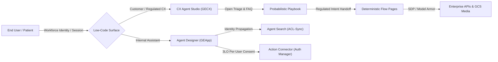

# Track 1 — Building Agents Using Low-Code Tools

> **Personal study repo — not affiliated with Google Cloud.** Official guidance: [cloud.google.com/learn/certification/agentic-architect](https://cloud.google.com/learn/certification/agentic-architect) · [Disclaimer](../../DISCLAIMER.md)

**Exam weight:** ~13% (Section 1)
**Key products:** Gemini Enterprise, Gemini Enterprise App (`GEApp`), Gemini Enterprise Agent Designer, Customer Experience Agent Studio (`CX Agent Studio` / `GECX`), Agent Search (`DiscoveryEngineSearchTool` / `VertexAiSearchTool`), Auth Manager (OAuth 2.0), Agent Identity, Sensitive Data Protection, Model Armor

This track covers **Section 1** of the Google Cloud Certified Professional Agentic Architect exam. The architectural focus is **configuration over code**—knowing when managed console primitives solve the business problem faster and more safely than custom Python orchestration, and knowing how identity, state machines, and enterprise data connectors work underneath the UI.

Because **Agent Designer** and **CX Agent Studio** are console-authored products rather than standalone Python frameworks, the hands-on labs in this track pair real `google-adk` / `google-genai` / `iamconnectorcredentials` SDK surfaces with **deterministic Python state and security simulators**. Every lab runs 100% offline and free by default.

---

## Architecture Overview



---

## High-Yield Beta Exam Takeaways Covered in Track 1

1. **GECX (`CX Agent Studio`) — Deterministic Flows vs. Probabilistic Playbooks vs. Hybrid Orchestration:**
   - **Deterministic Flows:** Built from **Pages**, required **Form Parameters** (slot-filling), **Intent & Condition Transition Routes** (e.g., `$session.params.otp_verified = true`), and **Event Handlers** (`sys.no-match-default`, `sys.no-match-2`, `webhook.error`). Mandatory when legal, financial, or healthcare steps cannot be skipped.
   - **Probabilistic Flows (Generative Playbooks):** Goal-driven natural-language instructions paired with Tools and Agent Search Data Stores. Eliminates brittle "intent explosion" for open-ended troubleshooting and multi-intent turns.
   - **Hybrid Orchestration:** The exam's preferred enterprise pattern—use a **Probabilistic Playbook** for empathetic triage and multi-intent FAQ, transition into a **Deterministic Flow Page** for OTP verification, refund ceilings, or mandatory HIPAA consent disclosures, and attach **Generative Fallback** on `no-match` events to answer off-script questions without leaving the regulated Page.
2. **Customer Support & Industry Compliance (HIPAA / Financial Services):**
   - Expect heavy customer-service and healthcare patient-support scenarios: preventing Protected Health Information (PHI) hallucinations via strict grounding, enforcing explicit patient consent before disclosing lab or claim status, and scrubbing PHI with **Sensitive Data Protection (SDP)** and **Model Armor** prior to model invocation or transcript storage.
3. **Gemini Enterprise (`GEApp`) Connector Authentication & Agent Identity:**
   - **Indexing / ACL-Sync Connectors:** Crawl third-party SaaS repositories (SharePoint, Jira, Confluence, Google Drive) into **Agent Search** along with Document-Level ACLs. Paired with **Workforce Identity Federation**, retrieval filters unauthorized chunks *before* LLM prompt construction.
   - **Real-Time Federated / Action Connectors (3LO):** Use **Auth Manager OAuth 2.0 (3-Legged OAuth)** via `IAMConnectorCredentialsServiceClient` (`RetrieveCredentialsRequest`) so write actions execute strictly under the signed-in user's identity and consent, while OAuth client secrets stay in **Secret Manager**.
4. **Cross-Project Least-Privilege IAM (~30–35% of Exam Scenarios):**
   - Every lab reinforces exact minimum IAM bindings across project boundaries—such as `roles/dialogflow.client` (runtime caller) vs. `roles/dialogflow.flowEditor` (author), `roles/discoveryengine.viewer` on a shared search project, `roles/secretmanager.secretAccessor` for connector secrets, and bucket-scoped `roles/storage.objectViewer` for multimodal GCS objects.

---

## The Labs

| Lab | Objectives | Core Architectural Decisions & Simulators |
| :--- | :---: | :--- |
| **[Lab 01 — Agent Designer Workflows](./lab_01_agent_designer_workflows/)** | **1.1** | System instructions & in-console prompt templates (**Zero-Shot**, **Few-Shot** ticket routing, **Chain-of-Thought** SLA/HIPAA policy reasoning vs. latency cost), **Agent Designer vs. CX Agent Studio vs. ADK** decision matrix, and least-privilege IAM verification. |
| **[Lab 02 — CX Agent Studio State](./lab_02_cx_agent_studio_state/)** | **1.1** | **Key Lab for Section 1:** **Deterministic Flows** (Pages, Form Parameters, Condition/Intent Transition Routes, `sys.no-match-2` & `webhook.error` Event Handlers) vs. **Probabilistic Playbooks** vs. **Hybrid Customer/HIPAA Support Orchestration** with **Generative Fallback**. |
| **[Lab 03 — Enterprise Data & Multimodal](./lab_03_enterprise_data_and_multimodal/)** | **1.2** | **Gemini Enterprise (`GEApp`) Connector Auth** (**ACL-Sync Indexing** + Workforce Identity Federation vs. **3LO Per-User Action Connectors** via `IAMConnectorCredentialsServiceClient`), cross-project least-privilege IAM simulator, `DiscoveryEngineSearchTool` / `VertexAiSearchTool`, and **Native Multimodal (`gs://`) vs. Preprocessing Pipelines**. |

---

## Run All Track 1 Labs & Contract Tests Offline

```bash
./.venv-adk/bin/python -m pytest tracks/01_low_code_agents/ tests/test_lab_contract.py -q
```

> [!WARNING]
> **Product & Naming Note.** The exam guide uses umbrella and updated naming: **Gemini Enterprise**, **Gemini Enterprise Agent Designer**, **Customer Experience Agent Studio (CX Agent Studio)**, and **Agent Search** (formerly *Vertex AI Search*). Underneath the console UI, the Google Cloud APIs and ADK classes retain technical identifiers such as `dialogflow`, `discoveryengine` (`DiscoveryEngineSearchTool`, `VertexAiSearchTool`), and `iamconnectorcredentials_v1alpha`.
