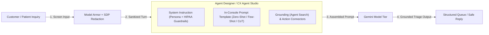

# Lab 01 — Agent Designer Workflows & Prompt Templates

**Exam section:** 1. Building agents using low-code tools (~13% of the exam)
**Objectives covered:** 1.1
**Time:** ~20 minutes · **Cost:** Free offline / ~$0.01 live

---

> **Personal study repo — not affiliated with Google Cloud.** Official guidance: [cloud.google.com/learn/certification/agentic-architect](https://cloud.google.com/learn/certification/agentic-architect) · [Disclaimer](../../../DISCLAIMER.md)

## 1. Exam objectives covered

> Quoted verbatim from the official exam guide:
> - "Creating system instructions and in-console prompt templates (e.g., few-shot and chain-of-thought) to guide agent behavior"
> - "Configuring state-based workflows (pages, transition routes, and event handlers) using Gemini Enterprise tools (e.g., Gemini Enterprise Agent Designer and Customer Experience Agent Studio [CX Agent Studio])"

## 2. Explain it simply

An agent's **system instruction** is its operating charter: it defines the agent's persona, domain boundaries, compliance guardrails (for example, never diagnosing medical conditions or echoing Protected Health Information [PHI]), and output contract.

In low-code tools such as **Gemini Enterprise Agent Designer** (inside `GEApp`) and **CX Agent Studio** (`GECX`), business analysts and architects steer behavior through **in-console prompt templates** rather than custom Python loops:
- **Zero-Shot Templates:** State the role, constraints, and task directly. Lowest token cost and fastest latency, best when categories are unambiguous.
- **Few-Shot Templates:** Embed concrete input/output demonstrations (`Examples:`) inside the template. Essential when an enterprise customer-support desk has 15+ custom routing queues, nuanced HIPAA escalation rules, or strict structured key/value formatting that zero-shot prompts misclassify.
- **Chain-of-Thought (CoT) Templates:** Instruct the model to reason step-by-step through multi-variable policies (such as checking warranty window, $250 auto-refund ceiling, and HIPAA authorization status) before emitting its final action. CoT improves multi-step policy accuracy at the cost of **higher output token count and higher latency**.

## 3. How it works



When a user submits a customer support or healthcare patient-support message:
1. **Perimeter Screening:** In regulated environments (such as HIPAA healthcare support or PCI billing), **Model Armor** and **Sensitive Data Protection (SDP)** inspect and redact raw identifiers (SSNs, Medical Record Numbers [MRNs]) before unsanitized text is logged or sent downstream.
2. **System Instruction Injection:** The console prepends immutable persona and boundary instructions (e.g., *"Never fabricate lab results; require verified patient consent before clinical status lookup"*).
3. **Template Expansion:** Console placeholders bind user input and session metadata into a **Zero-Shot**, **Few-Shot**, or **Chain-of-Thought** structure and invoke the selected Gemini tier (`gemini-3.5-flash-lite` for high-volume routing, `gemini-3.7-flash` for balanced tool-calling, or `gemini-3.1-pro-preview` / `gemini-2.5-pro` for deep multi-policy reasoning).

## 4. The decision that matters

### Choosing the Right Authoring Surface

| If the scenario requires... | Choose | Why not the alternatives |
| :--- | :--- | :--- |
| **Rapid internal employee assistant over Drive/Jira/Confluence built by business teams** | **Gemini Enterprise Agent Designer (`GEApp`)** | Code-first ADK adds unnecessary Python/CI/CD overhead; CX Agent Studio is tailored to external multi-turn customer support and telephony state machines. |
| **External omnichannel customer/patient support with strict OTP, refund ceilings, or HIPAA consent gates** | **CX Agent Studio (`GECX` Hybrid Playbooks + Flows)** | Agent Designer lacks deterministic Dialogflow-style Pages, Form Parameters, and telephony/contact-center Event Handlers. |
| **Complex cyclic graph workflows (`Workflow`), custom gVisor/GKE code sandboxes, or GitOps CI/CD** | **Code-First (`google-adk` on Agent Platform `GEAP`)** | Console prompt templates cannot express arbitrary Python graph nodes, custom unit-test suites in Git, or self-hosted Gemma GPU pools on GKE. |

### Choosing the Prompt Template Strategy

| Strategy | Best Use Case | Token & Latency Profile |
| :--- | :--- | :--- |
| **Zero-Shot** | Simple binary sentiment, short FAQ summarization, unambiguous instructions | **Lowest** input/output tokens; lowest Time-to-Last-Token |
| **Few-Shot** | Mapping messy support tickets into custom enterprise taxonomy queues (`HIPAA_CLINICAL_ESCALATION`, `BILLING_REFUND_REVIEW`) or strict schema formats | **Higher input tokens** (examples sent on every call, mitigated by context caching); **low output tokens** |
| **Chain-of-Thought (CoT)** | Multi-rule SLA math, refund eligibility ceilings, HIPAA authorization pre-checks | **Highest output tokens & latency** (generates intermediate reasoning steps before final answer) |

### Least-Privilege IAM for Low-Code & Prompt Workflows

| Actor / Principal | Minimum IAM Role | Common Exam Trap (Over-Privileged) |
| :--- | :--- | :--- |
| **Web/Mobile backend invoking CX session `detectIntent` at runtime** | `roles/dialogflow.client` | `roles/dialogflow.admin` or `roles/editor` (allows deleting flows/agents) |
| **Conversation designer editing prompt templates, Playbooks, and Flows** | `roles/dialogflow.flowEditor` | `roles/owner` or `roles/dialogflow.admin` |
| **Agent service account invoking Gemini models on Vertex AI** | `roles/aiplatform.user` | `roles/aiplatform.admin` |
| **Agent Designer querying an Agent Search knowledge datastore** | `roles/discoveryengine.viewer` | `roles/discoveryengine.admin` or `roles/discoveryengine.editor` |
| **Pre-LLM PHI redaction pipeline calling Sensitive Data Protection** | `roles/dlp.user` | `roles/dlp.admin` |

## 5. Hands-on A — offline (free)

Run the deterministic offline simulator and verification suite:

```bash
./tracks/01_low_code_agents/lab_01_agent_designer_workflows/run_lab.sh
```

**Expected Output:**
1. Instantiates three `google.adk.Agent` configurations modeling Agent Designer / CX Agent Studio prompt templates for a healthcare & billing support desk: `ZeroShotSupportAgent`, `FewShotTriageAgent`, and `ChainOfThoughtPolicyAgent`.
2. Evaluates authoring surface selection (**Agent Designer** vs. **CX Agent Studio** vs. **ADK**).
3. Benchmarks prompt template trade-offs (proving Few-Shot enforces custom taxonomy formatting while CoT trades output latency for multi-rule HIPAA/SLA policy accuracy).
4. Audits least-privilege IAM role mappings and confirms all checks pass with zero cloud calls.

## 6. Hands-on B — live on Google Cloud (opt-in)

To execute the three customer/patient triage prompt templates against live Gemini models:

```bash
./tracks/01_low_code_agents/lab_01_agent_designer_workflows/run_lab.sh --live
```

> [!WARNING]
> **Cost note:** Live mode sends three short requests to `gemini-3.7-flash` via ADK `InMemoryRunner` (typically < $0.01 total). Ensure `GOOGLE_CLOUD_PROJECT` and `GOOGLE_API_KEY` (or Vertex AI ADC) are configured.

## 7. Verify it worked

Run the standalone pytest suite from the repository root:

```bash
./.venv-adk/bin/python -m pytest tracks/01_low_code_agents/lab_01_agent_designer_workflows/ -q
```

All tests must pass, confirming verified model IDs from `common.models`, HIPAA guardrail instructions, Few-Shot `Examples:` structure, CoT `step-by-step` policy reasoning, authoring surface selection, and least-privilege IAM checks.

## 8. Troubleshooting

| Symptom | Cause | Fix |
| :--- | :--- | :--- |
| `ImportError: cannot import name 'Agent' from 'google.adk'` | Wrong Python environment active. | Run via `./.venv-adk/bin/python` or `run_lab.sh`. |
| `403 PERMISSION_DENIED` on live Vertex AI call | Caller lacks Vertex AI invocation permission. | Grant `roles/aiplatform.user` to the active sandbox identity and enable `aiplatform.googleapis.com`. |
| Few-shot output still drifts from JSON/key-value contract | Conflicting examples or prose trailing after examples. | Ensure every example in `Examples:` follows the exact identical delimiter and field order, or enforce `output_schema` in ADK. |

## 9. Clean up

```bash
./tracks/01_low_code_agents/lab_01_agent_designer_workflows/cleanup.sh
```

Offline mode provisions zero cloud resources. `cleanup.sh` removes local `__pycache__` and `.pytest_cache` artifacts.

## 10. Exam traps

- **Trap 1 — Using Chain-of-Thought to "reduce latency":** CoT *increases* latency and output token cost because Gemini generates intermediate reasoning tokens before the final answer. Never pick CoT when the primary requirement is sub-200ms classification latency; pick **Few-Shot** on `gemini-3.5-flash-lite` instead.
- **Trap 2 — Prompt instructions alone as a HIPAA security boundary:** Telling an LLM *"Do not log SSNs"* in a system instruction does not prevent SSNs from entering request logs or model context. Pair system instructions with **Model Armor** and **Sensitive Data Protection (SDP)** for deterministic PII/PHI inspection and de-identification.
- **Trap 3 — Over-privileging runtime callers:** A web chat widget backend calling CX Agent Studio only needs `roles/dialogflow.client`, never `roles/dialogflow.admin` or `roles/editor`.
- **Trap 4 — Floating model aliases in regulated production:** Avoid unpinned `-latest` aliases (`gemini-flash-latest`) in regulated healthcare or financial workflows where silent model upgrades can alter prompt template behavior without regression evaluation.

## 11. Check yourself

<details>
<summary>1. A healthcare support team uses Agent Designer to classify incoming patient portal messages into 18 custom clinical and billing queues. Zero-shot instructions misroute edge cases where patients mention both a co-pay dispute and a prescription refill. What is the lowest-effort console fix?</summary>

Convert the system instruction into a **Few-Shot prompt template** containing representative multi-topic `Examples:` mapped to the exact target queue and priority rules. Few-shot demonstrations teach boundary edge cases without requiring custom Python code or fine-tuning.
</details>

<details>
<summary>2. A customer support agent routinely miscalculates prorated SLA credits when evaluating multi-tier enterprise contracts with holiday exclusions. Which prompt engineering technique directly addresses this failure?</summary>

**Chain-of-Thought (CoT) prompting**. Instructing the model to think `step-by-step`—listing contract tier, outage minutes, holiday exclusions, and intermediate arithmetic before outputting the credit—prevents single-token math leaps and hallucinations.
</details>

<details>
<summary>3. Your mobile app backend invokes a CX Agent Studio customer-service agent on behalf of authenticated users. Security rejects a Terraform PR granting <code>roles/dialogflow.admin</code> to the backend service account. Which role should replace it?</summary>

**`roles/dialogflow.client`**. It grants runtime session `detectIntent` / `streamingDetectIntent` permissions without allowing flow modification, agent deletion, or IAM changes.
</details>

<details>
<summary>4. A non-engineering HR operations team wants to launch an internal benefits Q&amp;A assistant grounded in SharePoint PDFs within two days, with zero Python maintenance. Which Google Cloud tool fits best?</summary>

**Gemini Enterprise Agent Designer** (inside `GEApp`) connected to **Agent Search** with ACL sync / Identity Propagation enabled.
</details>

> [!WARNING]
> **Product & naming note.** The exam guide references *Gemini Enterprise Agent Designer* and *Customer Experience Agent Studio [CX Agent Studio]*. Because their prompt template editors are console interfaces, `lab.py` models the exact prompt structures using `google-adk` `Agent` objects and deterministic policy evaluators so every concept can be tested offline.
