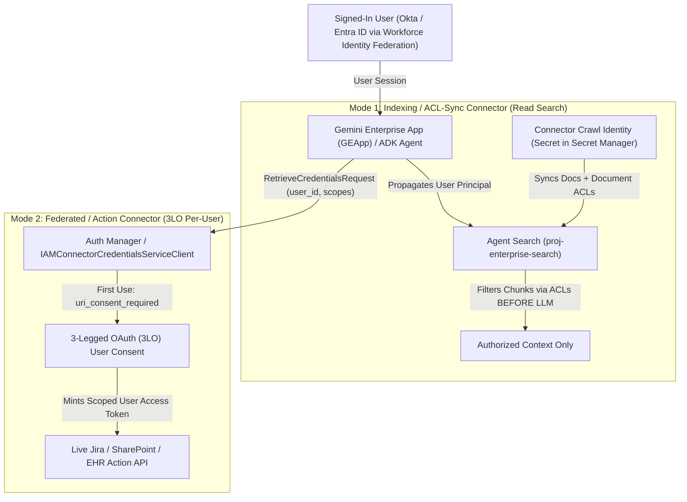
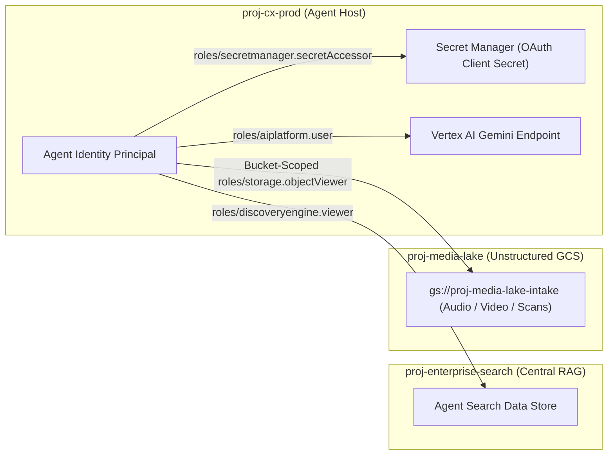

# Lab 03 — Enterprise Data Connectors, Agent Identity & Multimodal Ingestion

**Exam section:** 1. Building agents using low-code tools (~13% of the exam)
**Objectives covered:** 1.2
**Time:** ~25 minutes · **Cost:** Free offline

---

> **Personal study repo — not affiliated with Google Cloud.** Official guidance: [cloud.google.com/learn/certification/agentic-architect](https://cloud.google.com/learn/certification/agentic-architect) · [Disclaimer](../../../DISCLAIMER.md)

## 1. Exam objectives covered

> Quoted verbatim from the official exam guide:
> - "Configuring agents to securely connect and query enterprise proprietary data sources (e.g., Gemini Enterprise and Agent Search)"
> - "Ingesting and processing unstructured multimodal data (e.g., videos, audio, and images) into the agentic workflow"

## 2. Explain it simply

Enterprise agents fail security reviews in two predictable ways:
1. **Data over-exposure (RAG leakage):** An internal assistant indexes Jira, SharePoint, Google Drive, or clinical policies, and accidentally summarizes an executive M&A memo or another patient's record because retrieval ran under an unrestricted admin key.
2. **Action over-privilege (confused deputy):** When an agent creates a Jira ticket or updates a CRM record, using a single shared admin Service Account destroys per-user audit attribution and lets any user mutate records they do not own.

**Gemini Enterprise (`GEApp`)** and **Agent Platform (`GEAP`)** solve both problems by separating **two connector authentication modes**, enforcing **cross-project least-privilege IAM** via **Agent Identity**, and offering two distinct paths for **unstructured multimodal media** (videos, audio, images): **native `gs://` multimodal prompting** versus **dedicated preprocessing pipelines**.

## 3. How it works

### Part A — Gemini Enterprise (`GEApp`) Connector Authentication Modes



1. **Mode 1 — Indexing / ACL-Sync Connector (Enterprise Search):**
   - An ingestion connector crawls third-party repositories (SharePoint, Confluence, Jira, Google Drive, ServiceNow) using a connector credential stored in **Secret Manager**, indexing both document chunks and **Document-Level Access Control Lists (ACLs)** into **Agent Search** (`DiscoveryEngineSearchTool` / `VertexAiSearchTool`).
   - External corporate identities (Okta, Microsoft Entra ID) map to Google Cloud principals via **Workforce Identity Federation**.
   - At query time, **Identity Propagation** passes the caller's federated identity to Agent Search so unauthorized chunks are filtered out **at the retrieval layer before LLM generation**.
2. **Mode 2 — Real-Time Federated / Action Connector (3-Legged OAuth [3LO]):**
   - When an agent executes live user-scoped actions (e.g., creating a Jira ticket, approving a ServiceNow change, or querying a live clinical endpoint as `dr.alice@hospital.org`), **Auth Manager (OAuth 2.0)** brokers per-user 3LO credentials via `google.cloud.iamconnectorcredentials_v1alpha.IAMConnectorCredentialsServiceClient` (`RetrieveCredentialsRequest(connector=..., user_id=..., scopes=..., continue_uri=...)`) and ADK's `GcpAuthProviderScheme` / `GcpAuthProvider` (`google-adk[agent-identity]`).
   - If the user has not yet authorized the connector, `RetrieveCredentialsMetadata.uri_consent_required` returns an interactive OAuth consent URL; once approved, the agent receives a short-lived user-scoped token while OAuth client secrets remain locked in **Secret Manager**.

### Part B — Cross-Project Least-Privilege IAM Topology



### Part C — Gemini Enterprise Taxonomy (`Gemini Enterprise` vs. `GEApp` vs. `GEAP`)

- **Gemini Enterprise (Umbrella Brand):** Google Cloud's overarching enterprise agentic portfolio spanning low-code and code-first tooling.
- **Gemini Enterprise App (`GEApp`):** Formerly *Google Agentspace*. The turnkey employee-facing web app providing enterprise search, prebuilt SaaS connectors, and Agent Designer.
- **Agent Platform (`GEAP` / Vertex AI Agent Platform):** The developer plane (`google-adk`, Agent Runtime, Agent Registry, Memory Bank, Agent Identity) that can run custom agents on **Agent Runtime**, **Cloud Run**, or **GKE** and surface them back into `GEApp`.

## 4. The decision that matters

### Connector Auth & Identity Selection Matrix

| Scenario | Correct Architecture | Why Not the Alternative |
| :--- | :--- | :--- |
| **Semantic Q&A across 2M SharePoint & Confluence pages respecting Okta group permissions** | **ACL-Sync Indexing Connector -> Agent Search + Workforce Identity Federation** | Live 3LO API fan-out across 2M unindexed pages times out and lacks semantic vector + keyword hybrid ranking. |
| **Agent creates a Jira issue or updates a Salesforce opportunity strictly as the logged-in user** | **Action Connector with Auth Manager OAuth 2.0 (3LO) via `IAMConnectorCredentialsServiceClient`** | A shared Service Account breaks user audit trails and lets low-privilege users mutate restricted projects. |
| **Storing third-party OAuth client secrets or SaaS API keys used by connectors** | **Secret Manager (`roles/secretmanager.secretAccessor` granted to Agent Identity / Connector SA)** | Never hard-code credentials in system instructions, environment variables in plain text, or Git commits. |
| **Agent in `proj-cx-prod` querying a centralized Agent Search datastore in `proj-enterprise-search`** | **Grant `roles/discoveryengine.viewer` on `proj-enterprise-search` to the Agent Identity** | `roles/discoveryengine.admin`, `roles/discoveryengine.editor`, or `roles/editor` violate least privilege by allowing datastore deletion or schema mutation. |

### Multimodal Ingestion: Native `gs://` URI vs. Preprocessing Pipeline

| Workload Requirement | Recommended Pattern | Why Not the Alternative |
| :--- | :--- | :--- |
| **Single-clip cross-modal reasoning (e.g., "Why did the customer's checkout fail at 0:42 in this screen recording with voiceover?")** | **Native Multimodal Prompting (`types.Part.from_uri("gs://...", mime_type="video/mp4")` into `gemini-3.7-flash`)** | Speech-to-Text strips visual UI state; OCR strips vocal tone and temporal alignment. |
| **Batch analytics over 25,000 hours of call-center audio into BigQuery tables** | **Dedicated Preprocessing Pipeline (Cloud Speech-to-Text + Sensitive Data Protection -> BigQuery)** | Passing 25,000 hours of raw audio tokens to a general multimodal LLM is far slower and more expensive than purpose-built ASR batch pipelines. |
| **HIPAA patient intake audio/PDFs where raw PHI must NEVER reach an LLM context window** | **Preprocessing Pipeline (Speech-to-Text / Document AI -> Sensitive Data Protection De-identification -> LLM)** | Native raw audio/PDF prompting exposes unredacted PHI directly inside the model context before text-level redaction can run. |
| **Making video/audio archives searchable by keyword and vector similarity inside Agent Search** | **Preprocessing / Enrichment Pipeline (extract transcripts + timestamps -> index into Agent Search)** | Standard enterprise search indexes require extracted text/embeddings and metadata facets for sub-second retrieval across thousands of files. |

## 5. Hands-on A — offline (free)

Run the deterministic offline lab and verification checks:

```bash
./tracks/01_low_code_agents/lab_03_enterprise_data_and_multimodal/run_lab.sh
```

**Expected Output:**
1. **ACL-Sync Indexing + Workforce Identity Federation Simulator:** Verifies that `dr.alice@hospital.org` (clinician), `rep.sam@hospital.org` (billing support), and `contractor.lee@ext.org` receive strictly ACL-filtered search results *before* LLM context assembly.
2. **3LO Action Connector Simulator (`iamconnectorcredentials_v1alpha`):** Constructs real `RetrieveCredentialsRequest` and ADK `GcpAuthProviderScheme` objects—demonstrating `uri_consent_required` on first invocation and scoped per-user OAuth token retrieval after consent.
3. **ADK Search Tools & Cross-Project Least-Privilege IAM Audit:** Instantiates real `DiscoveryEngineSearchTool` and `VertexAiSearchTool` instances pointing at `proj-enterprise-search`, and audits cross-project IAM bindings across `proj-cx-prod`, `proj-enterprise-search`, and `proj-media-lake`.
4. **Multimodal `gs://` Ingestion vs. Preprocessing Selector:** Builds a real `google.genai.types.Part.from_uri` multimodal reference and validates architectural routing across cross-modal clips vs. 25,000-hour HIPAA audio batches.

## 6. Hands-on B — live on Google Cloud (opt-in)

Because provisioning an enterprise **Agent Search** connector sync and **Workforce Identity Pool** involves organization-level IdP setup and multi-minute indexing, `--live` validates your project configuration and runs the full verification suite without creating persistent paid search engines:

```bash
./tracks/01_low_code_agents/lab_03_enterprise_data_and_multimodal/run_lab.sh --live
```

To test live in an Argolis or sandbox project:
1. Create an **Agent Search** datastore in `proj-enterprise-search` with **ACL / Identity Enforcement** enabled.
2. Grant `roles/discoveryengine.viewer` to your `proj-cx-prod` agent identity and `roles/storage.objectViewer` on your media bucket.

## 7. Verify it worked

Run the Lab 03 pytest suite:

```bash
./.venv-adk/bin/python -m pytest tracks/01_low_code_agents/lab_03_enterprise_data_and_multimodal/ -q
```

All tests assert pre-LLM ACL enforcement, real `RetrieveCredentialsRequest` / `GcpAuthProviderScheme` 3LO behavior, cross-project least-privilege IAM rejection of admin/editor roles, `DiscoveryEngineSearchTool` / `VertexAiSearchTool` instantiation, and multimodal `gs://` URI handling.

## 8. Troubleshooting

| Symptom | Cause | Fix |
| :--- | :--- | :--- |
| `ImportError` when importing `GcpAuthProviderScheme` | Missing `agent-identity` optional extra on `google-adk`. | Install `google-adk[agent-identity]==2.9.0` (pre-installed in `.venv-adk`). |
| Agent in `proj-cx-prod` gets `403 PERMISSION_DENIED` querying Agent Search in `proj-enterprise-search` | Missing cross-project read binding on the search project. | Grant `roles/discoveryengine.viewer` on `proj-enterprise-search` to the `proj-cx-prod` Agent Identity principal. |
| Gemini returns `403` when reading `gs://proj-media-lake-intake/clip.mp4` via `Part.from_uri` | Agent / Vertex AI caller lacks object read access on the cross-project GCS bucket. | Grant bucket-level `roles/storage.objectViewer` (and `roles/cloudkms.cryptoKeyDecrypter` if CMEK-encrypted). |

## 9. Clean up

```bash
./tracks/01_low_code_agents/lab_03_enterprise_data_and_multimodal/cleanup.sh
```

## 10. Exam traps

- **Trap 1 — Post-retrieval LLM prompt filtering ("Tell Gemini to ignore confidential chunks"):** Never rely on system instructions to hide unauthorized documents already injected into the prompt context. Enforce **Document-Level ACLs in Agent Search via Identity Propagation** *before* chunks reach the LLM.
- **Trap 2 — Using a single admin Service Account for write Action Connectors:** For user-attributed mutations in Jira, Confluence, ServiceNow, or Google Workspace, always select **Auth Manager OAuth 2.0 (3-Legged OAuth / 3LO)** per-user consent (`IAMConnectorCredentialsServiceClient`), never a shared admin key pasted into agent code.
- **Trap 3 — Granting `roles/discoveryengine.admin` or `roles/editor` across projects:** An agent that only *queries* an Agent Search datastore in another project requires **`roles/discoveryengine.viewer`**—nothing broader.
- **Trap 4 — Sending raw multi-thousand-hour HIPAA call recordings directly to a multimodal LLM:** Use **Speech-to-Text + Sensitive Data Protection** preprocessing for massive-scale transcription and mandatory pre-LLM PHI redaction; reserve **native multimodal `gs://` prompting** for cross-modal reasoning over targeted clips, images, and diagrams.

## 11. Check yourself

<details>
<summary>1. An agent running in <code>proj-cx-prod</code> must query a centralized Agent Search knowledge base hosted in <code>proj-enterprise-search</code> and inspect customer-uploaded damage photos in bucket <code>gs://claims-intake-prod</code> inside <code>proj-media-lake</code>. What is the exact least-privilege IAM configuration?</summary>

Bind the `proj-cx-prod` **Agent Identity** principal to:
1. **`roles/discoveryengine.viewer`** on `proj-enterprise-search` (or the target datastore collection).
2. **`roles/storage.objectViewer`** scoped specifically to bucket `gs://claims-intake-prod` in `proj-media-lake`.
3. **`roles/aiplatform.user`** in `proj-cx-prod` to invoke Gemini.
</details>

<details>
<summary>2. You connect Gemini Enterprise App (<code>GEApp</code>) to Jira so employees can both search historical tickets and create new sprint bugs. How should authentication be configured for these two capabilities?</summary>

Use **ACL-Sync Indexing** (paired with **Workforce Identity Federation**) so Agent Search indexes historical Jira tickets with document ACL enforcement at query time, and configure **3-Legged OAuth (3LO) via Auth Manager (`IAMConnectorCredentialsServiceClient`)** for the Jira write/action connector so new bugs are created under each employee's own Jira identity and permissions.
</details>

<details>
<summary>3. A medical device support agent needs to diagnose why an infusion pump is beeping by watching a 20-second video clip uploaded by a nurse to Cloud Storage, correlating the flashing LED pattern with the audible alarm cadence. Which ingestion pattern should you choose?</summary>

**Native multimodal prompting**: pass the Cloud Storage object URI (`gs://...`) directly via `types.Part.from_uri(..., mime_type="video/mp4")` to a multimodal Gemini model (`gemini-3.7-flash`) after verifying consent/PHI policies, preserving joint audio-visual temporal context.
</details>

<details>
<summary>4. A developer proposes storing the SharePoint OAuth client secret in the Agent Designer system instruction as an environment hint so tools can read it. Why does security block this, and what is the fix?</summary>

System instructions are exposed to prompt-extraction attacks and model telemetry logs. Store OAuth client secrets in **Secret Manager**, grant **`roles/secretmanager.secretAccessor`** only to the connector/Auth Manager identity, and retrieve runtime user tokens dynamically via **Auth Manager / `IAMConnectorCredentialsServiceClient`**.
</details>

> [!WARNING]
> **Product & SDK naming note.** The exam guide uses **Gemini Enterprise**, **Agent Search** (formerly *Vertex AI Search*), and **Auth Manager (OAuth 2.0)**. In Python (`google-adk==2.9.0` and `google-cloud-iamconnectorcredentials`), these map to `DiscoveryEngineSearchTool` / `VertexAiSearchTool`, `GcpAuthProviderScheme` / `GcpAuthProvider`, and `google.cloud.iamconnectorcredentials_v1alpha.IAMConnectorCredentialsServiceClient`.
