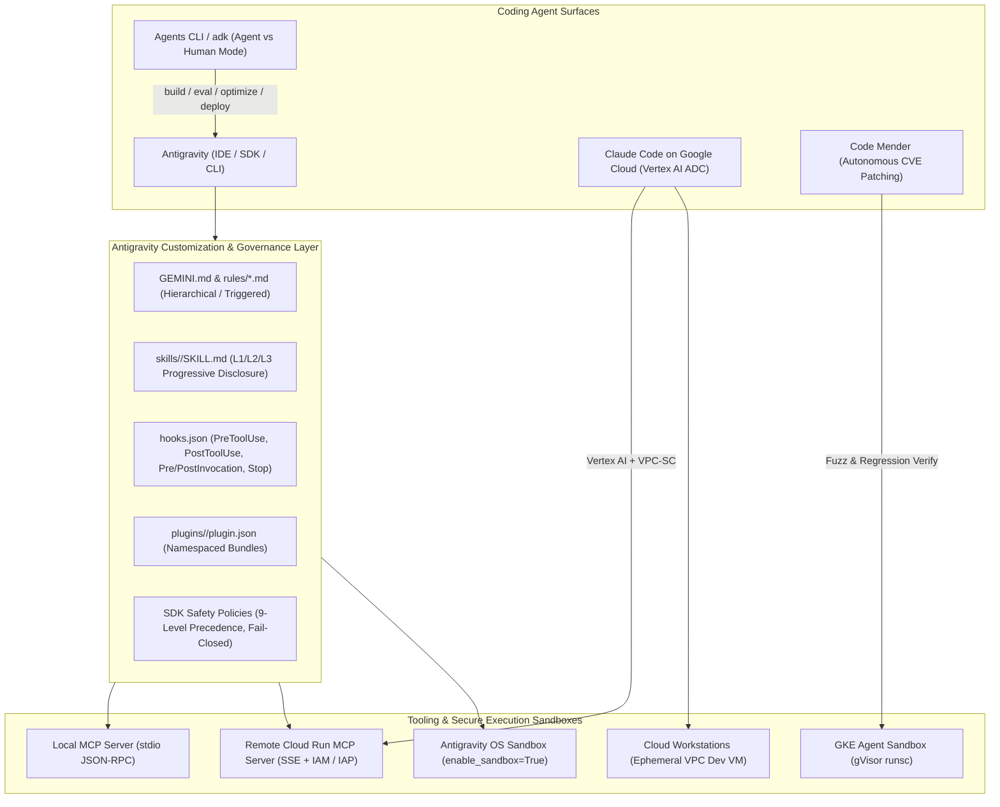

# Track 2 — Using coding agents for application development

> **Personal study repo — not affiliated with Google Cloud.** Official guidance: [cloud.google.com/learn/certification/agentic-architect](https://cloud.google.com/learn/certification/agentic-architect) · [Disclaimer](../../DISCLAIMER.md)

**Exam Section:** 2 (~17% of the exam)

This track covers how to configure, sandbox, customize, and govern autonomous coding agents on Google Cloud—including **Antigravity**, **Claude Code on Google Cloud**, **Code Mender**, **Cloud Workstations**, **GKE Agent Sandbox**, and the **Agents CLI (`adk`)**.

---

## Official Objectives Covered

* **2.1 Using coding agents effectively**
  * Configuring coding agents with Model Context Protocol (MCP) servers, custom skills, and access to tools (e.g., Antigravity and Claude Code on Google Cloud)
  * Using coding agents in secure sandboxes (e.g., Google Kubernetes Engine [GKE], Cloud Workstations, and Antigravity)
  * Using coding agents to refactor source code, optimize execution runtimes, and patch application-layer vulnerabilities
* **2.2 Customizing coding agents for enterprise workflows**
  * Creating skills, plugins, extensions hooks, rules, and subagents using Antigravity
  * Augmenting Antigravity with Agents CLI to build, scale, govern, and optimize deployed agents

---

## High-Yield Exam Blueprint & Architecture

Real-world exam scenarios test **exact file schemas, loading precedence, execution isolation boundaries, and least-privilege IAM** rather than high-level definitions:

### 1. Antigravity Customization Reference Matrix (Objective 2.2)

| Primitive | File / Path | Frontmatter / Schema | Activation & Exam Nuances |
| :--- | :--- | :--- | :--- |
| **Directory Rules** | `GEMINI.md` or `AGENTS.md` (any directory) | **None** (no YAML frontmatter supported) | Always active for its directory and subdirectories; discovered by walking **up** from CWD to repository root. Deduplicated by resolved path. |
| **Workspace / Global Rules** | `_agents/rules/*.md`, `~/.gemini/config/rules/*.md` | YAML: `trigger` (`always_on`, `model_decision`, `glob`, `manual`), `description`, `globs` | `model_decision` **requires** `description`; `glob` **requires** `globs` (e.g., `*.py,*.tf`); `manual` activates only on `@`-mention. |
| **Skills** | `skills/<name>/SKILL.md` + `skills.json` | YAML: `name` (must match folder name), `description`, `license`, `compatibility`, `allowed_tools`, `metadata` | **Progressive disclosure**: L1 (`name` + `description`) injected at startup; L2 (`SKILL.md` body) loaded on activation; L3 (`scripts/`, `references/`, `assets/`, `examples/`, `resources/`) read on demand. |
| **Lifecycle Hooks** | `hooks.json` | Top-level hook names with `enabled` + `PreToolUse`, `PostToolUse`, `PreInvocation`, `PostInvocation`, `Stop` | `stdin`/`stdout` **camelCase** JSON (`conversationId`, `toolCall`, `stepIdx`). `PreToolUse` outputs `allow`, `deny`, `ask`, `force_ask`, plus shallow `overwrite`. `Stop` outputs `{"decision": "continue"}` to block premature exit. |
| **Plugins** | `plugins/<name>/plugin.json` + `plugins.json` | `{"name": "plugin-name"}` | Shareable, namespaced bundle packaging `mcp_config.json`, `hooks.json`, `rules/`, `skills/`, and `agents/`. |
| **Custom Agents & Subagents** | `agents/<name>.md` or `agents/<name>/agent.json` + `config.yaml` | Markdown YAML (`name`, `description`, `tools`, `mainAgent`, `subagent`, `commandExecutionPolicy: off\|auto\|eager`) | SDK controls multi-tier delegation via `max_subagent_depth` and `allowed_subagents`. |
| **SDK Safety Policies** | `google.antigravity.hooks.policy` | 9-level priority (`Specific Deny` > `Specific Ask` > `Specific Allow` > `Prefix Wildcard` > `Global Wildcard`) | Default `confirm_run_command()` denies `run_command` headlessly (`ask_user` interactively). `when=` predicates **fail closed** on exception. |

### 2. Least-Privilege IAM Cheat Sheet for Coding Agents (~30–35% of Exam)

| Scenario | Principal | Required IAM Role / Mechanism | Why Not Broader Roles? |
| :--- | :--- | :--- | :--- |
| **Claude Code or Antigravity calling Vertex AI models** | Developer ADC or Workload SA | `roles/aiplatform.user` (+ VPC Service Controls perimeter) | `roles/aiplatform.admin` grants endpoint deletion and model deployment mutations. |
| **Developer launching a Cloud Workstation** | Developer corporate identity | `roles/workstations.user` on the workstation config | `roles/workstations.admin` allows altering VPC network bindings, CMEK, and container images. |
| **Agent invoking a remote MCP server on Cloud Run** | Agent Service Account / End-user via IAP | `roles/run.invoker` (+ `roles/iap.httpsResourceAccessor` for human OAuth) | Never deploy enterprise MCP servers with `--allow-unauthenticated` (`allUsers`). |
| **GKE Agent Sandbox pulling container images & calling APIs** | GKE Pod KSA bound via Workload Identity Federation | `roles/artifactregistry.reader` (node/pull) + scoped workload SA via `roles/iam.workloadIdentityUser` | Avoid mounting static JSON service account keys inside untrusted code sandboxes. |

---

## Labs in This Track

| Lab | Title | Focus |
| :--- | :--- | :--- |
| **Lab 04** | [MCP, Claude Code on GCP, and Enterprise Tooling](lab_04_mcp_and_tooling/README.md) | Configuring `mcp_config.json` (`stdio` vs remote `SSE`), ADK `McpToolset`, Claude Code on Google Cloud (Vertex AI ADC, `roles/aiplatform.user`, VPC-SC), `stdout` JSON-RPC safety, and Cloud Run MCP IAM (`roles/run.invoker`). |
| **Lab 05** | [Secure Sandboxes, Cloud Workstations, and Code Mender](lab_05_secure_sandboxes/README.md) | Architectural selection across **Cloud Workstations**, **GKE Agent Sandbox (`gVisor`)**, **Antigravity OS Sandbox (`enable_sandbox=True`)**, **`CloudRunSandboxCodeExecutor`**, **`AgentEngineSandboxCodeExecutor`**, and **Code Mender** autonomous CVE patching + least-privilege IAM. |
| **Lab 06** | [Antigravity Customization, Governance & Agents CLI](lab_06_antigravity_customization/README.md) | Deep-dive masterclass on `GEMINI.md`, `rules/*.md` triggers, L1/L2/L3 `SKILL.md` progressive disclosure (`list_skills_in_dir` vs `load_skills_from_dir`), `hooks.json` lifecycle simulation, `plugin.json` / `skills.json` inheritance, 9-level SDK policy precedence, and **Agents CLI (`adk`)** Agent Mode vs. Human Mode. |
