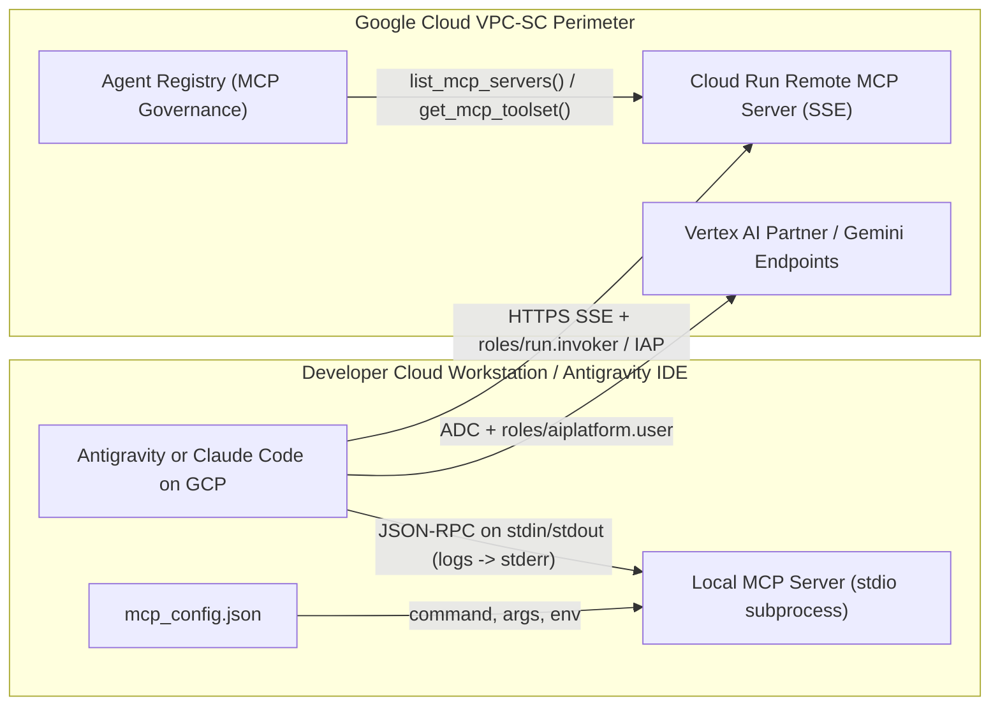

# Lab 04 — MCP, Claude Code on Google Cloud, and Enterprise Tooling

**Exam section:** 2. Using coding agents for application development (~17% of the exam)
**Objectives covered:** 2.1
**Time:** ~25 minutes · **Cost:** Free offline / ~$0.25 live

---

> **Personal study repo — not affiliated with Google Cloud.** Official guidance: [cloud.google.com/learn/certification/agentic-architect](https://cloud.google.com/learn/certification/agentic-architect) · [Disclaimer](../../../DISCLAIMER.md)

## 1. Exam objectives covered

> Quoted verbatim from the official exam guide:
> - "Configuring coding agents with Model Context Protocol (MCP) servers, custom skills, and access to tools (e.g., Antigravity and Claude Code on Google Cloud)"

## 2. Explain it simply

Before the **Model Context Protocol (MCP)**, connecting $N$ coding agents (Antigravity, Claude Code, custom ADK agents) to $M$ enterprise tools (Cloud Run, BigQuery, Jira, Git) required $N \times M$ bespoke integration plugins. MCP reduces this to $N + M$: you write **one** MCP server per tool surface, and every MCP-speaking coding agent discovers its **Tools** (executable actions), **Resources** (read-only context), and **Prompts** (reusable templates) over JSON-RPC 2.0.

In an enterprise Google Cloud environment, coding agents like **Antigravity** and **Claude Code on Google Cloud** must also satisfy two strict governance boundaries:
1. **Model Plane Governance:** Authenticate to **Vertex AI** using **Application Default Credentials (ADC)** and least-privilege **`roles/aiplatform.user`** inside a **VPC Service Controls (VPC-SC)** perimeter (with zero data retention—customer prompts and source code are never used to train foundation models), rather than calling external consumer APIs with raw API keys.
2. **Tool Plane Governance:** Connect to local tools via `stdio` subprocesses or to shared remote Cloud Run MCP servers via HTTPS **SSE** protected by **`roles/run.invoker`** and **Identity-Aware Proxy (IAP)**.

## 3. How it works



### Antigravity & Claude Code `mcp_config.json` Schema

Both Antigravity (`~/.gemini/config/mcp_config.json` globally or `plugins/<plugin_name>/mcp_config.json` inside a plugin) and Claude Code register MCP servers under a top-level `mcpServers` map supporting two transports:

```json
{
  "mcpServers": {
    "local-repo-crypto": {
      "command": "python3",
      "args": ["./mcp_server.py"],
      "env": {
        "MCP_READONLY": "true"
      }
    },
    "enterprise-jira-sse": {
      "serverUrl": "https://jira-mcp-gateway-uc.a.run.app/sse"
    }
  }
}
```

1. **Local `stdio` Transport (`command`, `args`, `env`):** The host IDE/CLI spawns the server as a child process and exchanges JSON-RPC 2.0 frames over `stdin`/`stdout`. **Critical rule:** `stdout` is exclusively reserved for JSON-RPC payloads; any `print()` statement writing debug text to `stdout` corrupts framing—all logs **must** go to `sys.stderr`.
2. **Remote `SSE` Transport (`serverUrl`):** Connects over HTTPS Server-Sent Events (or Streamable HTTP) to a centrally managed service such as **Cloud Run**.
3. **Claude Code on Google Cloud (Vertex AI Integration):** Configured to route Anthropic Claude calls through Vertex AI (`CLOUD_ML_REGION`, `ANTHROPIC_VERTEX_PROJECT_ID`, or ADK's `google.adk.models.Claude` backed by `AsyncAnthropicVertex`) using `gcloud auth application-default login` (ADC) + `roles/aiplatform.user`. This preserves VPC-SC egress controls, CMEK encryption, Cloud Audit Logs, and enterprise zero-data-retention guarantees.
4. **Google Cloud MCP Servers & `AgentRegistry`:** Google provides managed/prebuilt MCP servers (e.g., `cloudrun`, `firebase`, BigQuery/GKE MCP integrations), and ADK's `AgentRegistry` (`list_mcp_servers()`, `get_mcp_toolset()`) provides centralized discovery so teams consume approved MCP endpoints instead of hardcoding rogue URLs.

## 4. The decision that matters

| Scenario / Requirement | Choose | Required IAM / Auth | Why Alternatives Fail |
| :--- | :--- | :--- | :--- |
| **Local repo AST analyzer, git helper, or local SQLite inspector** | **MCP `stdio` transport** (`command`, `args`, `env` in `mcp_config.json`) | Local OS user permissions (confine with OS sandbox / `MCP_READONLY`) | Opening local HTTP ports creates localhost CSRF/port-collision risks; remote Cloud Run cannot see uncommitted local files. |
| **Shared enterprise Jira, ServiceNow, or internal API tool for 200 developers** | **Remote MCP over HTTPS `SSE` on Cloud Run** (`serverUrl` in `mcp_config.json` + `AgentRegistry`) | `--no-allow-unauthenticated` + **`roles/run.invoker`** (+ **`roles/iap.httpsResourceAccessor`** with IAP for human OAuth) | `stdio` forces distributing server binaries and DB secrets onto every developer laptop; `--allow-unauthenticated` (`allUsers`) exposes internal tools publicly. |
| **Running Claude Code or Antigravity on proprietary financial/healthcare source code** | **Vertex AI Standard Mode (ADC)** inside a **VPC-SC** perimeter | **`roles/aiplatform.user`** on the target GCP project | External vendor SaaS API keys bypass VPC-SC perimeters, omit Cloud Audit Logs, and violate enterprise data-boundary policies. `roles/aiplatform.admin` violates least privilege. |
| **Prototyping Antigravity locally when regional ADC setup is unavailable (non-regulated)** | **Antigravity Vertex Express Mode** (`vertex=True`, `api_key=...`) | Scoped Express API key | Convenient for quick sandboxes, but regulated production workloads require Standard Mode ADC + IAM + VPC-SC. |

## 5. Hands-on A — offline (free)

The offline lab validates an Antigravity `mcp_config.json` manifest (`stdio` + remote HTTPS `SSE`), statically scans `mcp_server.py` for `stdout` JSON-RPC pollution, executes a **real local `stdio` JSON-RPC round-trip** against `mcp_server.py` (`list_tools` + `calculate_checksum`), binds ADK `McpToolset` (`StdioConnectionParams` & `SseConnectionParams`) + `RemoteMcpServer` + `AgentRegistry`, and audits IAM/VPC-SC posture for Claude Code on Google Cloud.

```bash
./tracks/02_coding_agents/lab_04_mcp_and_tooling/run_lab.sh
```

**Expected output:**
All 5 deterministic checks pass (`PASS`), printing the parsed `mcp_config.json` table, the SHA-256 digest returned over real MCP `stdio` JSON-RPC, and the least-privilege IAM role verification (`roles/aiplatform.user`, `roles/run.invoker`, `roles/iap.httpsResourceAccessor`).

## 6. Hands-on B — live on Google Cloud (opt-in)

In live mode, an ADK `Agent` invokes Gemini (`DEFAULT_AGENT_MODEL`) via `InMemoryRunner`, dynamically discovers `calculate_checksum` from the local `mcp_server.py` subprocess, and returns the computed SHA-256 digest.

```bash
export GOOGLE_CLOUD_PROJECT="your-project-id"
export GEMINI_API_KEY="your-key"
./tracks/02_coding_agents/lab_04_mcp_and_tooling/run_lab.sh --live
```

> [!WARNING]
> Cost note: ~$0.01–$0.25 for live Gemini token usage. Always ensure remote Cloud Run MCP servers are deployed with `--no-allow-unauthenticated`.

## 7. Verify it worked

1. `mcp_config.json` validation accepts `stdio` (`command`/`args`/`env`) and `https://` `serverUrl` (`SSE`), while rejecting unencrypted `http://` remote endpoints.
2. `execute_local_mcp_roundtrip` discovers `calculate_checksum` and `server_security_mode` over `stdio` without JSON-RPC parse errors.
3. `evaluate_coding_agent_gcp_posture` passes with `roles/aiplatform.user` + VPC-SC + `roles/run.invoker` and flags `roles/owner` / `roles/aiplatform.admin` / `allUsers`.

## 8. Troubleshooting

| Symptom | Root Cause | Fix |
| :--- | :--- | :--- |
| MCP client fails immediately with `JSONDecodeError` or hangs during `initialize()` | A `print("...")` or logger wrote plaintext to `stdout` inside a `stdio` MCP server. | Route every log/banner to `sys.stderr` (`print(..., file=sys.stderr)` or `logging.StreamHandler(sys.stderr)`). |
| `403 PERMISSION_DENIED` when Claude Code or Antigravity calls Vertex AI | Active ADC principal lacks `roles/aiplatform.user`, or ADC quota project points to an unenabled project. | Grant `roles/aiplatform.user` and run `gcloud auth application-default set-quota-project PROJECT_ID`. |
| `401 / 403` connecting to a remote Cloud Run MCP `serverUrl` | Cloud Run requires an OIDC identity token with `roles/run.invoker` (or IAP token). | Attach an `Authorization: Bearer $(gcloud auth print-identity-token)` header provider and grant `roles/run.invoker`. |
| `TypeError` registering request handlers in `mcp` SDK | Mixing legacy MCP 1.x low-level handler signatures with `mcp` 2.x. | Use `from mcp.server import MCPServer` and `@mcp.tool()` decorators in `mcp==2.2.0`. |

## 9. Clean up

```bash
./tracks/02_coding_agents/lab_04_mcp_and_tooling/cleanup.sh
```

## 10. Exam traps

- **Trap 1 — `stdout` pollution in `stdio` MCP servers:** Any non-JSON-RPC byte written to `stdout` corrupts the protocol stream. Always log to `stderr`.
- **Trap 2 — Direct Anthropic SaaS API keys vs. Claude Code on Vertex AI:** On the exam, enterprise governance questions require routing Claude Code through **Vertex AI** using **ADC + `roles/aiplatform.user`** inside **VPC Service Controls**, never storing third-party vendor API keys on developer laptops.
- **Trap 3 — Over-privileged IAM roles:** Do **not** grant `roles/aiplatform.admin` for coding agent inference (use `roles/aiplatform.user`), and do **not** deploy internal Cloud Run MCP servers with `--allow-unauthenticated` (use `roles/run.invoker` + IAP).
- **Trap 4 — Rebuilding existing Google Cloud MCP servers:** Before building custom wrappers for Cloud Run, Firebase, or BigQuery, prefer **Google Cloud MCP servers** (`cloudrun`, `BigQueryToolset`) and discover approved servers via **`AgentRegistry`**.

## 11. Check yourself

<details>
<summary>1. A regulated bank wants 300 engineers to use Claude Code on Google Cloud while guaranteeing prompts never leave their VPC Service Controls perimeter and are audited in Cloud Audit Logs. How should authentication be configured?</summary>

Configure Claude Code to use **Vertex AI** endpoints via **Application Default Credentials (ADC)** inside a Cloud Workstation in the VPC-SC perimeter, granting engineers **`roles/aiplatform.user`** on the Vertex AI project. Do not use direct external Anthropic API keys, which bypass VPC-SC and Cloud Audit Logs.
</details>

<details>
<summary>2. You deploy an internal Change-Management MCP server on Cloud Run and add its `serverUrl` to your team's plugin `mcp_config.json`. Which transport and IAM configuration follow Google Cloud least privilege?</summary>

Deploy the Cloud Run service with `--no-allow-unauthenticated`, connect via HTTPS **SSE** (`serverUrl`), grant **`roles/run.invoker`** to authorized agent service accounts, and front human developer access with **Identity-Aware Proxy (IAP)** (`roles/iap.httpsResourceAccessor`).
</details>

<details>
<summary>3. Where can `mcp_config.json` be placed in Antigravity so that an MCP server is bundled and automatically enabled only when a team's custom plugin is loaded?</summary>

Place it at `plugins/<plugin_name>/mcp_config.json` (alongside `plugin.json`), rather than `~/.gemini/config/mcp_config.json` (which enables the server globally across all sessions).
</details>
