# Lab 05 — Secure Sandboxes, Cloud Workstations, and Code Mender

**Exam section:** 2. Using coding agents for application development (~17% of the exam)
**Objectives covered:** 2.1
**Time:** ~25 minutes · **Cost:** Free offline / ~$2.00 live (if provisioning GKE Sandbox)

---

> **Personal study repo — not affiliated with Google Cloud.** Official guidance: [cloud.google.com/learn/certification/agentic-architect](https://cloud.google.com/learn/certification/agentic-architect) · [Disclaimer](../../../DISCLAIMER.md)

## 1. Exam objectives covered

> Quoted verbatim from the official exam guide:
> - "Using coding agents in secure sandboxes (e.g., Google Kubernetes Engine [GKE], Cloud Workstations, and Antigravity)"
> - "Using coding agents to refactor source code, optimize execution runtimes, and patch application-layer vulnerabilities"

## 2. Explain it simply

Autonomous coding agents don't just suggest text—they run compilers, benchmarks, fuzzers, and test suites to prove their changes work. Running AI-generated code or reproducing an exploit directly on a developer's laptop or inside an unisolated host container exposes ambient credentials, source repositories, and internal networks.

Google Cloud provides **layered sandboxing** matched to *where* the coding agent operates:
- **Cloud Workstations** isolates the **developer's interactive coding-agent session** inside a customer-owned VPC / VPC-SC perimeter so proprietary source code never touches a physical laptop.
- **Antigravity OS Sandbox (`RunCommandConfig(enable_sandbox=True)`)** confines **what local shell commands can touch** once Antigravity SDK tool policies approve execution.
- **GKE Agent Sandbox (`GkeCodeExecutor(executor_type="sandbox")`)** isolates **untrusted autonomous code execution and CVE fuzzing** behind **gVisor (`runsc`)** user-space kernel syscall interception.
- **Cloud Run Sandbox (`CloudRunSandboxCodeExecutor`)** and **Agent Engine Sandbox (`AgentEngineSandboxCodeExecutor`)** provide serverless code execution inside managed runtimes.

## 3. How it works

```mermaid
flowchart TD
    subgraph Interactive["Interactive Enterprise Dev Plane"]
        Dev["Developer (roles/workstations.user)"] --> CW["Cloud Workstations (Ephemeral VM in VPC-SC, CMEK Disk)"]
        CW --> AGY["Antigravity / Claude Code"]
        AGY --> Pol["SDK Safety Policy (confirm_run_command / ask_user)"]
        Pol --> OSS["Antigravity OS Sandbox (enable_sandbox=True)"]
    end

    subgraph Autonomous["Autonomous Patching & Execution Plane"]
        CVE["CVE Advisory / ASan Trace"] --> CM["Code Mender (Root-Cause & Patch Synthesis)"]
        CM -->|"PoC Exploit + Fuzzer + Unit Tests"| GW["GKE Sandbox Gateway (Warm Pod Claim)"]
        GW --> GVisor["GKE Agent Sandbox (executor_type='sandbox', gVisor runsc)"]
        GVisor -->|"Verified Diff + Regression Proof"| PR["Human-in-the-Loop PR Review"]
    end

    subgraph Serverless["Managed Serverless Sandboxes"]
        CR["CloudRunSandboxCodeExecutor (Inside Cloud Run, allow_egress=False)"]
        AE["AgentEngineSandboxCodeExecutor (Managed Agent Runtime)"]
    end
```



### 1. Comparing the Five Google Cloud Sandboxes (+ `UnsafeLocalCodeExecutor`)

1. **Cloud Workstations (Interactive Dev Environment Sandbox):**
   - Managed, browser/SSH-accessible cloud development VMs running inside your VPC and **VPC Service Controls** perimeter with no public IP, private ingress/egress, and **CMEK-encrypted** persistent home directories.
   - Platform admins pre-bake custom container images containing Antigravity, Claude Code, internal CA certs, and approved `mcp_config.json` (`roles/workstations.admin`), while developers receive least-privilege **`roles/workstations.user`** to start and connect to their workstation.
2. **GKE Agent Sandbox (`GkeCodeExecutor(executor_type="sandbox")`):**
   - Executes untrusted Python/shell workloads inside a **GKE Sandbox** node pool powered by **gVisor (`runsc`)**, which intercepts Linux syscalls in user space so a malicious script cannot exploit host kernel CVEs.
   - Uses `sandbox_gateway_name` and `sandbox_template` for sub-second claiming of pre-warmed sandbox pods, paired with Kubernetes `NetworkPolicy` (default-deny egress) and **Workload Identity Federation** (`roles/iam.workloadIdentityUser`) + `roles/artifactregistry.reader`—never mounted JSON service account keys.
   - **Critical contrast:** `GkeCodeExecutor(executor_type="job")` launches a standard Kubernetes `Job` sharing the host node's Linux kernel. It does **not** provide gVisor syscall isolation.
3. **Antigravity OS-Level Command Sandbox (`RunCommandConfig(enable_sandbox=True)`):**
   - In the Antigravity SDK (`google.antigravity`), safety policies (`policy.confirm_run_command()`, `policy.ask_user()`, `policy.deny()`) govern **whether** `run_command` is permitted to run; `CapabilitiesConfig(run_command_config=RunCommandConfig(enable_sandbox=True))` confines **what** the process can access on disk/network once allowed.
   - **Defense-in-depth rule:** On OS environments where kernel sandboxing is unavailable, `enable_sandbox=True` **silently has no effect** without raising an error. Always pair `enable_sandbox=True` with explicit `policy` rules.
4. **`CloudRunSandboxCodeExecutor` (`google.adk.integrations.cloud_run`):**
   - Invokes `/usr/local/bin/sandbox` (`allow_egress=False`, `stateful=False`, `timeout_seconds=30`) **from inside** a Cloud Run container where sandboxes are enabled. It is **not** a remote RPC client callable from a laptop or GCE VM.
5. **`AgentEngineSandboxCodeExecutor` (`google.adk.code_executors`):**
   - Managed code execution natively integrated with **Agent Runtime** (formerly Vertex AI Agent Engine).
6. **`UnsafeLocalCodeExecutor`:**
   - Spawns an unisolated local `subprocess` with full access to host environment variables (`GOOGLE_APPLICATION_CREDENTIALS`, SSH keys) and filesystem. **Never use in production.**

### 2. Code Mender: Refactoring, Runtime Optimization & Vulnerability Patching (Objective 2.1)

When coding agents refactor legacy services, optimize hot-path runtimes, or remediate CVEs (**Code Mender**), they follow a closed-loop **verified synthesis** pattern:
1. **Root-Cause Localization:** Ingests CVE reports, sanitizer stack traces (ASan/UBSan), profiler flamegraphs, or SAST findings, traversing ASTs and call graphs across the repository to locate the true root cause rather than applying superficial crash-site guards.
2. **Surgical Patch / Optimization Synthesis:** Generates a minimal patch (e.g., replacing string-formatted SQL with parameterized bindings or replacing an $O(N^2)$ loop while preserving API contracts).
3. **Sandboxed Exploit Reproduction, Fuzzing & Regression Testing:** Runs the proof-of-concept exploit, differential fuzzers, benchmarks, and existing unit tests inside an isolated **GKE Agent Sandbox (`executor_type="sandbox"`, gVisor, no internet egress)**—proving the exploit fails *before* the patch and passes *after* the patch with zero regressions.
4. **Human-in-the-Loop (HITL) PR Gate:** Opens a pull request containing root-cause explanation and sandbox verification artifacts for human security sign-off—never force-pushing directly to production `main`.

## 4. The decision that matters

| If the exam scenario asks for... | Choose | Required IAM / Security Control | Why Alternatives Fail |
| :--- | :--- | :--- | :--- |
| **Contractors or regulated engineers using Antigravity / Claude Code with zero source code on laptops** | **Cloud Workstations** inside a VPC-SC perimeter | Developers: **`roles/workstations.user`** + **`roles/aiplatform.user`**; Platform ops: `roles/workstations.admin` | Local laptops store git clones on disk and sit outside VPC-SC; `roles/workstations.admin` lets developers weaken network/CMEK configs. |
| **Executing untrusted LLM-generated Python, reproducing exploits, or running Code Mender fuzzers at scale** | **`GkeCodeExecutor(executor_type="sandbox")`** (GKE Sandbox / gVisor `runsc`) | KSA bound via **Workload Identity Federation** (`roles/iam.workloadIdentityUser`) + **`roles/artifactregistry.reader`** + K8s `NetworkPolicy` | `executor_type="job"` shares the host Linux kernel; `E2BEnvironment` / `DaytonaEnvironment` run outside your GCP VPC-SC perimeter. |
| **Running isolated helper scripts inside an agent already deployed as a Cloud Run service** | **`CloudRunSandboxCodeExecutor`** (`allow_egress=False`) | Service identity scoped to minimal downstream roles; callers require `roles/run.invoker` | Cannot be invoked remotely from outside Cloud Run; enabling unrestricted egress allows data exfiltration. |
| **Allowing an Antigravity SDK coding agent to run local test commands (`pytest`) safely** | **`RunCommandConfig(enable_sandbox=True)` + `policy.confirm_run_command()` / `ask_user()`** | SDK policy gate + OS-level workspace confinement | Relying on `enable_sandbox=True` alone fails open if the host OS lacks sandbox support; `policy.allow_all()` alone lets `run_command` touch files outside the repo. |
| **Managed turn-key code execution for an agent hosted on Agent Runtime (Agent Engine)** | **`AgentEngineSandboxCodeExecutor`** | `roles/aiplatform.user` | Avoids GKE cluster management overhead when custom container images/fuzzers aren't needed. |

## 5. Hands-on A — offline (free)

The offline lab runs the `select_sandbox_architecture` decision engine across all 7 execution surfaces, verifies `GkeCodeExecutor(executor_type="sandbox")` vs `"job"`, blocks `UnsafeLocalCodeExecutor` by default, executes a simulated **Code Mender** SQL-injection remediation & gVisor verification gate, and audits least-privilege sandbox IAM bindings.

```bash
./tracks/02_coding_agents/lab_05_secure_sandboxes/run_lab.sh
```

**Expected output:**
All 7 deterministic checks pass (`PASS`), printing the sandbox comparison table, confirming Code Mender rejects `executor_type="job"` for exploit verification and holds patches for human PR review (`auto_merged=False`), and catching IAM over-grant violations.

## 6. Hands-on B — live on Google Cloud (opt-in)

Provisioning a live GKE Autopilot / Standard cluster with a gVisor (`sandbox_config`) node pool takes ~8–10 minutes; `--live` validates your active GCP project configuration and runs the full sandbox policy & IAM compliance suite.

```bash
export GOOGLE_CLOUD_PROJECT="your-project-id"
export GEMINI_API_KEY="your-key"
./tracks/02_coding_agents/lab_05_secure_sandboxes/run_lab.sh --live
```

> [!WARNING]
> Cost note: Running `lab.py --live` incurs $0.00 unless you provision a live GKE Sandbox cluster (~$2.00/hr).

## 7. Verify it worked

1. `GkeCodeExecutor` reports `executor_type == "sandbox"` and binds `sandbox_gateway_name` + `sandbox_template`.
2. `CloudRunSandboxCodeExecutor` enforces `allow_egress is False` and `stateful is False`.
3. `run_code_mender_remediation_workflow` raises `PermissionError` if handed `executor_type="job"` and sets `auto_merged_to_main=False`.
4. `validate_sandbox_iam_bindings` rejects `roles/workstations.admin` on developers and mounted JSON SA keys in GKE pods.

## 8. Troubleshooting

| Symptom | Root Cause | Fix |
| :--- | :--- | :--- |
| `ImportError: cannot import name 'GkeCodeExecutor'` | Optional Kubernetes dependencies are gated behind the ADK `extensions` extra. | Install `pip install "google-adk[extensions]"`. |
| Sandbox fails on `pip install` at runtime | `allow_egress=False` or Kubernetes `NetworkPolicy` blocks internet PyPI traffic (by design!). | Pre-bake required dependencies into an Artifact Registry image (`roles/artifactregistry.reader`) instead of enabling internet egress. |
| Antigravity `enable_sandbox=True` did not block a command on an unsupported container host | `RunCommandConfig(enable_sandbox=True)` silently no-ops when OS sandboxing is unavailable. | Always combine `enable_sandbox=True` with `google.antigravity.hooks.policy` (`deny` / `ask_user` / `workspace_only`). |
| `CloudRunSandboxCodeExecutor` fails with `FileNotFoundError: /usr/local/bin/sandbox` on laptop | Called outside a sandbox-enabled Cloud Run container. | Run `CloudRunSandboxCodeExecutor` only *inside* Cloud Run, or use `GkeCodeExecutor` / `AgentEngineSandboxCodeExecutor` remotely. |

## 9. Clean up

```bash
./tracks/02_coding_agents/lab_05_secure_sandboxes/cleanup.sh
```

## 10. Exam traps

- **Trap 1 — `GkeCodeExecutor` `job` vs. `sandbox`:** Standard Kubernetes Jobs (`executor_type="job"`) share the node's Linux kernel. Untrusted agent code or Code Mender fuzzing requires **`executor_type="sandbox"`** (GKE Sandbox / **gVisor**).
- **Trap 2 — `roles/workstations.admin` vs. `roles/workstations.user`:** Developers only need **`roles/workstations.user`** to launch and use Cloud Workstations. Granting `roles/workstations.admin` lets them change VPC subnets, enable public IPs, or swap container images.
- **Trap 3 — Calling `CloudRunSandboxCodeExecutor` from a GCE VM or laptop:** It wraps the local `/usr/local/bin/sandbox` binary *inside* a Cloud Run instance—it is not a remote API client.
- **Trap 4 — Relying solely on `enable_sandbox=True` in Antigravity SDK:** Because `enable_sandbox=True` silently does nothing on unsupported platforms, it is a **defense-in-depth** layer alongside `policy.confirm_run_command()` / `policy.deny()`, never a standalone control.
- **Trap 5 — Auto-merging autonomous CVE patches:** Code Mender verifies exploits and regressions inside a sandbox first, then submits a **pull request for human review** (HITL)—it should not push unreviewed commits directly to production.

## 11. Check yourself

<details>
<summary>1. Your security team deploys Code Mender to automatically generate patches for C++ memory-corruption alerts and verify them with ASan + fuzzers. Which execution environment should run the fuzzer verification?</summary>

**GKE Agent Sandbox (`GkeCodeExecutor` with `executor_type="sandbox"`)** backed by **gVisor (`runsc`)**, default-deny egress `NetworkPolicy`, pre-baked Artifact Registry images (`roles/artifactregistry.reader`), and a human PR approval gate before merge.
</details>

<details>
<summary>2. An enterprise wants offshore contractors to write code with Antigravity and Gemini Code Assist, ensuring zero source files can be copied to contractor laptops and all Vertex AI traffic stays inside VPC Service Controls. What architecture and IAM roles do you choose?</summary>

Provision **Cloud Workstations** inside the VPC-SC perimeter with private ingress/egress and custom pre-configured IDE images. Grant contractors **`roles/workstations.user`** and **`roles/aiplatform.user`** (reserving `roles/workstations.admin` for the platform engineering team).
</details>

<details>
<summary>3. An engineer enables `RunCommandConfig(enable_sandbox=True)` paired with `policies=[policy.allow_all()]` in an Antigravity SDK agent and deploys it inside a minimal Linux container where OS sandboxing is unavailable. What happens when the agent calls `run_command`?</summary>

`enable_sandbox=True` **silently has no effect** (no exception or warning is raised), and because `policy.allow_all()` approved `run_command`, the shell command executes unconfined inside the container. Always combine `enable_sandbox=True` with explicit `policy.deny()` / `policy.ask_user()` rules and verify sandbox support in the target runtime.
</details>
