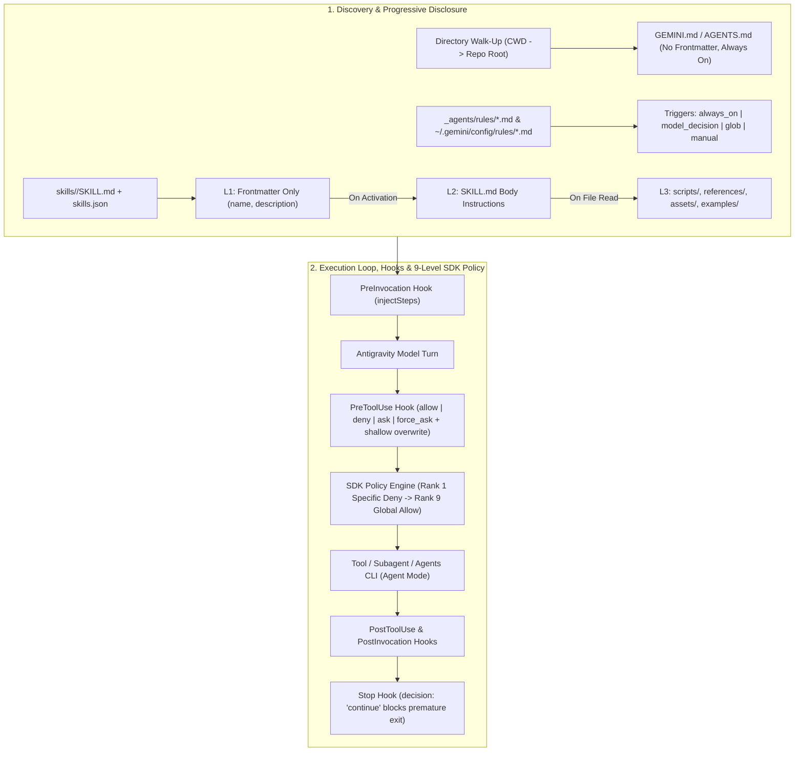

# Lab 06 — Antigravity Customization, Enterprise Governance & Agents CLI

**Exam section:** 2. Using coding agents for application development (~17% of the exam)
**Objectives covered:** 2.2 (plus 3.1 Agents CLI modes)
**Time:** ~30 minutes · **Cost:** Free offline / Free live

---

> **Personal study repo — not affiliated with Google Cloud.** Official guidance: [cloud.google.com/learn/certification/agentic-architect](https://cloud.google.com/learn/certification/agentic-architect) · [Disclaimer](../../../DISCLAIMER.md)

## 1. Exam objectives covered

> Quoted verbatim from the official exam guide:
> - "Creating skills, plugins, extensions hooks, rules, and subagents using Antigravity"
> - "Augmenting Antigravity with Agents CLI to build, scale, govern, and optimize deployed agents"

> [!NOTE]
> **Terminology alignment (`docs/VERIFIED_FACTS.md`):** The exam tests **Antigravity** customization files (`GEMINI.md`, `AGENTS.md`, `rules/*.md`, `skills/<name>/SKILL.md`, `hooks.json`, `plugin.json`, `skills.json`), **Antigravity SDK** governance (`google.antigravity.hooks.policy`), ADK's portable **`google.adk.skills` / `GCPSkillRegistry`**, and the **Agents CLI** (`adk` CLI commands `create`, `eval`, `optimize`, `deploy` in Agent Mode vs. Human Mode).

## 2. Explain it simply

An uncustomized coding agent is a smart generalist who knows Python and Terraform, but knows nothing about your company's internal frameworks, security gates, or deployment runbooks. Dumping a 50-page engineering handbook into every prompt wastes context tokens and degrades reasoning quality.

**Antigravity** solves this with six distinct, composable customization primitives:
1. **Rules (`GEMINI.md`, `AGENTS.md`, `rules/*.md`):** Context-aware guardrails scoped by directory hierarchy or file globs.
2. **Skills (`skills/<name>/SKILL.md`):** On-demand runbooks loaded via **3-tier progressive disclosure** so only tiny metadata sits in context until needed.
3. **Lifecycle Hooks (`hooks.json`):** Deterministic shell gates (`PreToolUse`, `Stop`, `PreInvocation`, `PostInvocation`, `PostToolUse`) enforced *outside* the LLM.
4. **Plugins (`plugins/<name>/plugin.json`):** Shareable, namespaced team bundles packaging skills, rules, subagents, hooks, and `mcp_config.json`.
5. **Custom Agents / Subagents (`agents/<name>.md` or `agent.json`):** Specialized personas with scoped tools and bounded delegation depth (`max_subagent_depth`).
6. **Agents CLI (`adk`):** Non-interactive **Agent Mode** commands that let Antigravity autonomously scaffold, evaluate (`eval`), GEPA-optimize (`optimize`), and deploy production agents.

## 3. How it works



### Deep-Dive Specifications (High-Frequency Exam Material)

#### A. Rules (`GEMINI.md`, `AGENTS.md`, `_agents/rules/*.md`, `~/.gemini/config/rules/*.md`)
- **Standalone Directory Rules (`GEMINI.md` / `AGENTS.md`):** Placed in *any* directory. They **do NOT support YAML frontmatter** and are always active for their directory and subdirectories. Antigravity walks **up** from the current working directory (CWD) to the repository root, loading every `GEMINI.md` / `AGENTS.md` along the path.
- **Triggered Rules (`rules/*.md`):** Placed in `_agents/rules/` (workspace) or `~/.gemini/config/rules/` (global). Support YAML frontmatter:
  - `trigger: always_on` — Injected on every turn (use sparingly to avoid token bloat).
  - `trigger: model_decision` — **Requires `description`**. Only the description is listed; the LLM dynamically decides whether to load the rule body.
  - `trigger: glob` — **Requires `globs`** (or `glob`), e.g., `"*.py,*.tf"`. Automatically activates when an open/edited file matches.
  - `trigger: manual` — Activates **only** when the user explicitly `@`-mentions the rule in chat.
- **Deduplication & 7-Level Loading Precedence:** All rules are deduplicated by resolved file path (`Path.resolve()`). Naming conflicts across customizations resolve from highest to lowest priority:
  1. Workspace Personal (`configs/users/%USERNAME%/_agents/`)
  2. Workspace Project (hierarchical walk-up from CWD)
  3. Repository Shared (`google3/configs/jetski/_agents/`)
  4. Declared JSON Configs (`skills.json`, `agents.json`, `plugins.json`)
  5. Global Discovery (`~/.gemini/config/`)
  6. Built-in Customizations
  7. Global Declared JSON Configs

#### B. Skills (`skills/<name>/SKILL.md`, `skills.json`, ADK `SkillRegistry`)
- **Progressive Disclosure:**
  - **L1 (`list_skills_in_dir`):** Injects only YAML frontmatter (`name`, `description`; ADK `Frontmatter` also parses `license`, `compatibility`, `allowed_tools`, `metadata`). **ADK enforces `frontmatter.name == directory_name`** (`ValueError` on mismatch).
  - **L2 (`load_skill_from_dir`):** Reads the Markdown instruction body only after activation.
  - **L3 (`Skill.resources`):** Reads `scripts/`, `references/`, `assets/`, `examples/`, or `resources/` on demand.
- **`skills.json` / `plugins.json` / `agents.json` Schema:** Registers non-standard or shared paths using `inherits` (processed first in listed order) and `entries`, each supporting `{ "path": "...", "include_only": ["regex"], "exclude": ["regex"] }`.
- **Managed Governance:** `GCPSkillRegistry(project_id, location)` backs ADK's `SkillRegistry` (`get_skill`, `search_skills`, `search_tool_description`) with Google Cloud IAM.

#### C. Lifecycle Hooks (`hooks.json`)
Configured as top-level named hook objects with optional `"enabled": true|false`. Commands run synchronously (`type: "command"`, default `timeout: 30`), receiving **camelCase** JSON on `stdin` (`conversationId`, `workspacePaths`, `transcriptPath`, `stepIdx`) and writing JSON to `stdout`:

| Event | `hooks.json` Structure | Key `stdin` Fields | Allowed `stdout` Response |
| :--- | :--- | :--- | :--- |
| **`PreToolUse`** | **Grouped:** `[{"matcher": "run_command", "hooks": [...]}]` | `toolCall: {"name", "args"}`, `stepIdx` | `decision`: `"allow"`, `"deny"`, `"ask"` (uses cache), `"force_ask"` (bypasses cache); optional `reason`, `permissionOverrides`, and **`overwrite`** (**shallow top-level** merge into `args`—nested objects replaced wholesale!) |
| **`PostToolUse`** | **Grouped** (`matcher` currently ignored; runs for all tools) | `stepIdx`, optional `error` | `{}` |
| **`PreInvocation`** | **Flat:** `[{"command": "..."}]` | `invocationNum`, `initialNumSteps` | `{"injectSteps": [{"ephemeralMessage": "..."}, {"userMessage": "..."}, {"toolCall": {...}}]}` |
| **`PostInvocation`** | **Flat:** `[{"command": "..."}]` | `invocationNum`, `initialNumSteps` | `{"injectSteps": [...], "terminationBehavior": "force_continue" \| "terminate"}` |
| **`Stop`** | **Flat:** `[{"command": "..."}]` | `executionNum`, `terminationReason`, `fullyIdle` | `{"decision": "continue", "reason": "..."}` **blocks premature stop** and re-enters the agent loop! |

#### D. Plugins (`plugin.json`), Custom Subagents & 9-Level SDK Policy Precedence
- **Plugins (`plugins/<name>/plugin.json`):** Contains `{"name": "team-kit"}` and bundles `mcp_config.json`, `hooks.json`, `rules/`, `skills/`, and `agents/` with automatic namespacing.
- **Custom Agents / Subagents:** Authored as Markdown (`agents/<name>.md` with `name`, `description`, `tools`, `mainAgent`, `subagent`, `commandExecutionPolicy: "off"|"auto"|"eager"`), Declarative YAML (`agent.json` -> `config.yaml`), or Interactive Executable (`command_spec`). In the Antigravity SDK, multi-tier delegation is bounded via `CapabilitiesConfig(enable_subagents=True, max_subagent_depth=3, allowed_subagents=[...])`.
- **Antigravity SDK Safety Policies (`google.antigravity.hooks.policy`):**
  - Default `LocalAgentConfig` applies `policy.confirm_run_command()` (**denies** `run_command` headlessly; upgrades to **`ask_user`** in `run_interactive_loop()`) plus `policy.workspace_only()` when `workspaces` is set.
  - **Exact 9-Level Priority Order (Highest -> Lowest, first-match-wins per level):**
    `1. Specific Deny` > `2. Specific Ask` > `3. Specific Allow` > `4. Prefix Wildcard Deny (server/*)` > `5. Prefix Wildcard Ask` > `6. Prefix Wildcard Allow` > `7. Global Wildcard Deny (*)` > `8. Global Wildcard Ask` > `9. Global Wildcard Allow (*)`.
  - **Fail-Closed Predicates (`when=`):** If `when=lambda args: ...` raises an exception, the policy **fails closed** (treats it as a match so the rule's decision applies).

#### E. Augmenting Antigravity with Agents CLI (`adk`) — Agent Mode vs. Human Mode
Antigravity invokes the CLI to scaffold (`adk create`), test (`adk test`), evaluate golden sets (`adk eval`, `adk eval_set`), optimize system prompts with **GEPA** (`adk optimize`), verify conformance (`adk conformance`), and deploy (`adk deploy agent_engine | cloud_run | gke | docker`):
- **Agent Mode (Coding Agent / CI caller):** Non-interactive flags, `NO_COLOR=1`, structured JSON results, deterministic exit codes—never blocking on TUI prompts or launching `adk web`.
- **Human Mode (Developer terminal):** Interactive `adk run` REPL or `adk web` FastAPI UI with ANSI formatting and human prompts.

## 4. The decision that matters

| Requirement | Best Antigravity / ADK Primitive | Why Alternatives Fail |
| :--- | :--- | :--- |
| **Enforce Python/Terraform style rules ONLY when `.py` or `.tf` files are open** | **`_agents/rules/*.md` with `trigger: glob` and `globs: "*.py,*.tf"`** | `GEMINI.md` has no frontmatter and loads unconditionally; `always_on` wastes context tokens when editing Markdown or Go. |
| **Teach a 12-step database migration runbook with helper scripts without bloating every turn** | **Skill (`skills/<name>/SKILL.md` + `scripts/` + `references/`)** | Progressive disclosure keeps only L1 `name` + `description` in prompt until activated; rules cannot bundle L3 scripts/assets. |
| **Hard-block `rm -rf` or rewrite `pytest` flags before shell execution regardless of prompt injection** | **`hooks.json` `PreToolUse` (`deny` / `force_ask` / `overwrite`) + SDK `policy.deny("run_command", when=...)`** | Markdown rules (`GEMINI.md` / `SKILL.md` L2) are soft LLM instructions that prompt injection can bypass. |
| **Prevent an autonomous coding agent from finishing its turn while unit tests are still failing** | **`hooks.json` `Stop` hook returning `{"decision": "continue", "reason": "..."}`** | `PreToolUse` fires only on tool calls, not when the model decides to emit a final text answer (`terminationReason: "model_stop"`). |
| **Distribute MCP servers, hooks, skills, rules, and review subagents to 40 teams as one unit** | **Plugin (`plugins/<name>/plugin.json`) + `plugins.json` `inherits`** | Copying loose files across repos causes configuration drift and tool-name collisions. |
| **Automatically improve an agent's root system instructions against an `evalset` from inside Antigravity** | **Agents CLI (`adk optimize` + `adk eval`) in non-interactive Agent Mode** | Manual prompt tweaking is non-reproducible; interactive `adk web` hangs headless coding agents. |

## 5. Hands-on A — offline (free)

The offline lab runs 6 end-to-end deterministic verifications:
1. Real ADK `list_skills_in_dir` (L1) vs `load_skills_from_dir` (L2/L3) + `GCPSkillRegistry`.
2. `GEMINI.md` / `AGENTS.md` walk-up, `rules/*.md` triggers (`glob`, `model_decision`, `manual`), and `Path.resolve()` deduplication.
3. `hooks.json` schema validation, `PreToolUse` camelCase `stdin` + shallow `overwrite`, and `Stop` `"continue"` gate.
4. `plugin.json`, subagent `commandExecutionPolicy` / `max_subagent_depth`, and `skills.json` `inherits` (`include_only` / `exclude`).
5. Antigravity SDK 9-level policy resolution + fail-closed `when=` predicate exception test.
6. Agents CLI (`adk`) Agent Mode (`eval`, GEPA `optimize`, `deploy`) vs. Human Mode (`web`).

```bash
./tracks/02_coding_agents/lab_06_antigravity_customization/run_lab.sh
```

**Expected output:**
All 6 checks report `PASS` with aligned summary tables showing rule activation states and resolved skill inheritance.

## 6. Hands-on B — live on Google Cloud (opt-in)

When publishing enterprise skills centrally to Google Cloud **Skill Registry** (`GCPSkillRegistry`), grant consumers read-only Skill/Agent Registry viewer roles while restricting registry mutation roles to CI/CD pipelines.

```bash
export GOOGLE_CLOUD_PROJECT="your-project-id"
export GEMINI_API_KEY="your-key"
./tracks/02_coding_agents/lab_06_antigravity_customization/run_lab.sh --live
```

## 7. Verify it worked

1. `list_skills_in_dir` returns `Frontmatter` objects with `approval_gate: required`, while `load_skills_from_dir` populates `resources.references` and `resources.scripts`.
2. `discover_and_resolve_rules` activates `GEMINI.md`, `AGENTS.md`, and matching `glob` rules once even when duplicate search paths are supplied.
3. `apply_pre_tool_use_response` replaces nested dictionaries wholesale during `overwrite`, and `evaluate_stop_hook` returns `"continue"` when `tests_passing=False`.
4. `evaluate_antigravity_policies` ranks `Specific Deny` (1) above `Specific Allow` (3) and `Global Allow` (9), failing closed when a `when=` lambda raises `KeyError`.

## 8. Troubleshooting

| Symptom | Root Cause | Fix |
| :--- | :--- | :--- |
| `ValueError: Skill name 'x' does not match directory name 'y'` | ADK validates that `frontmatter.name` in `SKILL.md` equals the parent folder name. | Rename either the directory `skills/<name>/` or `name:` in `SKILL.md` so they match identically. |
| YAML frontmatter (`trigger: glob`) at the top of `GEMINI.md` is ignored or flagged | Standalone `GEMINI.md` / `AGENTS.md` files do **not** support frontmatter. | Move triggered rules into `_agents/rules/<rule>.md` and keep `GEMINI.md` pure Markdown. |
| `PreToolUse` `overwrite` wiped out sibling keys inside a nested JSON argument | `overwrite` performs a **shallow, top-level** merge on `toolCall.args`. | Emit the complete replacement object for any top-level nested dictionary key you overwrite. |
| `Stop` hook fails to parse in `hooks.json` | Wrapped `Stop` handlers inside `{"matcher": "*", "hooks": [...]}`. | Use grouped `matcher`/`hooks` **only** for `PreToolUse` and `PostToolUse`; `PreInvocation`, `PostInvocation`, and `Stop` take a flat array of handler objects. |

## 9. Clean up

```bash
./tracks/02_coding_agents/lab_06_antigravity_customization/cleanup.sh
```

## 10. Exam traps

- **Trap 1 — Putting YAML frontmatter in `GEMINI.md`:** `GEMINI.md` and `AGENTS.md` have **no frontmatter** and always apply hierarchically. Use `_agents/rules/*.md` when you need `trigger: glob`, `model_decision` (requires `description`), or `manual`.
- **Trap 2 — `ask` vs. `force_ask` in `PreToolUse` hooks:** `"ask"` respects cached `"Always Allow"` user approvals, whereas `"force_ask"` bypasses cached permissions and forces an interactive confirmation every time (ideal for production `terraform apply` or `gcloud projects delete`).
- **Trap 3 — Policy order in array vs. 9-level priority:** Passing `[policy.deny("run_command"), policy.allow_all()]` vs `[policy.allow_all(), policy.deny("run_command")]` yields the **exact same result** (`deny`), because **Specific Deny (Level 1)** always outranks **Global Wildcard Allow (Level 9)**. Array order only breaks ties *within the same priority level*.
- **Trap 4 — Predicate exceptions failing open:** In `google.antigravity.hooks.policy`, if a `when=` lambda throws an exception (e.g., `KeyError`), it **fails closed** (counts as a match), never failing open.
- **Trap 5 — Running interactive CLI commands from a coding agent:** When Antigravity calls the Agents CLI (`adk`), always use **Agent Mode** (non-interactive `adk eval`, `adk optimize`, `adk test` with structured output), never `adk web` or interactive `adk run` without input.

## 11. Check yourself

<details>
<summary>1. You configure `policies=[policy.allow_all(), policy.allow("run_command"), policy.deny("run_command", when=lambda args: "prod" in args["env"])]` in the Antigravity SDK. The model invokes `run_command` with `args={"CommandLine": "ls"}` (no `"env"` key). What happens and why?</summary>

The call is **denied** (`Specific Deny`, Priority Level 1). First, `Specific Deny` (Level 1) is evaluated before `Specific Allow` (Level 3) and `Global Wildcard Allow` (Level 9) regardless of list order. Second, `args["env"]` raises a `KeyError`, and Antigravity policy predicates **fail closed** on exception—treating the predicate as matched and applying `deny`.
</details>

<details>
<summary>2. An enterprise team notices Antigravity sometimes stops and tells the user "Done!" right after editing a Python file without verifying whether `pytest` passes. Which customization guarantees the agent cannot finish its loop while tests are failing?</summary>

Configure a **`Stop`** lifecycle hook in **`hooks.json`** (flat handler list) that runs `pytest -q` and writes `{"decision": "continue", "reason": "Pytest failed; fix failing tests before stopping."}` to `stdout` whenever the test suite exits non-zero.
</details>

<details>
<summary>3. Why does Antigravity inject only `name` and `description` from `skills/<name>/SKILL.md` at session start instead of loading the entire `SKILL.md` and `references/` folder?</summary>

Because of **progressive disclosure**: keeping only L1 metadata (`name`, `description`) in the initial prompt prevents dozens of enterprise skills from exhausting the context window and diluting model attention. L2 (`SKILL.md` instructions) loads only when the skill is activated, and L3 (`references/`, `scripts/`, `assets/`) loads only when explicitly read.
</details>
