# Track 3 — Developing Custom Agents

> **Personal study repo — not affiliated with Google Cloud.** Official guidance: [cloud.google.com/learn/certification/agentic-architect](https://cloud.google.com/learn/certification/agentic-architect) · [Disclaimer](../../DISCLAIMER.md)

**Exam Section:** 3. Developing custom agents (**~33% of the exam — Largest Single Section!**)

Section 3 represents roughly one-third of the entire Professional Agentic Architect certification exam. Moving beyond low-code studio builders and developer IDE assistants, this track focuses on architecting production-grade Python multi-agent systems with the **Agent Development Kit (`google-adk` 2.9.0)**, **Agent Runtime**, **Agent Platform Memory Bank**, **Agents CLI**, **Vertex AI RAG Engine & Discovery Engine Ranking API**, **Vector Search 1.0**, **Agent Identity**, **Agent Registry**, **MCP**, and **Agent-to-Agent (A2A)** cross-project topologies.

---

## Official Objectives Covered

* **3.1 Designing and building agentic workflows in code**
  * Selecting and configuring the appropriate language model (LLM vs. SLM, self-hosted vs. SaaS, OSS vs. proprietary) considering cost, security, and agent architecture
  * Building custom agents using open-source libraries (e.g., ADK)
  * Configuring sessions and memory (e.g., Agent Platform Memory Bank and managed sessions)
  * Configuring skills using Agents CLI (e.g., plugins and agent vs. human mode)
* **3.2 Integrating enterprise domain knowledge**
  * Designing, configuring, and managing RAG pipelines and vector retrieval systems (embedding models, similarity scoring, reranking) using services such as vector databases (e.g., Vector Search and Agent Retrieval)
  * Configuring agent permissions (e.g., Agent Identity)
  * Using Google Cloud tools (e.g., Agent Registry, Google Cloud MCP Servers) to configure prebuilt and custom capabilities
* **3.3 Orchestrating and coordinating agentic workflows**
  * Orchestrating agents using agentic protocols (e.g., MCP and A2A)
  * Selecting and coordinating multiagent handoffs and workflows (parallel, sequential, graph workflow) using Google Cloud tools (Agent Identity, Agent Registry, Agent Runtime, agent policies)

---

## High-Yield Reference Architecture & Exam Blueprint

```mermaid
flowchart TB
    subgraph OrchestratorProject["Project A: proj-support-orchestrator (Agent Runtime)"]
        CLI["Agents CLI (Agent Mode JSON vs Human Mode TUI)"]
        Coord["Coordinator LlmAgent (gemini-3.7-flash)"]
        Graph["ADK Workflow Graph (FunctionNode / JoinNode)"]
        Sess["VertexAiSessionService (Short-Term Turn State)"]
        Mem["VertexAiMemoryBankService (Long-Term User Facts)"]
    end

    subgraph GovernancePlane["Shared Governance & Discovery Plane"]
        AReg["Agent Registry (get_remote_a2a_agent / get_mcp_toolset)"]
        SReg["GCPSkillRegistry (L1/L2/L3 Governed Skills)"]
        AId["Agent Identity + PAB (GcpAuthProviderScheme)"]
    end

    subgraph KnowledgePlane["Enterprise Knowledge & Two-Stage RAG"]
        RAG["Vertex AI RAG Engine (Chunking + LayoutParser + HybridSearch)"]
        VS["Vector Search 1.0 (ScaNN ANN, gemini-embedding-2, 8192d)"]
        Rank["Discovery Engine Ranking API (Cross-Encoder Reranker)"]
    end

    subgraph RemoteProjects["Cross-Project Capabilities (Least-Privilege IAM)"]
        PCI["Project B: proj-pci-billing (Cloud Run RemoteA2aAgent)"]
        HIPAA["Project C: proj-hipaa-claims (Agent Runtime RemoteA2aAgent)"]
        BQ["Managed GCP MCP / BigQueryToolset (Read-Only Scoped)"]
    end

    CLI -->|"deploy / eval / optimize"| Coord
    Coord --> Graph
    Coord <--> Sess
    Coord <-->|"preload_memory vs load_memory"| Mem
    Coord -.->|"Discover endpoints"| AReg
    Coord -.->|"Load governed skills"| SReg
    Coord -->|"Stage 1 Recall -> Stage 2 Rerank"| RAG
    RAG --> VS
    RAG --> Rank
    AId -->|"Mint scoped OIDC / OAuth token"| Coord
    Coord -->|"A2A + roles/run.invoker"| PCI
    Coord -->|"A2A + roles/aiplatform.user"| HIPAA
    Coord -->|"MCP + external_access_token_key"| BQ
```

### 1. Multi-Agent Orchestration Latency & Token Math Cheat Sheet (Objectives 3.1 & 3.3)

| ADK Pattern | End-to-End Latency Formula | Extra Routing LLM Calls | Token & State Hygiene Best Practice |
| :--- | :--- | :--- | :--- |
| **`SequentialAgent` / Linear `Workflow`** | $\sum_{i=1}^{k} T_i$ | **0** (deterministic edge) | Bind `output_schema` + `output_key` and set `include_contents="none"` on downstream steps to prevent $O(k)$ transcript bloat. |
| **`ParallelAgent` / `Workflow` + `JoinNode`** | $\max_{i}(T_i)$ | **0** (deterministic fan-out) | Ideal when fetching independent context (orders, billing, shipping SLA) concurrently; write to distinct `output_key` slots to avoid state collisions. |
| **`LoopAgent` (`max_iterations` + `exit_loop`)** | $N \times T_{\text{iter}}$ ($N \le N_{\max}$) | **0** per loop boundary | Always cap `max_iterations` and provide the `exit_loop` tool to avoid tail-latency timeouts and runaway token spend. |
| **`LlmAgent` + `sub_agents` (`transfer_to_agent`)** | $T_{\text{router}} + T_{\text{specialist}}$ | **+1** (router classification) | Hands control directly to the specialist so the specialist streams the final answer without bouncing back through the parent. |
| **`LlmAgent` + `AgentTool(agent=...)`** | $T_{\text{parent\_1}} + T_{\text{sub}} + T_{\text{parent\_2}}$ | **+2** (call + parent synthesis) | Use when the parent must synthesize multiple tool outputs; set `skip_summarization=True` if raw sub-agent output is sufficient. |
| **Cross-Project `RemoteA2aAgent`** | $T_{\text{net+auth}} + T_{\text{remote\_task}}$ | Network + remote agent turns | Discover via `AgentRegistry`, authenticate per-service with Agent Identity, and wrap independent A2A calls in `ParallelAgent` to bound latency at $\max(T_i)$. |

### 2. Cross-Project Least-Privilege IAM & Security Matrix (~30–35% of Exam)

| Cross-Boundary Call | Caller Identity | Target Resource & Project | Minimum Required IAM / Policy Control |
| :--- | :--- | :--- | :--- |
| **Coordinator -> Remote A2A Agent on Cloud Run** | Dedicated Coordinator SA / Agent Identity (`proj-orchestrator`) | Specific Cloud Run service in `proj-pci-billing` | Resource-level `roles/run.invoker` on that Cloud Run service **only** + OIDC ID token (`aud` = service URL). Never `allUsers` or project-wide `roles/editor`. |
| **Coordinator -> Remote A2A Agent on Agent Runtime** | Dedicated Coordinator SA / Agent Identity (`proj-orchestrator`) | Reasoning Engine endpoint in `proj-hipaa-claims` | `roles/aiplatform.user` scoped via IAM condition / endpoint + **Principal Access Boundary (PAB)** blocking direct GCS/BQ PHI access. |
| **Agent -> BigQuery Analytics Dataset** | Agent Identity / Delegated OAuth (`GcpAuthProviderScheme`) | Specific dataset in `proj-analytics` | Dataset-level `roles/bigquery.dataViewer` + project-level `roles/bigquery.jobUser` + `BigQueryToolset(tool_filter=[...])` read-only allowlist. |
| **RAG Engine -> Discovery Engine Reranker** | RAG Engine Service Agent / Workload SA | Ranking config in `proj-knowledge` | `roles/discoveryengine.viewer` (or Ranking API invoker permission) — never `roles/discoveryengine.admin`. |

---

## Labs in This Track

| Lab | Title | Objectives & Key Exam Concepts |
| :--- | :--- | :--- |
| **[Lab 07](lab_07_model_selection/README.md)** | **Model Selection & Multi-Tier Routing** | **3.1** · LLM vs. SLM, SaaS vs. self-hosted (`Gemini`, `Gemma`, `LiteLlm`, `Gemma3Ollama`, `Claude`, `ApigeeLlm`, `FallbackModel`), Dense (`gemma-4-31b-it`) vs. MoE (`gemma-4-26b-a4b-it`), version pinning vs. floating aliases, and multi-tier cost math. |
| **[Lab 08](lab_08_adk_fundamentals/README.md)** | **ADK Fundamentals & Multi-Agent Latency Math** | **3.1, 3.3** · `LlmAgent` (`output_schema`, `output_key`, `include_contents="none"`), `SequentialAgent` / `ParallelAgent` / `LoopAgent` (and exact ADK 2.9.0 `Workflow` deprecation nuance), `Workflow` + `FunctionNode` + `JoinNode`, and `AgentTool` vs. `transfer_to_agent` latency formulas. |
| **[Lab 09](lab_09_sessions_and_memory/README.md)** | **Managed Runtime Sessions & Memory Patterns** | **3.1** · Agent Runtime (`adk deploy agent_engine`) pairing with `VertexAiSessionService` & `VertexAiMemoryBankService`, `preload_memory` vs. `load_memory` round-trip trade-offs, `RedisSessionService` vs. `DatabaseSessionService`, `adk migrate session`, and per-`user_id` HIPAA/support retention isolation. |
| **[Lab 10](lab_10_tools_and_skills/README.md)** | **Agents CLI, Agent Identity & GCP MCP Toolsets** | **3.1, 3.2** · **Agents CLI** (**Agent Mode** JSON/`--non-interactive` vs. **Human Mode** TUI + plugins), `Skill` / `Frontmatter` L1/L2 progressive disclosure, `GCPSkillRegistry`, `GcpAuthProviderScheme` (Agent Identity), `BigQueryToolset` (`external_access_token_key`), `APIHubToolset`, and HITL (`request_input`, `get_user_choice`). |
| **[Lab 11](lab_11_rag_and_retrieval/README.md)** | **RAG Engine, Reranking API & Vector Search 1.0** | **3.2** · **Vertex AI RAG Engine** (`RagCorpus`, `TransformationConfig`, `ChunkingConfig`, `LayoutParserConfig`, `HybridSearch`), **Two-Stage Retrieval** (`gemini-embedding-2` 8,192d ANN recall + `discoveryengine_v1.RankServiceClient` / `RankService` vs. `LlmRanker`), and Agent Search vs. RAG Engine vs. Vector Search 1.0. |
| **[Lab 12](lab_12_multi_agent_and_a2a/README.md)** | **Multi-Agent Orchestration & Cross-Project A2A** | **3.3** · `RemoteA2aAgent`, `A2aRemoteAgentConfig` (`RequestInterceptor`), `AgentRegistry` (`get_remote_a2a_agent`, `get_mcp_toolset`), cross-project least-privilege IAM (`roles/run.invoker`, `roles/aiplatform.user`, PAB), and parallel A2A fan-out latency optimization. |
