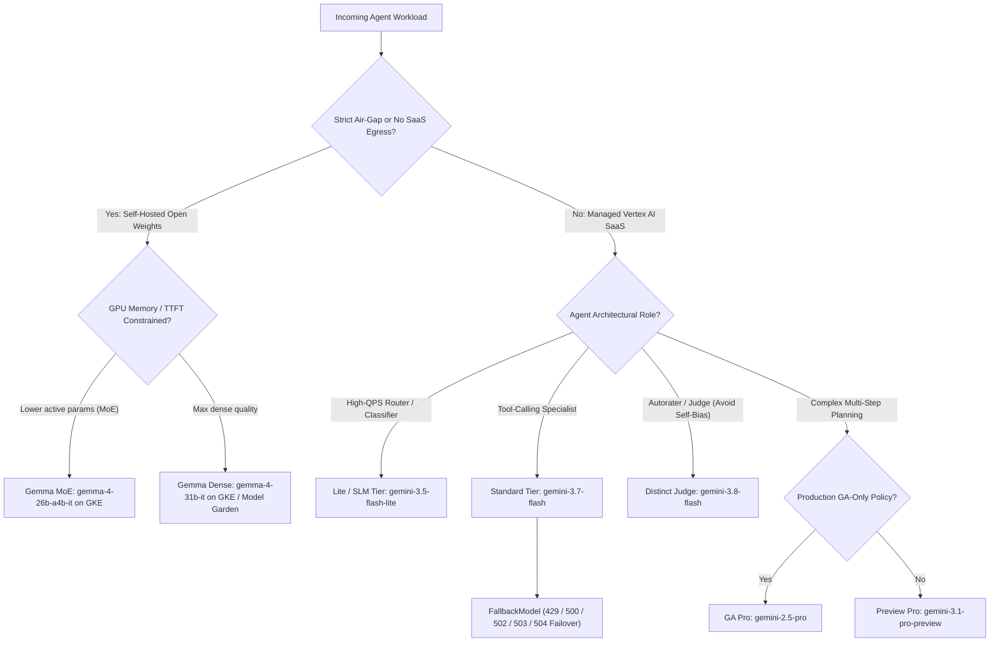

# Lab 07 — Model Selection & Multi-Tier Agent Routing

**Exam section:** 3. Developing custom agents (~33% of the exam)
**Objectives covered:** 3.1 Designing and building agentic workflows in code
**Time:** ~20 minutes · **Cost:** Free offline / ~$0.01 live

---

> **Personal study repo — not affiliated with Google Cloud.** Official guidance: [cloud.google.com/learn/certification/agentic-architect](https://cloud.google.com/learn/certification/agentic-architect) · [Disclaimer](../../../DISCLAIMER.md)

## 1. Exam objectives covered

> Quoted verbatim from the official exam guide:
> - "Selecting and configuring the appropriate language model (LLM vs. SLM, self-hosted vs. SaaS, OSS vs. proprietary) considering cost, security, and agent architecture"
> - "Building custom agents using open-source libraries (e.g., ADK)"

## 2. Explain it simply

Choosing one "smartest" frontier model for every step in an agentic workflow is one of the fastest ways to fail both production SLAs and certification scenario questions. Every turn in an agentic system balances four competing constraints:

1. **Security & Data Residency (Hard Constraint):** Can prompts leave your VPC or sovereign boundary? If not, SaaS endpoints are eliminated immediately—you must self-host open-weights models (`Gemma` on GKE or Vertex AI Model Garden).
2. **Release Governance (SLA Constraint):** Does enterprise policy forbid preview models in regulated production? If so, select a GA Pro model (`gemini-2.5-pro`) rather than a preview model (`gemini-3.1-pro-preview`).
3. **Latency & Cost at Scale (LLM vs. SLM Tiering):** High-QPS intent routers, classifiers, and entity extractors belong on a Small/Lite tier (`gemini-3.5-flash-lite`), standard tool-calling specialists belong on Flash (`gemini-3.7-flash`), and only genuinely ambiguous multi-step planning escalates to Pro.
4. **Resiliency & Governance Gateways:** Production agents wrap models in `FallbackModel` for automatic regional/model failover on `429` / `5xx` errors, or route through `ApigeeLlm` for centralized token quotas, mTLS, and cross-project chargeback.

## 3. How it works



### ADK `google.adk.models` Class Taxonomy

All ADK language model wrappers inherit from `BaseLlm` so you can swap hosting strategies without rewriting `LlmAgent` business logic:

| ADK Class | Hosting & Licensing | Primary Enterprise Use Case |
| :--- | :--- | :--- |
| **`Gemini`** | Managed SaaS · Proprietary | First-party Vertex AI / Gemini API models (`gemini-3.5-flash-lite`, `gemini-3.7-flash`, `gemini-2.5-pro`, `gemini-3.1-pro-preview`). Supports 1M-token context and native tool calling. |
| **`Gemma`** | Self-hosted · Open Weights | Serving Google open-weights models (`gemma-4-31b-it` dense or `gemma-4-26b-a4b-it` Mixture-of-Experts with only 4B active parameters per token) on GKE GPU pools or Model Garden dedicated endpoints. |
| **`Gemma3Ollama`** | Local / Workstation · Open Weights | Zero-cost offline local developer prototyping against an Ollama daemon before promoting to GKE. |
| **`LiteLlm`** | Hybrid / Multi-Provider · OSS or SaaS | Unified adapter (`vertex_ai/...`, vLLM/OpenAI-compatible endpoints on GKE) when teams standardize across heterogeneous open-source or third-party endpoints. |
| **`Claude`** | Managed Partner SaaS · Proprietary | Anthropic Claude models hosted on Vertex AI Model Garden under Google Cloud IAM and VPC Service Controls. |
| **`ApigeeLlm`** | API Gateway Proxy (`apigee/<model>`) | Routes LLM calls through Apigee for per-department token rate-limiting, semantic caching, header injection, and cross-project chargeback attribution. |
| **`FallbackModel`** | Resiliency Wrapper (`BaseLlm`) | Accepts an ordered `models=[primary, secondary, ...]` list and automatically fails over on `retriable_status_codes` (`{429, 500, 502, 503, 504}`). |

### Least-Privilege IAM for Model Invocation

- **Managed Vertex AI SaaS (`Gemini`, `Claude`):** Bind a dedicated Workload Identity service account with **`roles/aiplatform.user`** scoped to the serving project inside a **VPC Service Controls (VPC-SC)** perimeter. Never grant `roles/aiplatform.admin` (which allows deleting endpoints and modifying deployments).
- **Self-Hosted GKE (`Gemma` on vLLM / GKE Inference Gateway):** Bind the GKE Kubernetes Service Account via Workload Identity Federation with **`roles/artifactregistry.reader`** to pull container/model artifacts and block internet egress via Kubernetes `NetworkPolicy`.

## 4. The decision that matters

| Scenario Constraint | Recommended Selection | Why Alternatives Fail on the Exam |
| :--- | :--- | :--- |
| **Defense / sovereign workload where prompts cannot leave customer-managed GKE nodes** | **`Gemma`** (`gemma-4-31b-it` dense or `gemma-4-26b-a4b-it` MoE) on GKE | Managed SaaS (`Gemini`, `Claude`) processes tokens on multi-tenant regional endpoints outside customer-owned nodes. |
| **GKE GPU cluster needs open-weights quality with minimal Time-To-First-Token (TTFT) and KV-cache footprint** | **`gemma-4-26b-a4b-it`** (MoE) behind **GKE Inference Gateway** | `gemma-4-31b-it` activates all 31B parameters on every token, consuming ~7x more active compute bandwidth than the 4B-active MoE variant. |
| **Triage router classifying 50,000 support messages/min before handing off 10% of hard cases** | Tiered architecture: **`gemini-3.5-flash-lite`** router -> **`gemini-2.5-pro`** specialist | Sending 100% of traffic to Pro wastes ~10x–15x budget and blows P95 latency SLAs on trivial intents. |
| **Healthcare insurer needing deep multi-step clinical claim reasoning under a strict GA-only compliance mandate** | **`gemini-2.5-pro`** | `gemini-3.1-pro-preview` is a preview release (`preview=True`) and violates GA-only production governance. |
| **Preventing `429 ResourceExhausted` outages during regional traffic spikes** | **`FallbackModel(models=[primary, backup])`** | Hard-coding a single endpoint without fallback causes immediate user-visible failures when burst quotas saturate. |
| **Evaluating an agent built on `gemini-3.7-flash` using an LLM-as-a-Judge autorater** | **`gemini-3.8-flash`** (distinct judge model) | Using the exact same model to grade its own outputs introduces self-preference bias. |

## 5. Hands-on A — offline (free)

Run the offline lab to verify constraint-driven model selection, instantiate all seven ADK `BaseLlm` model classes (`Gemini`, `Gemma`, `LiteLlm`, `Gemma3Ollama`, `Claude`, `ApigeeLlm`, `FallbackModel`), compare Dense vs. MoE self-hosted profiles, and compute multi-tier routing cost savings:

```bash
./tracks/03_custom_agents/lab_07_model_selection/run_lab.sh
```

## 6. Hands-on B — live on Google Cloud (opt-in)

When you pass `--live` with `GOOGLE_CLOUD_PROJECT` and `GOOGLE_API_KEY` configured, the lab executes a real round-trip generation check using the selected `DEFAULT_FAST_MODEL` and `DEFAULT_AGENT_MODEL` to verify live model availability:

```bash
./tracks/03_custom_agents/lab_07_model_selection/run_lab.sh --live
```

> [!WARNING]
> Cost note: Live mode sends two tiny short-text prompts (<50 tokens total), costing well under $0.01.

## 7. Verify it worked

Confirm that `run_lab.sh` prints `All ... checks passed` in the `LabReport` summary and that `pytest` passes all unit checks in `tests/test_lab_07.py`:

- Air-gapped constraint selects `gemma-4-31b-it` (`Hosting.SELF_HOSTED`, `Licensing.OPEN_WEIGHTS`).
- Tiered routing (90% Lite router + 10% GA Pro escalation) cuts ordinal token cost by **>80%** compared to routing 100% of requests to Pro.
- `FallbackModel` automatically includes `429`, `500`, `502`, `503`, and `504` in `retriable_status_codes`.
- Production pinning audit rejects floating aliases (`gemini-flash-latest`, `gemini-pro-latest`).

## 8. Troubleshooting

| Symptom | Cause | Fix |
| :--- | :--- | :--- |
| `ValueError: Invalid model string` when instantiating `ApigeeLlm` | Missing `apigee/` prefix on the model identifier | Prefix the governed model ID as `apigee/<model_id>` (for example, `f"apigee/{DEFAULT_AGENT_MODEL}"`). |
| `KeyError: '... is not in the verified catalog'` | Passing an unverified or retired model ID or a floating alias to `get_profile()` | Import pinned constants from `common.models` (`DEFAULT_AGENT_MODEL`, `DEFAULT_FAST_MODEL`, `DEFAULT_OSS_MODEL`). |
| Silent quality regression in production without code changes | Agent configured with floating alias `gemini-flash-latest` | Pin an explicit versioned model ID (`gemini-3.7-flash`) and gate upgrades via `adk eval`. |

## 9. Clean up

```bash
./tracks/03_custom_agents/lab_07_model_selection/cleanup.sh
```

No persistent cloud infrastructure is provisioned in this lab.

## 10. Exam traps

- **Floating aliases in production (`gemini-flash-latest`):** Convenient in quick notebooks, **wrong** in regulated production because underlying model weights shift without triggering your CI evaluation gate. Always pin explicit model versions.
- **Confusing VPC-SC with Self-Hosting:** VPC Service Controls prevent data exfiltration from your Google Cloud project perimeter when calling Vertex AI SaaS (`Gemini`), **but** if a question states *"weights must run exclusively inside customer-managed GKE nodes with zero external API calls"*, only open-weights self-hosting (`Gemma` / Model Garden on GKE) satisfies the requirement.
- **Dense vs. MoE Open Weights:** Both `gemma-4-31b-it` and `gemma-4-26b-a4b-it` offer 262,144 input token limits, but `gemma-4-26b-a4b-it` is a Mixture-of-Experts model (4B active parameters), making it the exam-preferred choice when GPU memory bandwidth and per-token latency on GKE are constrained.
- **Paying per-token vs. paying per-accelerator:** SaaS models (`Gemini`) bill per input/output token (ideal for spiky traffic); self-hosted `Gemma` on GKE bills continuously for GPU/TPU node hours (requiring high steady utilization or autoscaled GKE Inference Gateway pools to be cost-effective).

## 11. Check yourself

<details>
<summary>1. A financial services company processes 2 million customer chat turns per day. 85% are simple FAQ/intent lookups, and 15% require complex multi-policy reconciliation. Preview models are banned by compliance. What architecture minimizes cost and latency while meeting policy?</summary>
Use a tiered ADK architecture: front the system with an intent-routing <code>LlmAgent</code> using <code>gemini-3.5-flash-lite</code> (Lite/SLM tier) and escalate only the 15% complex turns to a specialist agent running <code>gemini-2.5-pro</code> (the GA Pro model, avoiding preview models).
</details>

<details>
<summary>2. Your platform team requires every business unit's ADK agents to traverse a central enterprise API proxy for token quota enforcement, custom header injection, and chargeback billing. Which ADK model class should agents use?</summary>
<code>ApigeeLlm</code> (from <code>google.adk.models</code>), configured with an <code>apigee/&lt;model&gt;</code> identifier and the enterprise <code>proxy_url</code>.
</details>

<details>
<summary>3. How does <code>FallbackModel</code> behave when the primary Vertex AI region returns HTTP <code>429 Too Many Requests</code> or <code>503 Service Unavailable</code>?</summary>
Because <code>429</code> and <code>503</code> are in <code>FallbackModel.retriable_status_codes</code> (<code>{429, 500, 502, 503, 504}</code>), <code>FallbackModel</code> transparently retries the turn against the next <code>BaseLlm</code> in its <code>models</code> list without crashing the agent invocation.
</details>

<details>
<summary>4. Why should your evaluation pipeline use <code>gemini-3.8-flash</code> as the LLM-as-a-Judge autorater when the agent under test runs on <code>gemini-3.7-flash</code>?</summary>
Using a distinct model family/version for judging mitigates self-preference bias, where a model disproportionately favors its own phrasing and formatting quirks.
</details>
