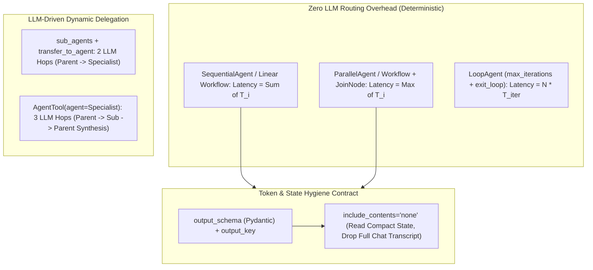

# Lab 08 — ADK Fundamentals & Multi-Agent Latency Math

**Exam section:** 3. Developing custom agents (~33% of the exam)
**Objectives covered:** 3.1, 3.3
**Time:** ~25 minutes · **Cost:** Free offline / ~$0.03 live

---

> **Personal study repo — not affiliated with Google Cloud.** Official guidance: [cloud.google.com/learn/certification/agentic-architect](https://cloud.google.com/learn/certification/agentic-architect) · [Disclaimer](../../../DISCLAIMER.md)

## 1. Exam objectives covered

> Quoted verbatim from the official exam guide:
> - "Building custom agents using open-source libraries (e.g., ADK)"
> - "Selecting and coordinating multiagent handoffs and workflows (parallel, sequential, graph workflow) using Google Cloud tools (Agent Identity, Agent Registry, Agent Runtime, agent policies)"

## 2. Explain it simply

In the Agent Development Kit (`google-adk`), an `LlmAgent` pairs a language model with instructions, tools, lifecycle callbacks, and a typed state contract (`output_schema` + `output_key`). When a single agent becomes overloaded with too many tools or conflicting instructions, you decompose it into specialists.

On the exam, **picking the right multi-agent coordination pattern is fundamentally a latency and token-budget math problem**:

- If three lookups (order status, billing history, shipping SLA) are independent, running them in a `SequentialAgent` adds their latencies ($\sum T_i = 420 + 510 + 380 = 1,310\text{ ms}$), whereas a `ParallelAgent` or a fan-out `Workflow` with a `JoinNode` bounds latency at the slowest branch ($\max(T_i) = 510\text{ ms}$).
- If an orchestrator wraps a specialist in an `AgentTool`, the turn makes **three** LLM hops (Parent calls tool -> Specialist executes -> Parent synthesizes). Handing off via `sub_agents` + `transfer_to_agent` cuts that to **two** LLM hops, and deterministic `Workflow` edges incur **zero** LLM routing latency.

## 3. How it works



### 1. Core `LlmAgent` Anatomy & Token Hygiene

- **`instruction` vs. `static_instruction` vs. `global_instruction`:** `instruction` defines the agent's task persona (and can interpolate `{state_key}` placeholders from `Session.state`); `static_instruction` separates immutable system context to maximize prefix/context caching; `global_instruction` applies across an entire agent tree.
- **Structured State Handoffs (`output_schema` + `output_key` + `include_contents="none"`):** In a multi-step pipeline, default `include_contents="default"` forwards the entire growing conversation transcript into every downstream agent ($O(k)$ compounding prompt tokens). Binding `output_schema` + `output_key` on Step 1 and setting **`include_contents="none"`** on Step 2 lets Step 2 read only the compact validated JSON from `{output_key}` in `Session.state`, slashing latency and input token cost.
- **Transfer Guardrails (`disallow_transfer_to_parent`, `disallow_transfer_to_peers`):** Restricts where a sub-agent can dynamically route control, enforcing hub-and-spoke governance when specialists should not cross-call peers directly.
- **Lifecycle Callbacks:** `before_agent_callback`, `before_model_callback`, `after_agent_callback` attach deterministic policy checks, caching, or PII redaction without spending an LLM turn.

### 2. Multi-Agent Latency & Token Math Matrix

| Pattern | Total Latency | Routing LLM Calls | Key Architectural Trade-Off |
| :--- | :--- | :--- | :--- |
| **`SequentialAgent` / Linear `Workflow`** | $\sum_{i=1}^{k} T_i$ | **0** | Deterministic step order; pair with `output_schema` + `output_key` + `include_contents="none"` to avoid compounding prompt tokens. |
| **`ParallelAgent` / Fan-Out `Workflow` (`JoinNode`)** | $\max_{i}(T_i)$ | **0** | Slashes P95 latency for independent data gathering (e.g., customer support fetching order, billing, and shipping policy concurrently). Each worker must write to a **distinct** `output_key`. |
| **`LoopAgent`** | $N \times T_{\text{iter}}$ ($N \le N_{\max}$) | **0** | Iterative generator-critic refinement; **tail-latency trap** unless bounded by `max_iterations` and early-terminated via the `exit_loop` tool. |
| **`sub_agents` + `transfer_to_agent`** | $T_{\text{router}} + T_{\text{specialist}}$ | **+1** (router) | Hands the conversation turn directly to the specialist, saving the parent synthesis round-trip. |
| **`AgentTool(agent=specialist)`** | $T_{\text{parent\_1}} + T_{\text{sub}} + T_{\text{parent\_2}}$ | **+2** (call + synthesis) | Keeps the parent in control to combine multiple specialist outputs; set `skip_summarization=True` if parent re-synthesis is unnecessary. |

### 3. The ADK 2.9.0 `Workflow` vs. `SequentialAgent` Nuance

In `google-adk==2.9.0`, `SequentialAgent`, `ParallelAgent`, and `LoopAgent` emit a `DeprecationWarning`:

> `SequentialAgent is deprecated in favor of Workflow and will be removed in a future version. Workflow cannot yet be used as an LlmAgent sub-agent.`

Read both sentences carefully:
1. Top-level deterministic pipelines, conditional branches (`FunctionNode` + `Edge(route=...)`), and fan-in joins (`JoinNode`) should use **`google.adk.workflow.Workflow`**.
2. However, **`Workflow` is not a `BaseAgent`**—passing a `Workflow` inside `LlmAgent(sub_agents=[...])` raises a Pydantic `ValidationError`. Whenever a composite pipeline must be nested inside an `LlmAgent` hierarchy, you still use `SequentialAgent`, `ParallelAgent`, or `LoopAgent` today.

### 4. The `adk` CLI Lifecycle Surface

- `adk create`: Scaffolds an agent package (`agent.py` exposing `root_agent`).
- `adk run` / `adk web` / `adk api_server`: Local interactive terminal, stakeholder FastAPI Web UI, and headless HTTP server.
- `adk eval` / `adk test` / `adk optimize`: Golden-dataset evaluation, JSON trajectory tests, and GEPA instruction optimization.
- `adk deploy {agent_engine, cloud_run, docker, gke}`: Deploys to managed runtimes.

## 4. The decision that matters

| If the exam scenario asks for... | Choose | Why the distractors lose |
| :--- | :--- | :--- |
| **Customer support agent must fetch Order Status, Billing History, and Shipping Policy under a strict 700 ms SLA** | **`ParallelAgent`** or **`Workflow` fan-out -> `JoinNode`** | `SequentialAgent` sums all three latencies ($>1.2\text{ s}$); `AgentTool` adds multiple serial LLM synthesis turns. |
| **Deterministic 3-stage ETL/extraction pipeline where Stage 3 suffers 40k-token prompt bloat** | **`Workflow`** (or `SequentialAgent`) with **`output_schema` + `output_key`** and **`include_contents="none"`** | Leaving `include_contents="default"` replays verbose raw tool dumps and prior turns into every downstream model call. |
| **Triage router that hands billing disputes permanently to a Billing Specialist for direct response** | **`LlmAgent(sub_agents=[...])`** (`transfer_to_agent`) | `AgentTool` forces the Billing Specialist's answer back through the Triage LLM for an extra synthesis round-trip. |
| **Supervisor that must query both a Legal Specialist and a Tax Specialist, then draft one unified executive memo** | **`AgentTool`** wrapping each specialist | `transfer_to_agent` hands off the turn completely rather than returning structured specialist results to the supervisor. |
| **Iterative SQL query generator + validator that must never exceed 3 retries** | **`LoopAgent(max_iterations=3)`** + **`exit_loop`** tool (or cyclic `Workflow` with bounded counter) | Unbounded loops cause 504 gateway timeouts and runaway token spend when validation repeatedly fails. |

## 5. Hands-on A — offline (free)

Run the offline lab to construct linear, fan-out (`JoinNode`), loop (`exit_loop`), and dynamic delegation (`transfer_to_agent` vs. `AgentTool`) topologies in ADK 2.9.0 and verify exact latency/round-trip formulas:

```bash
./tracks/03_custom_agents/lab_08_adk_fundamentals/run_lab.sh
```

## 6. Hands-on B — live on Google Cloud (opt-in)

Pass `--live` to execute a real `InMemoryRunner` turn through the `LlmAgent` structured extraction pipeline on Gemini:

```bash
./tracks/03_custom_agents/lab_08_adk_fundamentals/run_lab.sh --live
```

> [!WARNING]
> Cost note: Live execution runs a single structured-output `InMemoryRunner` invocation costing <$0.02.

## 7. Verify it worked

Confirm that all checks in `LabReport` and `pytest` pass:

- Customer support parallel fan-out (`420 ms`, `510 ms`, `380 ms`) computes **510 ms** (`ParallelAgent` / `JoinNode`) vs. **1,310 ms** (`SequentialAgent`).
- Downstream `LlmAgent` configures `include_contents="none"` alongside upstream `output_schema` + `output_key`.
- `AgentTool` incurs **3 LLM calls** by default vs. **2 LLM calls** for `transfer_to_agent` and **0 LLM routing calls** for `Workflow`.
- `SequentialAgent` emits the expected `DeprecationWarning` referencing `Workflow`, while attempting `LlmAgent(sub_agents=[workflow])` raises `ValidationError`.

## 8. Troubleshooting

| Symptom | Cause | Fix |
| :--- | :--- | :--- |
| `ValidationError` passing a `Workflow` into `LlmAgent(sub_agents=[...])` | `Workflow` inherits from `BaseNode`, not `BaseAgent` | Use `Workflow` at the root orchestration layer, or nest a `SequentialAgent` / `ParallelAgent` when composing under `LlmAgent.sub_agents`. |
| Parallel workers overwrite each other's output in `Session.state` | Multiple branches share the same `output_key` | Assign a unique `output_key` per branch (e.g., `order_ctx`, `billing_ctx`, `shipping_ctx`) before merging at `JoinNode`. |
| `LoopAgent` burns all `max_iterations` even after approval | Validator sub-agent never calls `exit_loop` | Attach `google.adk.tools.exit_loop` to the validator agent and instruct it to call `exit_loop` once `is_approved=True`. |

## 9. Clean up

```bash
./tracks/03_custom_agents/lab_08_adk_fundamentals/cleanup.sh
```

No persistent cloud resources are created.

## 10. Exam traps

- **The `AgentTool` Extra Round-Trip Trap:** Candidates frequently pick `AgentTool` for simple intent routing. Unless the parent must synthesize multiple sub-agent answers (or sets `skip_summarization=True`), `AgentTool` adds an unnecessary third LLM call ($T_{\text{parent}} \to T_{\text{sub}} \to T_{\text{parent}}$). Use `sub_agents` (`transfer_to_agent`) for direct handoffs and `Workflow` when routing rules are deterministic in Python (`FunctionNode`).
- **Compounding Context Bloat in Pipelines:** Chaining 5 verbose agents with `include_contents="default"` sends every intermediate scratchpad to Agent 5. Use `output_schema` + `output_key` + `include_contents="none"` so each stage receives only its required typed inputs.
- **Unbounded `LoopAgent` Tail Latency:** Latency scales linearly as $N \times T_{\text{iter}}$. Always pair `max_iterations` with `exit_loop`.
- **Nuanced ADK 2.9.0 Deprecation:** Neither *"SequentialAgent was deleted"* nor *"SequentialAgent is still preferred over Workflow"* is true—`Workflow` is preferred for top-level orchestration, while `SequentialAgent` remains required when nested as an `LlmAgent` sub-agent.

## 11. Check yourself

<details>
<summary>1. A customer support agent must retrieve Order Status (400 ms), Payment Ledger (550 ms), and Return Eligibility (300 ms) before drafting a response (600 ms). Compare total latency using a 4-step <code>SequentialAgent</code> vs. a fan-out <code>Workflow</code> with <code>JoinNode</code> feeding the drafter.</summary>
<code>SequentialAgent</code> sums every step: $400 + 550 + 300 + 600 = 1,850\text{ ms}$. A fan-out <code>Workflow</code> runs the three lookups concurrently into a <code>JoinNode</code> ($\max(400, 550, 300) = 550\text{ ms}$) followed by the drafter ($600\text{ ms}$), finishing in <strong>1,150 ms</strong>—saving 700 ms per turn.
</details>

<details>
<summary>2. Why does wrapping a Specialist agent in <code>AgentTool</code> have higher default latency than registering it in <code>LlmAgent(sub_agents=[...])</code>?</summary>
<code>AgentTool</code> treats the specialist like a function call: the Parent LLM invokes the tool, the Specialist LLM runs, and control returns to the Parent LLM for a second generation pass to summarize the tool result (3 LLM calls). With <code>sub_agents</code> (<code>transfer_to_agent</code>), the Specialist takes ownership of the turn and answers the user directly (2 LLM calls).
</details>

<details>
<summary>3. In a 4-stage ADK document processing pipeline, Stage 4 hits latency spikes because Stages 1–3 append huge intermediate transcripts. What combination of <code>LlmAgent</code> parameters fixes this?</summary>
Configure Stages 1–3 with compact Pydantic <code>output_schema</code> models and distinct <code>output_key</code> names, then set <code>include_contents="none"</code> on downstream stages so they read only the compact structured state keys rather than the full conversation history.
</details>
