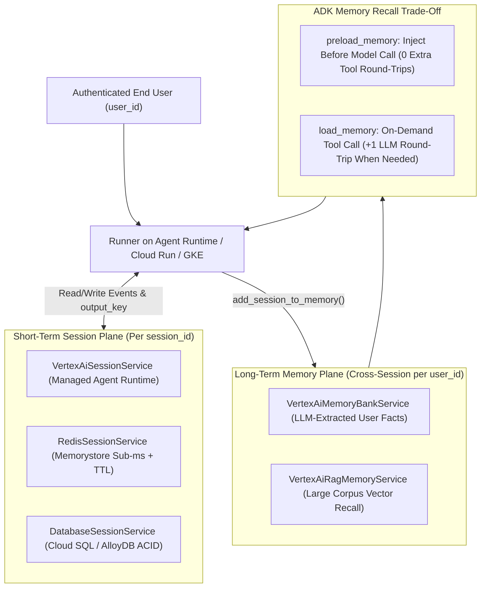

# Lab 09 — Managed Runtime Sessions & Memory Service Patterns

**Exam section:** 3. Developing custom agents (~33% of the exam)
**Objectives covered:** 3.1 Designing and building agentic workflows in code
**Time:** ~20 minutes · **Cost:** Free offline / Free live

---

> **Personal study repo — not affiliated with Google Cloud.** Official guidance: [cloud.google.com/learn/certification/agentic-architect](https://cloud.google.com/learn/certification/agentic-architect) · [Disclaimer](../../../DISCLAIMER.md)

## 1. Exam objectives covered

> Quoted verbatim from the official exam guide:
> - "Configuring sessions and memory (e.g., Agent Platform Memory Bank and managed sessions)"
> - "Building custom agents using open-source libraries (e.g., ADK)"

## 2. Explain it simply

Stateless LLM calls forget everything between turns. Enterprise agent architectures separate persistence into **two distinct planes** with completely different lifecycles, data shapes, and GCP backends:

1. **Managed Sessions (`BaseSessionService` — Short-Term Conversational State):** Stores the ordered turn-by-turn `Event` log and typed `Session.state` (`state_schema`) for **one active conversation** (`session_id`). Think *"what items are in the customer's cart right now?"*
2. **Memory Bank (`BaseMemoryService` — Long-Term Cross-Session Knowledge):** Consolidates durable user facts and preferences extracted across completed sessions, keyed by `(app_name, user_id)`. Think *"this customer prefers seating in aisle rows and has platinum status next month in a brand-new chat."*

When you deploy an ADK agent to **Agent Runtime** (`adk deploy agent_engine`), pairing **`VertexAiSessionService(project=..., location=..., agent_engine_id=...)`** with **`VertexAiMemoryBankService(project=..., location=..., agent_engine_id=...)`** delivers a **100% zero-ops managed stateful runtime**—no Redis clusters or SQL schemas to provision.

## 3. How it works



### 1. Managed Agent Runtime Pairing (`agent_engine_id`)

On **Agent Runtime** (formerly Vertex AI Agent Engine), both services bind to the same `agent_engine_id`:

- **`VertexAiSessionService(project, location, agent_engine_id)`:** Persists turn `Event` transcripts and structured `Session.state` mutations (`output_key`) serverlessly inside the Agent Platform perimeter (supporting VPC-SC and CMEK).
- **`VertexAiMemoryBankService(project, location, agent_engine_id)`:** Uses managed LLM extraction to distill completed session transcripts into concise, deduplicated semantic user facts—updating facts over time when preferences change rather than dumping raw transcripts verbatim.

### 2. `preload_memory` vs. `load_memory` Latency & Token Trade-Offs

| Built-In ADK Tool | Execution Timing | Extra LLM Round-Trips | Input Token Impact | Best Fit Scenario |
| :--- | :--- | :--- | :--- | :--- |
| **`preload_memory`** | Runs **proactively** inside the request preprocessor *before* the model call | **0** (single LLM turn) | **Higher base tokens** on every turn (memories always injected) | Personalized concierge / VIP support where user preferences matter on nearly every turn and P95 latency must stay low. |
| **`load_memory`** | Exposed as a callable tool; the LLM decides whether to invoke it | **+1** when called (**0** when skipped) | **Lower average tokens** (zero memory tokens on generic queries) | Technical troubleshooting or mixed-intent chat where <15% of turns require historical user recall. |

### 3. Session Backend Comparison & Migration

| Session Backend | Package | Latency / Durability Profile | When to Choose on Cloud Run / GKE / Agent Runtime |
| :--- | :--- | :--- | :--- |
| **`VertexAiSessionService`** | `google.adk.sessions` | Managed HTTPS API · Zero-ops serverless | Default choice for **Agent Runtime (`adk deploy agent_engine`)** or teams wanting zero database administration. |
| **`RedisSessionService`** | `google.adk.integrations.redis` | **Sub-millisecond** in-memory · `ttl_seconds` auto-expiry | High-QPS customer chat on **Cloud Run** or **GKE** via Serverless VPC Access / Direct VPC Egress to **Memorystore for Redis**. |
| **`DatabaseSessionService`** | `google.adk.sessions` | Relational **ACID transactions** · SQL auditability | Regulated financial/healthcare workflows on **Cloud SQL**, **AlloyDB**, or **Spanner** requiring multi-region relational durability and SQL compliance audits. |
| **`InMemorySessionService`** | `google.adk.sessions` | Process RAM only (ephemeral) | Local unit tests (`pytest`) and offline CI only—lost immediately on container scale-to-zero or restart! |

> **Seamless Promotion:** Use `adk migrate session` to migrate persisted sessions when moving an application between session backends.

### 4. Multi-Tenant Isolation & HIPAA / PCI Retention Hygiene

- **Strict `(app_name, user_id, session_id)` Isolation:** Never trust a `user_id` supplied in an LLM prompt! Derive `user_id` deterministically from the verified OAuth/IAP/OIDC JWT `sub` claim in the gateway/runner layer so Tenant B (`cust-202`) gets `None` if attempting to load Tenant A's (`cust-101`) `session_id` or memories.
- **Compliance Retention & PII/PHI Redaction:**
  - Configure `ttl_seconds` (e.g., `1800`–`3600`s) and `ssl=True` on `RedisSessionServiceConfig` so abandoned support carts expire automatically without lingering PII.
  - Scrub raw PCI card numbers (PAN) and unredacted HIPAA PHI via **Sensitive Data Protection (SDP)** or `before_agent_callback` *before* calling `add_session_to_memory()`—long-term `VertexAiMemoryBankService` should store safe operational facts (e.g., `"preferred pharmacy: downtown clinic"`), never raw SSNs or credit card numbers.

## 4. The decision that matters

| If the exam scenario asks for... | Choose | Why the alternatives fail |
| :--- | :--- | :--- |
| **Zero-ops managed short-term turns + cross-session user preferences on Agent Runtime** | **`VertexAiSessionService` + `VertexAiMemoryBankService`** sharing `agent_engine_id` | Self-managing Redis + custom Postgres fact tables adds unnecessary VPC/ops overhead on Agent Runtime. |
| **Sub-millisecond session reads for 25,000 concurrent chat users on Cloud Run with automatic 30-minute idle expiry** | **`RedisSessionService`** (`Memorystore for Redis`, `ttl_seconds=1800`, `ssl=True`) | `VertexAiSessionService` and SQL incur higher per-turn network/disk latency; `InMemorySessionService` loses state across Cloud Run instances. |
| **Always personalize every greeting without adding a tool-call round-trip** | **`preload_memory`** | `load_memory` forces the LLM to emit a tool call and wait for a second generation pass (+1 round-trip). |
| **Semantic recall over 50,000 pages of unstructured PDF engineering manuals** | **`VertexAiRagMemoryService`** (or RAG Engine tool) | `VertexAiMemoryBankService` is optimized for extracted user/entity facts, not massive document chunk corpora. |
| **Strict relational ACID audit trail of every state transition in Cloud SQL** | **`DatabaseSessionService`** | Standard Redis caches are not relational ACID ledgers. |

## 5. Hands-on A — offline (free)

Run the offline lab to instantiate the Agent Runtime managed session/memory pair (`agent_engine_id`), verify `RedisSessionServiceConfig` TTL/TLS fields and `DatabaseSessionService`, prove strict per-`user_id` tenant isolation asynchronously, and evaluate `preload_memory` vs. `load_memory` latency/token math:

```bash
./tracks/03_custom_agents/lab_09_sessions_and_memory/run_lab.sh
```

## 6. Hands-on B — live on Google Cloud (opt-in)

```bash
./tracks/03_custom_agents/lab_09_sessions_and_memory/run_lab.sh --live
```

> [!WARNING]
> Cost note: Provisioning a live Agent Runtime (`agent_engine_id`) or Memorystore instance takes several minutes and incurs hourly charges, so `--live` runs the verified local state/memory isolation suite at $0 cost and prints exact `adk deploy agent_engine` / `adk migrate session` commands.

## 7. Verify it worked

Confirm that all checks in `LabReport` and `pytest` pass:

- `VertexAiSessionService` and `VertexAiMemoryBankService` bind cleanly to `(project, location, agent_engine_id)`.
- Cross-tenant `get_session(app_name, user_id="cust-202", session_id=cust_101_session.id)` returns `None`, preventing cross-customer state leakage.
- `InMemoryMemoryService` recalls facts exclusively for the owning `user_id` and returns 0 hits for other tenants.
- `preload_memory` completes in **1 LLM call** per turn vs. **2 LLM calls** when `load_memory` triggers on-demand.

## 8. Troubleshooting

| Symptom | Cause | Fix |
| :--- | :--- | :--- |
| `ImportError: cannot import name 'RedisSessionService' from 'google.adk.sessions'` | Wrong module path | Import `RedisSessionService` and `RedisSessionServiceConfig` from `google.adk.integrations.redis`. |
| Cloud Run agent forgets conversation randomly on turn 3 | Using `InMemorySessionService` across horizontally scaled stateless containers | Replace with `VertexAiSessionService`, `RedisSessionService`, or `DatabaseSessionService`. |
| `StateSchemaError` when agent writes `output_key` | `output_key` name or Pydantic type mismatches `state_schema` | Ensure `AppState` declares a matching field and compatible type for every agent's `output_key`. |

## 9. Clean up

```bash
./tracks/03_custom_agents/lab_09_sessions_and_memory/cleanup.sh
```

No persistent cloud resources are provisioned.

## 10. Exam traps

- **`InMemorySessionService` on Cloud Run / GKE:** Classic exam anti-pattern! Stateless autoscaling routes Turn 2 to a different container replica than Turn 1, losing in-memory sessions. Always pick a shared external backend (`VertexAiSessionService`, `RedisSessionService`, or `DatabaseSessionService`).
- **Session State vs. Memory Bank:** Shopping cart items, multi-step wizard slots, and active tool outputs belong in **Session State** (`output_key`). Durable user preferences across weeks/months belong in **Memory Bank** (`VertexAiMemoryBankService`).
- **`preload_memory` vs. `load_memory`:** Choose `preload_memory` when minimizing round-trip latency is paramount; choose `load_memory` when memory is rarely needed and you want to save prompt tokens on routine turns.
- **Identity Spoofing via Prompt:** Never let an LLM fill `user_id` as a tool parameter! Bind `user_id` in the trusted host application from the authenticated OAuth/IAP token before calling `runner.run_async(user_id=...)`.

## 11. Check yourself

<details>
<summary>1. You deploy a customer support agent to Agent Runtime (<code>adk deploy agent_engine</code>). Management wants zero database infrastructure to maintain, persistent active chat turns, and automatic recall of customer communication preferences across months. Which exact pair of ADK services do you configure?</summary>
<code>VertexAiSessionService(project=..., location=..., agent_engine_id=...)</code> for short-term managed sessions and <code>VertexAiMemoryBankService(project=..., location=..., agent_engine_id=...)</code> for long-term cross-session extracted user facts.
</details>

<details>
<summary>2. A VIP travel concierge agent needs every single response grounded in the traveler's loyalty tier and seating preferences while keeping P95 response latency under 1.2 seconds. Should you attach <code>load_memory</code> or <code>preload_memory</code>?</summary>
<code>preload_memory</code>. It injects relevant Memory Bank facts proactively before the model call (0 extra LLM tool-call round-trips), whereas <code>load_memory</code> costs an extra tool-call generation pass on every turn that fetches preferences.
</details>

<details>
<summary>3. Why must a healthcare support agent redact raw PHI/SSN fields before calling <code>add_session_to_memory()</code>, and how does ADK isolate memories across patients?</summary>
Long-term memory persists across sessions, so storing raw PHI/PCI data expands compliance scope and retention risk; redact sensitive identifiers via Sensitive Data Protection (SDP) or lifecycle callbacks first, and rely on ADK's strict <code>(app_name, user_id)</code> partitioning bound to verified OAuth/OIDC identities so one patient's session can never query another patient's memories.
</details>
