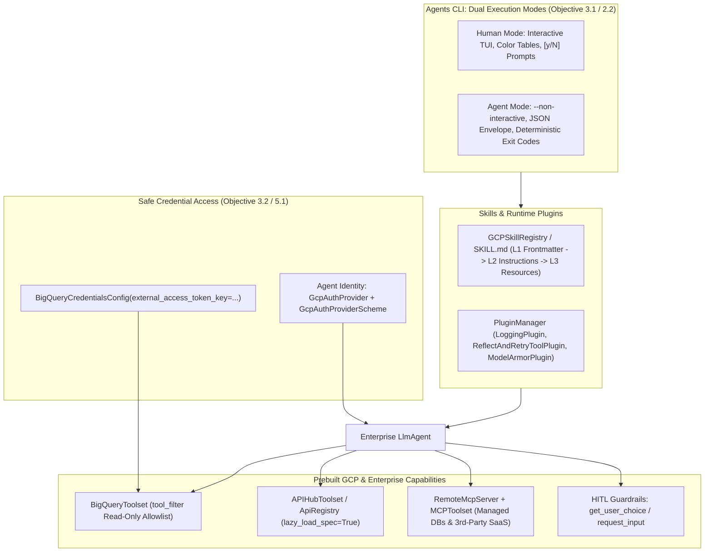

# Lab 10 — Agents CLI, Agent Identity & Prebuilt GCP MCP Toolsets

**Exam section:** 3. Developing custom agents (~33% of the exam)
**Objectives covered:** 3.1, 3.2, 2.2, 5.1
**Time:** ~25 minutes · **Cost:** Free offline / Free live

---

> **Personal study repo — not affiliated with Google Cloud.** Official guidance: [cloud.google.com/learn/certification/agentic-architect](https://cloud.google.com/learn/certification/agentic-architect) · [Disclaimer](../../../DISCLAIMER.md)

## 1. Exam objectives covered

> Quoted verbatim from the official exam guide:
> - "Configuring skills using Agents CLI (e.g., plugins and agent vs. human mode)"
> - "Configuring agent permissions (e.g., Agent Identity)"
> - "Using Google Cloud tools (e.g., Agent Registry, Google Cloud MCP Servers) to configure prebuilt and custom capabilities"
> - "Designing appropriate safety frameworks and guardrails (Agent Gateway, Model Armor, HITL)"

> [!WARNING]
> **Pre-GA / naming note.** The exam guide references *Agents CLI in Agent Platform* alongside `adk`. As recorded in `docs/VERIFIED_FACTS.md`, the locally verifiable SDK/CLI surface is `google-adk` (`adk` CLI, `google.adk.skills`, `google.adk.plugins`, `google.adk.integrations`). Both surfaces share the exact same **Agent Mode vs. Human Mode** automation principles and `SKILL.md` / `GCPSkillRegistry` contract taught here.

## 2. Explain it simply

Giving an enterprise agent "hands" safely requires solving four distinct architectural layers:

1. **Tool Layer (What can be called):** Prebuilt **Google Cloud MCP Servers** (BigQuery, Cloud SQL, AlloyDB, Spanner), Apigee **`APIHubToolset`**, 3rd-party SaaS MCP servers (`RemoteMcpServer` + `MCPToolset`), async **`LongRunningFunctionTool`**, and built-in **Human-in-the-Loop (HITL)** primitives (`request_input`, `get_user_choice`).
2. **Credential Layer (Who is calling — Agent Identity):** Never bake static service account JSON keys into containers or pass tokens inside LLM prompts. Use **Agent Identity** (`GcpAuthProvider` + `GcpAuthProviderScheme`) and token-key bindings (`BigQueryCredentialsConfig(external_access_token_key=...)`) to inject short-lived, least-privilege credentials outside the LLM's context window.
3. **Governance & Packaging Layer (Skills & Plugins):** Bundle instructions, `allowed_tools`, and reference assets into a versioned `Skill` (`SKILL.md`) stored in **`GCPSkillRegistry`**, and enforce cross-cutting runtime hooks (`LoggingPlugin`, `ReflectAndRetryToolPlugin`, `ModelArmorPlugin`) via `PluginManager`.
4. **CLI Automation Layer (Agents CLI — Agent Mode vs. Human Mode):** When a **human engineer** runs the CLI, interactive wizards, colorized tables, and `[y/N]` prompts prevent mistakes (**Human Mode**). When an **autonomous coding or orchestrator agent** (such as Antigravity or a CI pipeline) invokes the CLI, interactive prompts hang `stdin` forever—so **Agent Mode** enforces `--non-interactive`, machine-parseable JSON output, and deterministic exit codes.

## 3. How it works



### 1. Agents CLI: Agent Mode vs. Human Mode & Plugins

| Dimension | Human Mode (Interactive Operator) | Agent Mode (Autonomous Agent / CI Caller) |
| :--- | :--- | :--- |
| **Output Format** | ANSI colorized tables, progress spinners, human prose | Strict machine-parseable **JSON** (`--output=json`) on `stdout` |
| **Input / Prompts** | Interactive wizard prompts (`[y/N]`, OAuth browser popups) | **`--non-interactive`** — zero TTY reads so autonomous callers never hang |
| **Error Signaling** | Multi-line human stack traces | Deterministic non-zero exit code + structured JSON error code (`retryable: bool`) |
| **Plugin Workflow** | Interactive plugin browse & confirmation | Idempotent declarative plugin & skill sync (`plugins`, `GCPSkillRegistry`) |

### 2. Progressive Skill Disclosure (`L1` vs. `L2` vs. `L3`)

Loading 50 full enterprise skills into an agent's system prompt wastes tens of thousands of tokens on every turn. ADK solves this with **three-level progressive disclosure**:
- **L1 (`list_skills_in_dir` / `GCPSkillRegistry.search_skills`):** Parses **only** YAML `Frontmatter` (`name`, `description`, `allowed_tools`, `metadata`)—hundreds of tokens total so the agent discovers which skill matches the task.
- **L2 (`load_skill_from_dir` / `GCPSkillRegistry.get_skill`):** Loads the full Markdown `instructions` body *only* when that skill is activated.
- **L3 (`Skill.resources`):** Reads bundled `scripts/`, `references/`, and `assets/` on demand.

### 3. Safe Credential Access & Prebuilt GCP MCP Capabilities

- **Agent Identity (`GcpAuthProvider`, `GcpAuthProviderScheme`):** Binds workload or delegated OAuth 2.0 credentials to tool invocations without exposing secrets to the model.
- **`BigQueryToolset` + `BigQueryCredentialsConfig`:** Prebuilt BigQuery integration. Pass `external_access_token_key` to pull a pre-exchanged Agent Identity / OAuth token from the secure invocation context (note: ADK validates that `client_id`, `client_secret`, and `scopes` are **not** passed alongside `external_access_token_key`), and pass `tool_filter=["list_dataset_ids", "get_table_info", "execute_sql"]` plus dataset-level `roles/bigquery.dataViewer` + `roles/bigquery.jobUser` to enforce read-only SQL access.
- **`APIHubToolset` & `ApiRegistry`:** Turns OpenAPI specs governed in Apigee API Hub or MCP servers registered in Cloud API Registry into ADK tools (`lazy_load_spec=True` defers spec parsing until needed).
- **Prebuilt Google Cloud & 3rd-Party SaaS MCP Servers:** Connect to Cloud SQL, AlloyDB, Spanner, or external SaaS (Jira, Slack, ServiceNow) via `RemoteMcpServer(url=..., allowed_tools=[...])` + `MCPToolset`, or resolve governed endpoints dynamically via `AgentRegistry.get_mcp_toolset(...)`.

## 4. The decision that matters

| If the exam scenario asks for... | Choose | Why the distractors fail |
| :--- | :--- | :--- |
| **Antigravity or an orchestrator agent invokes Agents CLI commands autonomously without hanging** | **Agent Mode** (`--non-interactive`, `--output=json`, deterministic exit codes) | **Human Mode** emits ANSI spinners and blocks waiting for interactive TTY `[y/N]` input. |
| **Give an ADK agent read-only query access to BigQuery using dynamic caller tokens and zero JSON key files** | **`BigQueryToolset`** + **`BigQueryCredentialsConfig(external_access_token_key=...)`** + `tool_filter` + `roles/bigquery.dataViewer` | Passing `service_account_json` embeds long-lived exportable credentials; `roles/bigquery.admin` allows table deletion. |
| **Expose 80 enterprise REST APIs already catalogued in Apigee API Hub without writing 80 Python wrappers** | **`APIHubToolset(..., auth_scheme=GcpAuthProviderScheme(...), lazy_load_spec=True)`** | Hand-coding `FunctionTool` wrappers for dozens of OpenAPI specs creates schema drift and maintenance toil. |
| **Share governed instructions + `allowed_tools` across 15 engineering teams with minimal startup token overhead** | **`Skill` (`SKILL.md`)** in **`GCPSkillRegistry`** using L1 `Frontmatter` discovery | Copy-pasting giant system prompts into every repo causes policy drift and bloats base input tokens. |
| **Require explicit human approval ("Approve" / "Reject") before executing a production refund >$1,000** | **`get_user_choice`** (or `request_input` for free-text justification) | Prompt-only instructions ("please be careful") are soft guidance; HITL tools deterministically pause execution for human confirmation. |

## 5. Hands-on A — offline (free)

Run the offline lab to test **Agents CLI Agent Mode vs. Human Mode**, inspect L1 (`list_skills_in_dir`) vs. L2 (`load_skill_from_dir`) progressive skill disclosure on `weather-expert/SKILL.md`, configure **Agent Identity** (`GcpAuthProviderScheme`), instantiate **`BigQueryToolset`**, **`APIHubToolset`**, **`RemoteMcpServer`**, **`GCPSkillRegistry`**, and **`PluginManager`**, and verify HITL tool bindings:

```bash
./tracks/03_custom_agents/lab_10_tools_and_skills/run_lab.sh
```

## 6. Hands-on B — live on Google Cloud (opt-in)

```bash
./tracks/03_custom_agents/lab_10_tools_and_skills/run_lab.sh --live
```

> [!WARNING]
> Cost note: Offline-safe verification runs at $0 cost; live `GCPSkillRegistry` / `ApiRegistry` calls require provisioned registry resources in your sandbox project.

## 7. Verify it worked

Confirm that all checks in `LabReport` and `pytest` pass:

- Agents CLI **Agent Mode** produces valid JSON with `interactive_prompts=False` and deterministic `exit_code=0`, whereas **Human Mode** enables interactive TTY formatting.
- L1 `list_skills_in_dir` loads lightweight `Frontmatter` metadata (`weather-expert`), while L2 `load_skill_from_dir` hydrates full `instructions` and `resources`.
- `GcpAuthProviderScheme`, `BigQueryToolset` (`external_access_token_key`), `APIHubToolset` (`lazy_load_spec=True`), `RemoteMcpServer` (`allowed_tools`), `GCPSkillRegistry`, and `PluginManager` instantiate cleanly offline.

## 8. Troubleshooting

| Symptom | Cause | Fix |
| :--- | :--- | :--- |
| `ValidationError: If external_access_token_key is provided, client_id, client_secret, and scopes must not be provided` | Passing OAuth client fields alongside a pre-exchanged token key in `BigQueryCredentialsConfig` | Specify **only** `external_access_token_key` when Agent Identity / upstream auth already performed token exchange. |
| Autonomous agent hangs indefinitely when running a CLI subcommand | CLI invoked in **Human Mode**, waiting on interactive `[y/N]` confirmation | Switch to **Agent Mode** (`--non-interactive --output=json`). |
| `ImportError` importing `GcpAuthProvider` or `AgentRegistry` | Missing optional ADK extra | Install `google-adk[agent-identity]`. |

## 9. Clean up

```bash
./tracks/03_custom_agents/lab_10_tools_and_skills/cleanup.sh
```

No cloud resources are created.

## 10. Exam traps

- **Agent Mode vs. Human Mode in Agents CLI:** Whenever an AI agent (Antigravity, CI bot, orchestrator) calls a CLI tool, the exam answer requires **Agent Mode** (structured JSON output, `--non-interactive`, deterministic exit codes)—never parse human ASCII tables with regex!
- **Static SA Keys vs. Agent Identity:** Any answer choice mentioning downloading a service account JSON key (`GOOGLE_APPLICATION_CREDENTIALS=/app/key.json` or `service_account_json=...`) for Cloud Run / Agent Runtime / GKE is an immediate security anti-pattern. Always choose **Agent Identity** (`GcpAuthProviderScheme`) / Workload Identity.
- **Tool vs. Skill vs. Plugin:**
  - **Tool (`BaseTool` / `MCPToolset`):** A callable capability.
  - **Skill (`Skill` / `SKILL.md`):** A progressive-disclosure domain bundle (`Frontmatter` + `instructions` + `resources` + `allowed_tools`).
  - **Plugin (`BasePlugin`):** Lifecycle interceptor (`before_tool_callback`, `ReflectAndRetryToolPlugin`, `ModelArmorPlugin`) applied across all agent turns.
- **`ApiRegistry` vs. Offline Instantiation:** Note that `ApiRegistry(...)` fetches MCP server definitions from Google Cloud during `__init__`; use `AgentRegistry.get_mcp_toolset(...)` or `RemoteMcpServer(allowed_tools=[...])` when binding specific governed MCP tools.

## 11. Check yourself

<details>
<summary>1. Your platform team integrates Agents CLI into an autonomous Antigravity workflow that evaluates and promotes ADK skills nightly. The pipeline intermittently hangs forever in CI. What is the root cause and fix?</summary>
The CLI is running in <strong>Human Mode</strong> and blocking on an interactive TTY confirmation prompt (or browser auth prompt). Configure <strong>Agent Mode</strong> (<code>--non-interactive</code> with machine-parseable JSON output and non-interactive Workload Identity credentials).
</details>

<details>
<summary>2. How does ADK's L1/L2/L3 skill architecture allow an agent to have access to 200 enterprise skills in <code>GCPSkillRegistry</code> without exhausting context tokens?</summary>
At L1, the agent inspects only compact <code>Frontmatter</code> metadata (<code>name</code>, <code>description</code>, <code>allowed_tools</code>) via <code>search_skills</code> / <code>list_skills_in_dir</code>. Full L2 Markdown <code>instructions</code> and L3 <code>resources</code> are loaded exclusively for the 1–2 skills selected for the current turn.
</details>

<details>
<summary>3. An agent needs to query customer order tables in BigQuery using the end-user's delegated OAuth token stored in the session under key <code>user_bq_token</code>, and must never run DDL/DML statements. How do you configure ADK?</summary>
Instantiate <code>BigQueryCredentialsConfig(external_access_token_key="user_bq_token")</code> (without <code>client_id</code>/<code>scopes</code>), pass it to <code>BigQueryToolset(credentials_config=..., tool_filter=["list_dataset_ids", "get_table_info", "execute_sql"])</code>, and grant only dataset-level <code>roles/bigquery.dataViewer</code> + <code>roles/bigquery.jobUser</code>.
</details>
