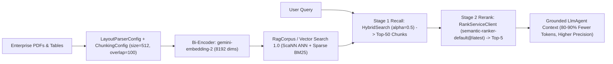

# Lab 11 — RAG Engine, Two-Stage Reranking API & Vector Search 1.0

**Exam section:** 3. Developing custom agents (~33% of the exam)
**Objectives covered:** 3.2 Integrating enterprise domain knowledge
**Time:** ~25 minutes · **Cost:** Free offline / ~$0.02 live

---

> **Personal study repo — not affiliated with Google Cloud.** Official guidance: [cloud.google.com/learn/certification/agentic-architect](https://cloud.google.com/learn/certification/agentic-architect) · [Disclaimer](../../../DISCLAIMER.md)

## 1. Exam objectives covered

> Quoted verbatim from the official exam guide:
> - "Designing, configuring, and managing RAG pipelines and vector retrieval systems (embedding models, similarity scoring, reranking) using services such as vector databases (e.g., Vector Search and Agent Retrieval)"

> [!WARNING]
> **SDK & naming note.** The exam guide uses **Agent Search** (formerly *Vertex AI Search*) and **Agent Retrieval / RAG Engine**. In Python, the installed Vertex AI SDK exposes RAG Engine under `from vertexai.preview import rag` (emitting a `UserWarning` noting ongoing SDK consolidation toward the newer `google-genai` / Agent Platform client surfaces), while standalone cross-encoder reranking lives in `google.cloud.discoveryengine_v1.RankServiceClient`. Know both the architectural concepts and these exact SDK primitives.

## 2. Explain it simply

Single-stage vector search is rarely accurate enough for enterprise production. A **bi-encoder** embedding model (`gemini-embedding-2`, 8,192 dimensions) embeds the user's query and every document chunk **independently** so an Approximate Nearest Neighbor (ANN) index can scan millions of vectors in milliseconds. Because query and chunk never attend to each other token-by-token during embedding, bi-encoders struggle with:

- **Exact identifiers & error codes** (`ERR-409-PCI`, SKU numbers, regulatory clauses) -> solved by **Hybrid Search** (combining dense semantic vectors + sparse keyword BM25 via **Reciprocal Rank Fusion [RRF]**).
- **Subtle negations & policy exceptions** (*"Which economy tickets are NOT eligible for a 24-hour refund?"* vs. *"24-hour refund eligibility"*) -> solved by **Stage-2 Cross-Encoder Reranking** (`Discovery Engine Ranking API`), which scores `(query, candidate_chunk)` pairs **jointly** through full transformer cross-attention, pruning Top-50 recall candidates down to the Top-5 highest-precision chunks before calling the LLM.

## 3. How it works



### 1. Vertex AI RAG Engine (`vertexai.preview.rag`) Primitives

| RAG Engine Class | Key Parameters | Why the Exam Cares |
| :--- | :--- | :--- |
| **`RagCorpus`** | `display_name`, `backend_config` / `vector_db` (`RagManagedDb`, `VertexVectorSearch`, AlloyDB, Spanner, Pinecone, Weaviate), `encryption_spec` | Modular managed RAG plane where you choose the vector store and CMEK key while Google manages ingestion & retrieval APIs. |
| **`TransformationConfig` + `ChunkingConfig`** | `chunk_size=512`, `chunk_overlap=100` | Overlap prevents facts split across chunk boundaries from losing semantic context. |
| **`LayoutParserConfig`** | `processor_name`, `max_parsing_requests_per_min` | Uses Document AI Layout Parser so multi-column PDFs and financial/clinical tables are chunked along structural table/section boundaries instead of slicing mid-row! |
| **`HybridSearch`** | `alpha=0.5` (`1.0` = pure dense semantic, `0.0` = pure sparse keyword) | Fuses dense vector similarity with sparse BM25 lexical matching via Reciprocal Rank Fusion (RRF). |
| **`RagRetrievalConfig` + `Ranking`** | `top_k=50`, `filter=Filter(...)`, `ranking=Ranking(rank_service=RankService(...))` or `llm_ranker=LlmRanker(...)` | Orchestrates metadata/distance filtering, hybrid recall, and server-side Stage-2 reranking in one API call. |

### 2. Discovery Engine Ranking API (`RankServiceClient`) vs. `LlmRanker`

Inside RAG Engine (or standalone via `google.cloud.discoveryengine_v1`), you have two reranking options:

1. **`RankService(model_name="semantic-ranker-default@latest")` / `RankServiceClient.rank(RankRequest(...))` (Default Choice):** Dedicated cross-encoder neural reranker accepting up to ~200 `RankingRecord(id, title, content)` candidates and returning relevance-scored `top_n` records in tens of milliseconds at a fraction of LLM cost.
2. **`LlmRanker(model_name=...)`:** Uses a generative LLM to reason over candidate relevance—higher latency and token cost, reserved for complex domain-specific rubric reranking where a standard cross-encoder is insufficient.

### 3. Why Two-Stage Retrieval Wins on Latency, Cost & Hallucinations

- **Bi-Encoder ANN (`Vector Search 1.0` ScaNN):** $O(\log N)$ sub-15 ms lookup across 100M+ chunks -> **high recall** (`top_k=50`–`100`), coarse ranking.
- **Cross-Encoder Reranker (`RankServiceClient`):** $O(K)$ cross-attention over only $K=50$ candidates -> **high precision** (`top_n=5`).
- Feeding **Top-5** reranked chunks instead of stuffing **Top-50** noisy chunks into `LlmAgent` cuts context input tokens by **~90%**, avoids the LLM *"lost-in-the-middle"* failure mode, and sharply reduces hallucinations.

### 4. Retrieval Architecture Comparison: Agent Search vs. RAG Engine vs. Vector Search 1.0

| Capability | Agent Search (`VertexAiSearchTool`) | Vertex AI RAG Engine (`VertexAiRagMemoryService` / `rag`) | Vector Search 1.0 (ScaNN Index) |
| :--- | :--- | :--- | :--- |
| **Operational Model** | Turn-key managed SaaS search & grounding | Modular developer RAG orchestration API | Low-level managed vector ANN index |
| **Native SaaS Connectors & ACLs** | **Yes** — SharePoint, Drive, Jira, Confluence + **Document-Level ACL identity propagation** | Partial ingestion sources (GCS, Drive, Slack, Jira); custom app-layer ACL filtering | **No** — bring your own embeddings, chunker, and metadata `restricts` |
| **Custom Chunking & Layout Parser** | Managed defaults (limited tuning) | **Full control** (`ChunkingConfig`, `LayoutParserConfig`) | DIY in your own ingestion pipeline (Dataflow / Spark) |
| **Index Update Modes** | Managed continuous sync | Managed `import_files` / `upload_file` | **Streaming updates** (real-time seconds) vs. **Batch updates** (cost-efficient periodic rebuilds) |
| **SQL Joins on Existing Operational Data** | Use BigQuery connector | Pluggable AlloyDB / Spanner vector backends | Prefer **AlloyDB `pgvector` / ScaNN** or **BigQuery `VECTOR_SEARCH`** if tabular joins dominate |

## 4. The decision that matters

| If the exam scenario asks for... | Choose | Why the distractors fail |
| :--- | :--- | :--- |
| **Enterprise intranet search across SharePoint, Google Drive, and Jira enforcing per-user Document-Level ACLs out of the box** | **Agent Search** (`VertexAiSearchTool`) | Building custom SharePoint ACL sync on raw Vector Search 1.0 takes months of brittle permissions engineering. |
| **Custom 512-token overlap chunking + Document AI table-aware PDF parsing + cross-encoder reranking with pluggable vector DB** | **Vertex AI RAG Engine** (`TransformationConfig` + `LayoutParserConfig` + `RankService`) | Agent Search hides low-level chunking/vector-DB swaps; raw Vector Search 1.0 lacks built-in parsing and reranking orchestration. |
| **Sub-15 ms ANN similarity over 200M custom multimodal product embeddings with real-time streaming updates and metadata `restricts` inside a Private Service Connect VPC** | **Vector Search 1.0** (Streaming Index + ScaNN) | Agent Search and RAG Engine target document/text RAG rather than billion-scale custom item-to-item ANN indexes. |
| **RAG agent retrieves Top-50 chunks containing the right keywords, yet hallucinates on policy negation questions and burns excessive prompt tokens** | Add **Stage-2 Reranking** (`RankServiceClient` / `semantic-ranker-default@latest` pruning Top-50 -> Top-5) + **`HybridSearch`** | Increasing `top_k` to 100 without a reranker worsens prompt noise and cost; fine-tuning the LLM does not fix retrieval ranking. |
| **Joining semantic similarity directly with live customer orders in an existing PostgreSQL transactional database** | **AlloyDB AI (`pgvector` + `alloydb_scann`)** | Exporting live transactional rows into a separate vector database introduces dual-write sync lag. |

## 5. Hands-on A — offline (free)

Run the offline lab to instantiate real **Vertex AI RAG Engine** objects (`RagCorpus`, `TransformationConfig`, `ChunkingConfig`, `LayoutParserConfig`, `RagRetrievalConfig`, `HybridSearch`, `Ranking`, `RankService`, `LlmRanker`), build a **Discovery Engine `RankRequest`** (`RankServiceClient` + `RankingRecord`), bind ADK's `VertexAiRagMemoryService` & `VertexAiSearchTool`, and execute a deterministic **Two-Stage Retrieval (Bi-Encoder + RRF Hybrid + Cross-Encoder Reranking)** benchmark proving negation rescue and 90% context-token savings:

```bash
./tracks/03_custom_agents/lab_11_rag_and_retrieval/run_lab.sh
```

## 6. Hands-on B — live on Google Cloud (opt-in)

Pass `--live` with `GOOGLE_CLOUD_PROJECT` and `GOOGLE_API_KEY` set to call the live `gemini-embedding-2` endpoint and verify its 8,192-dimensional output vector:

```bash
./tracks/03_custom_agents/lab_11_rag_and_retrieval/run_lab.sh --live
```

> [!WARNING]
> Cost note: Live mode embeds a single short sentence using `gemini-embedding-2`, costing <$0.001.

## 7. Verify it worked

Confirm that all checks in `LabReport` and `pytest` pass:

- `TransformationConfig` configures `chunk_size=512`, `chunk_overlap=100` alongside `LayoutParserConfig`.
- `RagRetrievalConfig` combines `top_k=50`, `HybridSearch(alpha=0.5)`, and `Ranking(rank_service=RankService(model_name="semantic-ranker-default@latest"))`.
- `discoveryengine_v1.RankRequest` packages `RankingRecord` candidates and prunes Top-50 down to `top_n=5` (90% context-chunk reduction).
- Stage-2 cross-encoder reranking promotes the exact negation-matching policy chunk to Rank #1 over a high-cosine lexical distractor.

## 8. Troubleshooting

| Symptom | Cause | Fix |
| :--- | :--- | :--- |
| Tables in financial/medical PDFs produce garbled answers | Naive fixed-character chunking splits table headers from row values | Configure `LayoutParserConfig` (Document AI Layout Parser) during `rag.import_files(...)`. |
| Exact part numbers (`SKU-8841-X`) miss in pure vector search | Dense embeddings smooth over rare alphanumeric tokens | Enable `HybridSearch(alpha=0.5)` to fuse dense cosine similarity with sparse BM25 keyword scores via RRF. |
| `403 PERMISSION_DENIED` calling `RankServiceClient.rank` | Workload SA missing Discovery Engine ranking permission | Grant least-privilege `roles/discoveryengine.viewer` on the target project (never `roles/discoveryengine.admin`). |

## 9. Clean up

```bash
./tracks/03_custom_agents/lab_11_rag_and_retrieval/cleanup.sh
```

No persistent cloud corpora or indexes are created in this lab.

## 10. Exam traps

- **RAG vs. Fine-Tuning for Frequently Changing Policies:** Never fine-tune model weights to teach dynamic factual documents, pricing tables, or ACL-restricted records—use RAG so updates take effect immediately upon re-indexing and citations remain auditable.
- **Embedding Model & Dimension Trap:** Current default embedding model is **`gemini-embedding-2`** (**8,192** input token limit / 8,192 dimensions in live API). Changing embedding models requires **re-embedding the entire corpus** because vector spaces from different models are mathematically incompatible.
- **`RankService` vs. `LlmRanker`:** Default to `RankService` (`semantic-ranker-default@latest`) for fast, cheap cross-encoder reranking; reach for `LlmRanker` only when custom prompt-based listwise reasoning justifies LLM latency.
- **Vector Search 1.0 Streaming vs. Batch Index:** Choose **Streaming Update** only when sub-minute freshness is required (higher cost); choose **Batch Update** when hourly/nightly index refreshes meet business SLAs at lower cost.

## 11. Check yourself

<details>
<summary>1. Why do production RAG pipelines retrieve Top-50 chunks with <code>gemini-embedding-2</code> + Vector Search and then pass those 50 chunks to <code>discoveryengine_v1.RankServiceClient</code> to keep only Top-5?</summary>
Bi-encoder ANN search scales logarithmically ($O(\log N)$) across millions of chunks for high recall, but embeds query and chunk separately. Passing only the Top-50 candidates into a cross-encoder reranker (<code>semantic-ranker-default@latest</code>) runs joint token-by-token query-chunk attention for high precision, cutting downstream LLM prompt tokens by ~90% and reducing hallucinations.
</details>

<details>
<summary>2. A hospital wants an agent to answer questions from 10,000 complex multi-column PDF clinical schedules containing dense dosage tables, using custom 512-token chunks and AlloyDB as the backing vector store. Should they choose Agent Search, Vertex AI RAG Engine, or raw Vector Search 1.0?</summary>
<strong>Vertex AI RAG Engine</strong>, configured with <code>LayoutParserConfig</code> (to preserve PDF table structure), <code>TransformationConfig(chunking_config=ChunkingConfig(chunk_size=512, chunk_overlap=100))</code>, AlloyDB vector backend, and <code>RankService</code> reranking.
</details>

<details>
<summary>3. Users complain that searching exact error code <code>ORA-01555</code> in a pure dense-vector RAG system returns vague conceptual database articles instead of the exact runbook. What RAG Engine feature fixes this?</summary>
Enable <strong>Hybrid Search</strong> (<code>rag.HybridSearch(alpha=0.5)</code>), which combines sparse keyword/BM25 lexical matching (exact <code>ORA-01555</code> match) with dense semantic embeddings using Reciprocal Rank Fusion (RRF).
</details>
