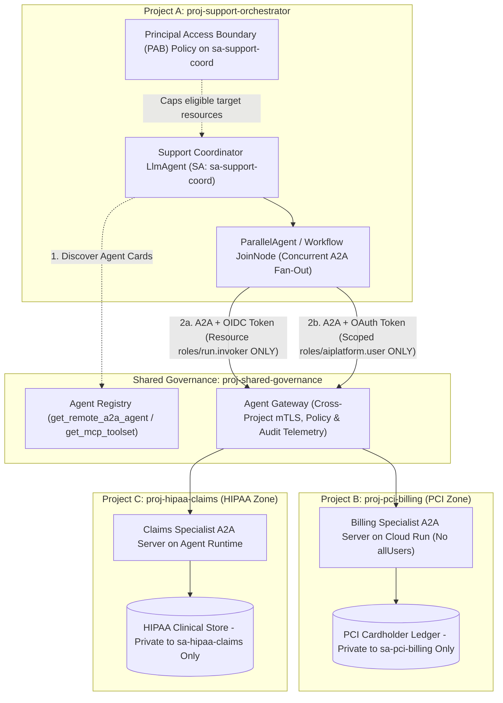
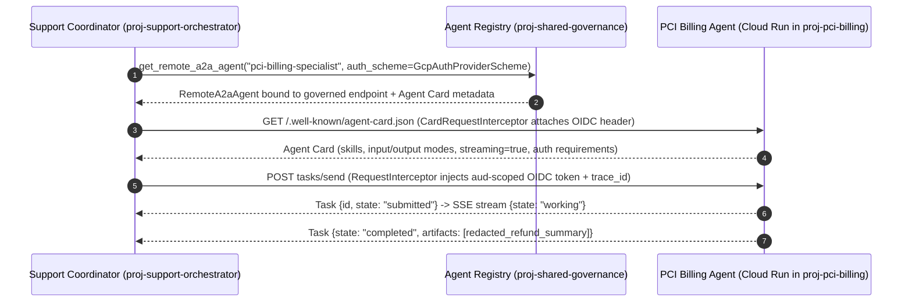

# Lab 12 — Multi-Agent Orchestration & Cross-Project A2A

**Exam section:** 3. Developing custom agents (~33% of the exam)
**Objectives covered:** 3.3 Orchestrating and coordinating agentic workflows
**Time:** ~30 minutes · **Cost:** Free offline / Free live

---

> **Personal study repo — not affiliated with Google Cloud.** Official guidance: [cloud.google.com/learn/certification/agentic-architect](https://cloud.google.com/learn/certification/agentic-architect) · [Disclaimer](../../../DISCLAIMER.md)

## 1. Exam objectives covered

> Quoted verbatim from the official exam guide:
> - "Orchestrating agents using agentic protocols (e.g., MCP and A2A)"
> - "Selecting and coordinating multiagent handoffs and workflows (parallel, sequential, graph workflow) using Google Cloud tools (Agent Identity, Agent Registry, Agent Runtime, agent policies)"

## 2. Explain it simply

Inside a single Python process, ADK agents share memory and delegate via `Workflow` edges or `sub_agents`. Across **separate Google Cloud projects, compliance zones (PCI / HIPAA), runtimes, or organizations**, sharing process memory or raw database credentials violates zero-trust isolation.

Enterprise multi-agent architectures use two complementary open protocols governed by a central discovery and identity plane:

- **MCP (Model Context Protocol — Vertical Agent-to-Tool):** Connects an agent to deterministic tools, APIs, and database queries (`RemoteMcpServer`, `MCPToolset`).
- **A2A (Agent-to-Agent Protocol — Horizontal Agent-to-Agent):** Delegates an autonomous goal/task to a remote peer agent (`RemoteA2aAgent`) without exposing the peer's internal prompts, private tools, or underlying databases.
- **Agent Registry + Agent Identity + PAB (Discovery & Zero-Trust IAM Plane):** Discovers remote A2A Agent Cards and MCP servers dynamically (`AgentRegistry.get_remote_a2a_agent`, `get_mcp_toolset`), authenticates cross-project calls with least-privilege OIDC/OAuth tokens (`roles/run.invoker`, `roles/aiplatform.user`), and caps blast radius with **Principal Access Boundary (PAB)** policies.

## 3. How it works

### Cross-Project Zero-Trust A2A Reference Topology



### The A2A Task Lifecycle & Agent Card Handshake

A2A is asynchronous and task-oriented (`submitted` -> `working` / `input-required` -> `completed` / `failed`), allowing long-running cross-project investigations without HTTP socket timeouts:



### 1. Cross-Project Least-Privilege IAM Rules (~30–35% of Exam!)

1. **Dedicated Identity per Agent:** `sa-support-coord@proj-support-orchestrator.iam.gserviceaccount.com` represents *only* the Coordinator. Never reuse the default Compute Engine service account.
2. **Resource-Scoped Invoker Only (Zero Direct Data Access):**
   - To invoke `pci-billing-agent` on Cloud Run in `proj-pci-billing`, grant `sa-support-coord` **`roles/run.invoker` on that single Cloud Run service resource**—never at the `proj-pci-billing` project level, never `--allow-unauthenticated` (`allUsers`), and **zero** IAM bindings on `proj-pci-billing`'s BigQuery or Cloud SQL tables!
   - To invoke `hipaa-claims-agent` on Agent Runtime in `proj-hipaa-claims`, grant `sa-support-coord` **`roles/aiplatform.user`** (scoped via IAM Condition to the target `ReasoningEngine` resource)—never `roles/aiplatform.admin` or raw PHI `roles/storage.objectViewer`.
3. **Auth Interceptors & Agent Identity (`RemoteA2aAgent`):**
   - Instantiate `RemoteA2aAgent(name=..., agent_card=..., auth_scheme=GcpAuthProviderScheme(...), config=A2aRemoteAgentConfig(request_interceptors=[...], card_request_interceptors=[...]))` (or resolve directly via `AgentRegistry.get_remote_a2a_agent(...)`).
4. **Blast-Radius Capping with Principal Access Boundary (PAB):**
   - Bind a **PAB policy** to `sa-support-coord` restricting the principal's eligible resources exclusively to the approved A2A gateway/service resources. Even if prompt injection tricks the coordinator into calling another GCP API, IAM denies the request at the boundary!

### 2. Cross-Project Latency Trade-Offs & Fan-Out Optimization

| Coordination Strategy | Wire & Auth Overhead | Total Latency Formula | Architectural Guidance |
| :--- | :--- | :--- | :--- |
| **In-Process `Workflow` / `ParallelAgent`** | **0 ms** (same memory space) | $\max_i(T_i)$ or $\sum T_i$ | Best when specialists share the same trust boundary, codebase, and deployment lifecycle. |
| **Serial Cross-Project `RemoteA2aAgent` Calls** | $k \times (T_{\text{TLS/OIDC}} + T_{\text{gateway}})$ | $\sum_{i=1}^{k} (T_{\text{net},i} + T_{\text{remote},i})$ | **High tail latency** if an orchestrator queries PCI Billing and HIPAA Claims one after another via `AgentTool`. |
| **Parallel Cross-Project `RemoteA2aAgent` Fan-Out** | Concurrent TLS/OIDC | $\max_{i} (T_{\text{net},i} + T_{\text{remote},i})$ | Wrap independent `RemoteA2aAgent` peers inside a **`ParallelAgent`** or parallel **`Workflow` -> `JoinNode`** to slash cross-project wall-clock latency! |

## 4. The decision that matters

| If the exam scenario asks for... | Choose | Why the distractors fail |
| :--- | :--- | :--- |
| **Coordinator in `proj-orchestrator` must delegate a dispute investigation to an autonomous Billing Agent on Cloud Run in `proj-pci-billing` without accessing PCI tables** | **`RemoteA2aAgent`** discovered via **`AgentRegistry`**, authenticated with **`roles/run.invoker`** on the `pci-billing` Cloud Run service + **PAB** | Granting `sa-support-coord` `roles/bigquery.dataViewer` on `proj-pci-billing` leaks raw PCI data into the non-PCI orchestrator project; `MCPToolset` exposes raw tools rather than opaque agentic reasoning. |
| **Agent needs to execute deterministic read-only SQL queries against a governed AlloyDB/BigQuery server** | **MCP** (`MCPToolset` / `RemoteMcpServer` via `AgentRegistry.get_mcp_toolset`) | A2A is for delegating tasks to autonomous peer *agents*, not invoking stateless database query tools. |
| **Coordinator calls 3 remote A2A specialist agents across 3 projects and breaches its 2.5 s SLA (each remote agent takes ~1.4 s)** | Orchestrate the 3 `RemoteA2aAgent` instances concurrently via **`ParallelAgent`** or **`Workflow` fan-out + `JoinNode`** | Calling 3 remote agents sequentially ($3 \times 1.4\text{ s} = 4.2\text{ s}$) or via serial `AgentTool` synthesis turns exceeds the 2.5 s budget. |
| **Prevent specialists in a hub-and-spoke supervisor tree from transferring control laterally to unapproved peer agents** | Set **`disallow_transfer_to_peers=True`** on specialist agents + enforce **Agent Gateway** / **PAB** policies | Prompt-only instructions ("do not talk to peers") are bypassable under adversarial prompt injection. |

## 5. Hands-on A — offline (free)

Run the offline lab to construct the complete **Cross-Project Customer Support A2A Architecture** (`RemoteA2aAgent`, `A2aRemoteAgentConfig` with `RequestInterceptor` & `CardRequestInterceptor`, `GcpAuthProviderScheme`, `AgentRegistry`, `RemoteMcpServer`), validate least-privilege cross-project IAM policies (rejecting `allUsers`, `roles/editor`, and direct cross-project DB grants), and benchmark parallel vs. sequential cross-project A2A latency:

```bash
./tracks/03_custom_agents/lab_12_multi_agent_and_a2a/run_lab.sh
```

## 6. Hands-on B — live on Google Cloud (opt-in)

```bash
./tracks/03_custom_agents/lab_12_multi_agent_and_a2a/run_lab.sh --live
```

> [!WARNING]
> Cost note: Multi-project Cloud Run / Agent Runtime A2A topologies require separate deployed GCP projects, so `--live` runs the verified offline architecture & IAM policy verifier at $0 cost and prints exact `gcloud run services add-iam-policy-binding` least-privilege commands.

## 7. Verify it worked

Confirm that all checks in `LabReport` and `pytest` pass:

- `RemoteA2aAgent` instances (`pci_billing_specialist`, `hipaa_claims_specialist`) bind `GcpAuthProviderScheme` and `A2aRemoteAgentConfig` (`RequestInterceptor`, `CardRequestInterceptor`) cleanly.
- `AgentRegistry` exposes both `get_remote_a2a_agent` and `get_mcp_toolset` for zero-hardcoded-URL discovery.
- Cross-project IAM validator approves resource-scoped `roles/run.invoker` + `roles/aiplatform.user` + PAB and flags `allUsers`, `roles/editor`, and cross-project `roles/bigquery.admin` violations.
- Wrapping cross-project `RemoteA2aAgent` peers in a `ParallelAgent` cuts simulated 2-project A2A latency from **2,760 ms** down to **1,480 ms**.

## 8. Troubleshooting

| Symptom | Cause | Fix |
| :--- | :--- | :--- |
| `403 Forbidden` when Coordinator calls Cloud Run A2A endpoint in `proj-pci-billing` | Missing `roles/run.invoker` on the target Cloud Run service or OIDC token missing `aud` claim matching the Cloud Run URL | Grant resource-level `roles/run.invoker` to `sa-support-coord` and configure OIDC audience via `GcpAuthProviderScheme` / interceptor. |
| `ImportError` importing `RemoteA2aAgent` or `A2aRemoteAgentConfig` | Missing `a2a-sdk` extra | Install `google-adk[a2a]`. |
| `RuntimeError: Failed to get default Google Cloud credentials` instantiating `AgentRegistry` in CI | `AgentRegistry.__init__` resolves ADC (`google.auth.default()`) eagerly | Configure Workload Identity / ADC in cloud environments, or mock `google.auth.default` with `AnonymousCredentials` in unauthenticated offline unit tests. |

## 9. Clean up

```bash
./tracks/03_custom_agents/lab_12_multi_agent_and_a2a/cleanup.sh
```

No persistent cloud resources are created.

## 10. Exam traps

- **MCP vs. A2A:** **MCP** = Agent-to-Tool (structured parameters -> deterministic function/DB execution). **A2A** = Agent-to-Agent (natural-language/multimodal task goal -> opaque peer reasoning, Agent Card capability negotiation, streaming task lifecycle).
- **Project-Level IAM vs. Resource-Level IAM Across Projects:** Granting `roles/run.invoker` at the *project* level in `proj-pci-billing` lets the orchestrator invoke **every** Cloud Run service in the PCI project! Always bind `roles/run.invoker` on the **specific Cloud Run service** (`gcloud run services add-iam-policy-binding pci-billing-agent ...`) and pair with **Principal Access Boundary (PAB)**.
- **Sharing Underlying Databases Instead of A2A Encapsulation:** Never give an orchestrator agent in `proj-support-orchestrator` direct `roles/cloudsql.client` or `roles/bigquery.dataViewer` on regulated `proj-pci-billing` or `proj-hipaa-claims` stores when an A2A specialist agent can enforce domain redaction and return only the minimum necessary compliance-safe summary.
- **Hardcoding A2A URLs:** Never hardcode ephemeral Cloud Run revision URLs across repositories—resolve Agent Cards and MCP servers dynamically via **`AgentRegistry`**.

## 11. Check yourself

<details>
<summary>1. A Customer Support Coordinator agent in <code>proj-support-orchestrator</code> must ask a Billing Specialist agent running on Cloud Run in <code>proj-pci-billing</code> whether an invoice qualifies for reversal. What is the exact minimum IAM configuration required?</summary>
Run the Coordinator under a dedicated service account (<code>sa-support-coord@proj-support-orchestrator.iam.gserviceaccount.com</code>), deploy the Billing Cloud Run service with authentication required (no <code>allUsers</code>), grant <code>sa-support-coord</code> <strong>resource-level <code>roles/run.invoker</code></strong> on only the <code>pci-billing-agent</code> Cloud Run service (zero direct access to PCI databases), attach an audience-scoped OIDC token on the A2A call, and bind a Principal Access Boundary (PAB) policy to <code>sa-support-coord</code>.
</details>

<details>
<summary>2. Your orchestrator queries both the PCI Billing A2A agent (1,300 ms including network/auth) and the HIPAA Claims A2A agent (1,500 ms including network/auth) for every combined account inquiry. Using two <code>AgentTool</code> wrappers causes P95 latency to exceed 3.5 seconds. How do you cut latency below 2.2 seconds?</summary>
Compose the two <code>RemoteA2aAgent</code> instances inside a <code>ParallelAgent</code> (or a parallel <code>Workflow</code> fan-out with a <code>JoinNode</code>) feeding a single synthesis step. The two cross-project A2A tasks execute concurrently in $\max(1300, 1500) = 1,500\text{ ms}$, eliminating both serial remote waiting and back-to-back parent LLM tool-call round-trips.
</details>

<details>
<summary>3. Which Google Cloud service lets an ADK agent dynamically resolve both a governed <code>RemoteA2aAgent</code> and a governed <code>MCPToolset</code> at runtime without hardcoding URLs?</summary>
<strong>Agent Registry</strong> (<code>google.adk.integrations.agent_registry.AgentRegistry</code> via <code>get_remote_a2a_agent(...)</code> and <code>get_mcp_toolset(...)</code>).
</details>
