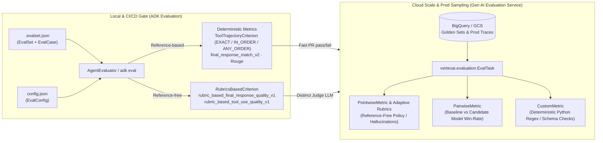

# Lab 13 — Agent Evaluation: Deterministic Metrics vs. Rubrics & Gen AI Evaluation Service

**Exam section:** 4.1 Evaluating agents in development and in production (~22% of the exam)
**Objectives covered:** 4.1 (Creating test sets for agent evaluation, continuous evaluation pipelines, determining appropriate evaluation framework and tooling — ADK evaluation tooling [evalset], Agent Platform Gen AI evaluation service, custom autoraters — and evaluating response & retrieval quality)
**Time:** ~30 minutes · **Cost:** Free offline / ~$0.05 live

---

> **Personal study repo — not affiliated with Google Cloud.** Official guidance: [cloud.google.com/learn/certification/agentic-architect](https://cloud.google.com/learn/certification/agentic-architect) · [Disclaimer](../../../DISCLAIMER.md)

## 1. Exam objectives covered

> Quoted verbatim from the official exam guide:
> - "Creating test sets for agent evaluation (golden data, prompts, edge cases)"
> - "Creating continuous evaluation pipelines to assess an agent's tool execution against success criteria"
> - "Determining the appropriate evaluation framework and tooling (ADK evaluation tooling (evalset), Agent Platform Gen AI evaluation service, custom autoraters)"
> - "Evaluating an agentic system against a golden dataset to assess response and retrieval quality"

## 2. Explain it simply

Agent evaluation has two fundamentally different ways to grade an agent turn, and **confusing a Metric with a Rubric — or local `adk eval` with the cloud Gen AI Evaluation Service — is one of the highest-frequency exam traps**:

1. **Deterministic / Reference-Based Metric (`ToolTrajectoryCriterion`, `final_response_match_v1` / `v2`, `Rouge`):** Compares what the agent actually did against a **pre-written golden answer or expected tool call list** (`expected_tool_use`, `reference`). It is fast, deterministic, and costs $0 in LLM judge tokens — ideal for every pull-request CI check. However, it **requires fixed golden references** and breaks whenever an agent phrases a valid answer differently or invokes a harmless extra helper tool.
2. **Rubric-Based Evaluation (`Rubric`, `RubricContent`, `RubricsBasedCriterion`, Adaptive Rubrics):** Decomposes quality, safety, and policy compliance into **explicit natural-language pass/fail questions** graded by a distinct autorater LLM (`JudgeModelOptions`), such as *"Did the pharmacy support agent verify `member_id` and DOB before disclosing HIPAA prescription status?"*. Rubrics work **reference-free** (no golden response text needed!) and catch subtle policy, tone, and sequencing violations.
3. **Local ADK Evaluation (`adk eval` / `AgentEvaluator`) vs. Agent Platform Gen AI Evaluation Service (`vertexai.evaluation.EvalTask`):** Use **`adk eval`** with `.evalset.json` during developer iteration and CI/CD unit/trajectory regression gates. Use the cloud **Gen AI Evaluation Service** when evaluating **thousands of rows in BigQuery/GCS**, running **Pairwise win-rate (`PairwiseMetric`) A/B comparisons** during model or prompt upgrades, generating **Adaptive Rubrics** dynamically per prompt, or scoring sampled production traces.

## 3. How it works



### Deep Comparison: ADK Deterministic Metric vs. Rubric

| Dimension | Deterministic / Reference-Based Metric | Rubric-Based Autorater (`RubricsBasedCriterion` / Adaptive Rubrics) |
| :--- | :--- | :--- |
| **ADK 2.9.0 Classes & Keys** | `ToolTrajectoryCriterion` (`MatchType.EXACT`, `IN_ORDER`, `ANY_ORDER`), `tool_trajectory_avg_score`, `final_response_match_v1`, `final_response_match_v2`, `response_match_score` (`Rouge`) | `Rubric`, `RubricContent`, `RubricsBasedCriterion`, `JudgeModelOptions`, `rubric_based_final_response_quality_v1`, `rubric_based_tool_use_quality_v1`, `rubric_based_multi_turn_trajectory_quality_v1` |
| **Requires Golden Reference?** | **Yes** — requires `final_response` text or `intermediate_data.tool_uses` in `.evalset.json`. | **No (Reference-Free capable)** — grades the actual transcript against explicit natural-language criteria (`text_property`). |
| **Determinism & Cost** | 100% deterministic, sub-millisecond, zero LLM judge token cost (except semantic v2). | Non-deterministic LLM judge; mitigated via `JudgeModelOptions(num_samples=3)` majority/mean aggregation. |
| **Primary Failure Mode** | **False negatives** when valid responses paraphrase or call an extra read-only diagnostic tool (`EXACT` mode). | **Self-preference bias** if `judge_model` equals the agent's own model, or vague rubric wording. |
| **Best Exam Use Case** | Verifying exact tool parameter schemas, deterministic math/JSON outputs, and fast GitHub/Cloud Build PR gates. | Regulated compliance (e.g., *"Verified HIPAA identity before disclosing order ETA"*), tone, empathy, multi-turn goal completion, and production trace sampling. |

### Trajectory Match Modes (`ToolTrajectoryCriterion.MatchType`)

- **`EXACT`**: Actual tool calls must match the golden list 1-for-1 in count, order, and arguments. Fails if the agent calls an optional read-only helper (`check_weather_advisory`).
- **`IN_ORDER`**: Every required golden tool call must appear in the exact required order (`verify_patient_identity` **before** `lookup_prescription_order`), while allowing extra diagnostic tool calls in between. **Best default for regulated HIPAA/financial workflows.**
- **`ANY_ORDER`**: Required tools can run in any sequence (e.g., fetching weather and store hours in parallel). **Dangerous for security gates** because calling `lookup_prescription_order` *before* `verify_patient_identity` would still score `1.0`!

### ADK Evaluation vs. Agent Platform Gen AI Evaluation Service

- **ADK Evaluation (`AgentEvaluator`, `adk eval`, `adk eval_set`, `adk test`):**
  - Runs locally in pytest or CI containers against `.evalset.json` / `.test.json` files managed via `adk eval_set create`, `adk eval_set add_eval_case`, and `adk eval_set generate_eval_cases`.
  - Can bridge to Vertex AI evaluators via `vertex_ai_eval_facade`.
- **Agent Platform Gen AI Evaluation Service (`vertexai.evaluation.EvalTask`):**
  - Managed cloud evaluation service integrated with Vertex AI Experiments, BigQuery, and Cloud Storage.
  - **`PointwiseMetric`**: Scores a single model/agent output against a static or **Adaptive Rubric** (rubrics dynamically generated per prompt to test prompt-specific constraints at scale).
  - **`PairwiseMetric`**: Compares **Model A (baseline)** vs. **Model B (candidate)** head-to-head and outputs win/tie/loss rates — the exam-standard answer when evaluating a model migration (e.g., moving from Pro to a fine-tuned Flash/Gemma tier).
  - **`CustomMetric`**: Runs a deterministic Python function alongside cloud autoraters (e.g., regex checking zero raw SSNs/MRNs in outputs).
  - **`hallucinations_v1`**: Evaluates groundedness of final and intermediate natural-language responses (`evaluate_intermediate_nl_responses=True`) against retrieved RAG/tool context.

## 4. The decision that matters

| Exam Scenario | Choose This Tooling & Criterion | Why the Alternatives Fail |
| :--- | :--- | :--- |
| Fast pull-request CI check ensuring `verify_patient_identity` always precedes `lookup_prescription_order`, even if optional helper tools run | **ADK `adk eval` + `ToolTrajectoryCriterion(match_type=IN_ORDER)`** | `EXACT` breaks on benign helper tools; `ANY_ORDER` misses the HIPAA sequence violation; `final_response_match_v1` ignores tool calls completely. |
| Evaluating whether a healthcare support agent uses empathetic tone and refuses unverified PHI requests across open-ended prompts with no golden text | **ADK `RubricsBasedCriterion` (`rubric_based_final_response_quality_v1` + `rubric_based_tool_use_quality_v1`)** | Reference-based metrics (`Rouge` / `final_response_match_v1`) cannot run without pre-authored golden answers and fail on valid paraphrases. |
| Comparing win-rate between `gemini-3.7-flash` and a candidate model across 5,000 historical customer tickets in BigQuery | **Agent Platform Gen AI Evaluation Service (`EvalTask` + `PairwiseMetric`)** | Local `adk eval` scores a single agent pointwise; `PairwiseMetric` directly measures head-to-head preference win rates at cloud scale with Vertex AI Experiments tracking. |
| Auditing 5% of live production conversations daily for ungrounded claims and prompt-specific compliance | **Gen AI Evaluation Service (`EvalTask` + Adaptive Rubrics + `hallucinations_v1`)** | Live production traffic has no pre-written golden answers; Adaptive Rubrics + groundedness autoraters grade live traces reference-free. |

## 5. Hands-on A — offline (free)

```bash
./tracks/04_evaluate_and_deploy/lab_13_agent_evaluation/run_lab.sh
```

The offline runner validates `.evalset.json` (`EvalSet`) and `config.json` (`EvalConfig`) against ADK 2.9.0's real Pydantic schemas, proves the difference between `EXACT`, `IN_ORDER`, and `ANY_ORDER` on a HIPAA pharmacy tool trajectory, instantiates `Rubric` + `RubricsBasedCriterion` with a distinct `JudgeModelOptions` model, and constructs a cloud `vertexai.evaluation.EvalTask` combining `PointwiseMetric`, `PairwiseMetric`, `CustomMetric`, and `Rouge`.

## 6. Hands-on B — live on Google Cloud (opt-in)

Configure your project and API credentials:

```bash
export GOOGLE_CLOUD_PROJECT="your-project-id"
export GOOGLE_CLOUD_LOCATION="us-central1"
```

Run the live ADK evaluator or CLI commands:

```bash
./tracks/04_evaluate_and_deploy/lab_13_agent_evaluation/run_lab.sh --live

# Equivalent ADK CLI workflow:
adk eval tracks/04_evaluate_and_deploy/lab_13_agent_evaluation \
  tracks/04_evaluate_and_deploy/lab_13_agent_evaluation/.evalset.json \
  --config_file_path=tracks/04_evaluate_and_deploy/lab_13_agent_evaluation/config.json \
  --print_detailed_results
```

> [!WARNING]
> Cost note: Live evaluation invokes both the agent model (`gemini-3.7-flash`) and the autorater judge model (`gemini-3.8-flash` with `num_samples=3`). Running two eval cases costs less than $0.05.

## 7. Verify it worked

1. Confirm `.evalset.json` parses cleanly into `google.adk.evaluation.eval_set.EvalSet` with both a reference-backed trajectory case (`case_01_verified_hipaa_order_lookup`) and a reference-free rubric case (`case_02_unverified_caller_refusal`).
2. Confirm `ToolTrajectoryCriterion` with `IN_ORDER` scores `1.0` when `check_weather_advisory` runs between `verify_patient_identity` and `lookup_prescription_order`, while scoring `0.0` if `lookup_prescription_order` is called before verification.
3. Confirm `JudgeModelOptions.judge_model` (`gemini-3.8-flash`) differs from `AGENT_MODEL` (`gemini-3.7-flash`).

## 8. Troubleshooting

| Symptom | Cause | Fix |
| :--- | :--- | :--- |
| `Not evaluated. No score was produced` (`EvalStatus.NOT_EVALUATED`) | Judge model hit Vertex AI quota limits, lacked permissions, or `expected_invocation` was omitted for a reference-required metric. | Use reference-free `rubric_based_final_response_quality_v1` when golden `final_response` is absent, or verify `roles/aiplatform.user` and quota for `judge_model`. |
| CI trajectory test fails whenever the agent calls an extra read-only lookup tool | `ToolTrajectoryCriterion` defaults to `EXACT` matching. | Switch `match_type` in `config.json` from `"EXACT"` to `"IN_ORDER"`. |
| Agent passes `final_response_match_v2` even though it guessed the order ETA without calling any tool | Final-response metrics inspect only the final text turn, ignoring `intermediate_data.tool_uses`. | Always pair response metrics with `tool_trajectory_avg_score` or `rubric_based_tool_use_quality_v1`. |
| High variance in LLM-as-judge rubric scores across runs | Single-sample LLM autorating (`num_samples=1`) has sampling noise. | Set `num_samples` (e.g., `3` or `5`) inside `judge_model_options` and write atomic binary Yes/No rubrics instead of vague 1–10 scales. |

## 9. Clean up

```bash
./tracks/04_evaluate_and_deploy/lab_13_agent_evaluation/cleanup.sh
```

## 10. Exam traps

- **Metric vs. Rubric:** If the question states *"there is no single correct wording / no golden reference response, and you must enforce domain policy rules (such as HIPAA verification or financial disclaimers)"*, **eliminate deterministic string metrics (`Rouge`, `BLEU`, `final_response_match_v1`)** and select **Rubric-based evaluation (`RubricsBasedCriterion` / Adaptive Rubrics)**.
- **`ANY_ORDER` Security Blind Spot:** Never choose `ANY_ORDER` when a security or authentication tool (`verify_patient_identity`) **must** execute prior to a data-access tool (`lookup_prescription_order`). Choose **`IN_ORDER`**.
- **Self-Preference Bias in Autoraters:** Never use the exact same model to generate responses and judge them if a distinct/stronger judge model is available (`DEFAULT_JUDGE_MODEL` != `DEFAULT_AGENT_MODEL`).
- **Pointwise vs. Pairwise on Model Upgrades:** When an exam question asks *"How do you decide whether migrating from Model X to a cheaper SLM degrades quality across 10,000 prompts?"*, choose **Gen AI Evaluation Service with `PairwiseMetric`** (win-rate comparison), not manual spot-checking or ROUGE.

## 11. Check yourself

<details>
<summary>1. What is the core architectural difference between an ADK Metric (like `final_response_match_v1` or `ToolTrajectoryCriterion`) and an ADK Rubric (`RubricsBasedCriterion`)?</summary>
A deterministic Metric is **reference-based** — it compares the agent's output or tool sequence against a pre-authored golden target in `.evalset.json`. A Rubric is **criterion-based (and works reference-free)** — an autorater LLM grades the agent's turn against decomposed natural-language pass/fail questions (`RubricContent.text_property`) without requiring fixed golden phrasing.
</details>

<details>
<summary>2. Your healthcare customer-support agent must call `verify_patient_identity` before `lookup_prescription_order`, and may optionally call `check_weather_advisory` in between. Which `ToolTrajectoryCriterion.MatchType` should you configure?</summary>
`IN_ORDER`. `EXACT` would falsely fail whenever the optional `check_weather_advisory` tool is invoked, while `ANY_ORDER` would dangerously pass if `lookup_prescription_order` were called before `verify_patient_identity`.
</details>

<details>
<summary>3. When should you move from local `adk eval` to the Agent Platform Gen AI Evaluation Service (`vertexai.evaluation.EvalTask`)?</summary>
When running large-scale batch evaluations over BigQuery/GCS datasets, computing head-to-head model upgrade win rates via `PairwiseMetric`, generating dynamic **Adaptive Rubrics** per prompt, or continuously evaluating sampled production traces in Vertex AI Experiments.
</details>
