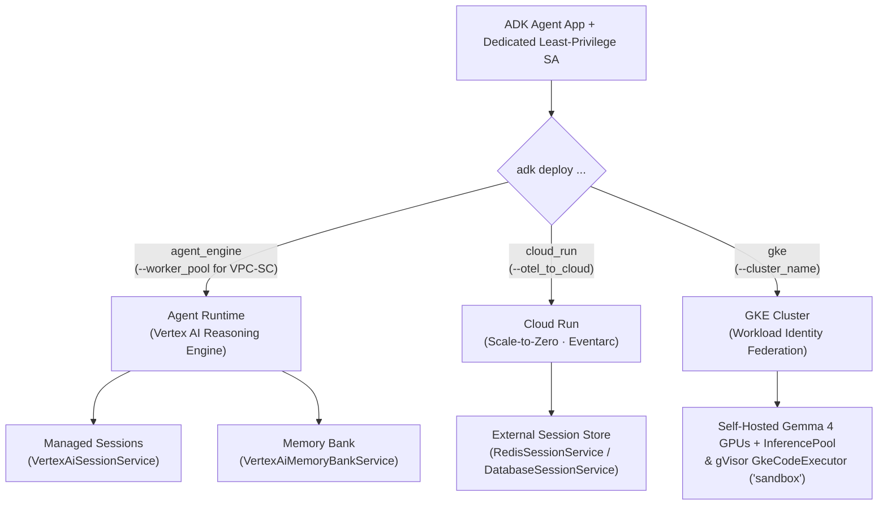

# Lab 14 — Deployment Runtimes, Managed Sessions & Memory Bank

**Exam section:** 4.2 Deploying and scaling production workloads (~22% of the exam) & 3.1 Sessions and memory
**Objectives covered:** 4.2 (Selecting optimal deployment runtime based on use case, requirements, and cost — Agent Runtime, Cloud Run, GKE), 3.1 (Configuring sessions and memory — Agent Platform Memory Bank and managed sessions)
**Time:** ~25 minutes · **Cost:** Free offline / ~$1.00 live

---

> **Personal study repo — not affiliated with Google Cloud.** Official guidance: [cloud.google.com/learn/certification/agentic-architect](https://cloud.google.com/learn/certification/agentic-architect) · [Disclaimer](../../../DISCLAIMER.md)

## 1. Exam objectives covered

> Quoted verbatim from the official exam guide:
> - "Selecting optimal deployment runtime based on use case, requirements, and cost (Agent Runtime, Cloud Run, GKE)"
> - "Configuring sessions and memory (e.g., Agent Platform Memory Bank and managed sessions)"

## 2. Explain it simply

The exam does **not** test generic Google Cloud VM trivia here — it tests **how your deployment runtime interacts with multi-turn agent state, long-term memory, network perimeters, and workload identity**:

- **Agent Runtime (`adk deploy agent_engine`):** Managed Vertex AI hosting purpose-built for ADK agents. It wires directly into **managed sessions (`VertexAiSessionService`)**, **Agent Platform Memory Bank (`VertexAiMemoryBankService`)**, managed code sandboxes (`AgentEngineSandboxCodeExecutor`), and dedicated **Agent Identity**. Choose this whenever you call SaaS Gemini models and want minimal operational overhead.
- **Cloud Run (`adk deploy cloud_run`):** Serverless containers that **scale to zero ($0 idle cost)** and trigger cleanly from **Eventarc / Pub/Sub / webhooks**. Because Cloud Run containers are ephemeral and stateless, `InMemorySessionService` loses conversation history whenever requests hit another replica — you **must** attach an external state backend (`RedisSessionService` on Memorystore, `DatabaseSessionService` on Cloud SQL/AlloyDB, or `VertexAiSessionService`).
- **GKE (`adk deploy gke`):** Kubernetes clusters required only when you hit Agent Runtime's architectural boundaries: **self-hosting open-weight SLMs/LLMs on GPUs (`Gemma 4`)**, **GKE Inference Gateway (`InferencePool` KV-cache & LoRA routing)**, or **kernel-isolated `GkeCodeExecutor(executor_type="sandbox")` on gVisor**.

## 3. How it works



### Runtime, State & Identity Architecture Matrix

| Dimension | Agent Runtime (`adk deploy agent_engine`) | Cloud Run (`adk deploy cloud_run`) | GKE (`adk deploy gke`) |
| :--- | :--- | :--- | :--- |
| **Idle Cost & Scaling** | Managed warm instances; billed on active Reasoning Engine compute | **Scales to zero ($0 idle)**; rapid HTTP & Eventarc burst scaling | Node pools run 24/7 (Autopilot/HPA scales pods & GPU nodes) |
| **Short-Term Turn State (`SessionService`)** | Native **`VertexAiSessionService`** (`agentengine://`) | Must configure external **`RedisSessionService`** (`redis://`) or **`DatabaseSessionService`** | External `RedisSessionService`, `DatabaseSessionService`, or `VertexAiSessionService` |
| **Long-Term Cross-Session Recall (`MemoryService`)** | Native **`VertexAiMemoryBankService`** (synthesizes durable user facts across sessions) | `VertexAiMemoryBankService` or `VertexAiRagMemoryService` (`rag://`) | `VertexAiMemoryBankService` or self-hosted vector store |
| **Code Execution Sandbox** | `AgentEngineSandboxCodeExecutor` | `CloudRunSandboxCodeExecutor(allow_egress=False)` (`--with_cloud_run_sandbox`) | `GkeCodeExecutor(executor_type="sandbox")` (gVisor `runsc` kernel isolation) |
| **VPC-SC & Private Build** | Pass **`--worker_pool=projects/.../workerPools/...`** so Cloud Build stays inside VPC-SC | Serverless VPC Access / Direct VPC Egress + private Cloud Build pool | Private GKE cluster (`ClusterIP` / Internal Load Balancer) |
| **Workload Identity Best Practice** | Dedicated **Agent Identity** / custom Reasoning Engine SA | Dedicated per-service Cloud Run SA (`--service_account=...`) | **GKE Workload Identity Federation** (`iam.gke.io/gcp-service-account` per Kubernetes SA) |

> [!CAUTION]
> **Critical Security Anti-Pattern Tested on the Exam:** Never deploy an agent on Cloud Run, GKE nodes, or Agent Runtime using the **default Compute Engine Service Account** (`<PROJECT_NUMBER>-compute@developer.gserviceaccount.com`), which traditionally receives broad project-wide `roles/editor` permissions. Always provision a dedicated, single-purpose Service Account / Agent Identity with least-privilege predefined roles.

## 4. The decision that matters

| If the scenario requires... | Choose | Why the alternatives are wrong |
| :--- | :--- | :--- |
| Fastest path to production for a multi-turn customer support ADK agent needing managed conversation state and cross-session user preference recall | **Agent Runtime (`adk deploy agent_engine`) + `VertexAiSessionService` + `VertexAiMemoryBankService`** | Cloud Run requires provisioning and operating external Redis/SQL session stores; GKE adds unnecessary cluster ops overhead. |
| Deploying to Agent Runtime inside an enterprise **VPC Service Controls (VPC-SC)** perimeter where default Cloud Build fails with perimeter violations | **`adk deploy agent_engine --worker_pool=projects/...`** | Default Cloud Build runs outside your VPC-SC perimeter; a private Cloud Build `--worker_pool` keeps container builds inside the perimeter. |
| Bursty internal webhook / PubSub / Eventarc agent invoked only ~40 times a day where idle compute cost must be $0 | **Cloud Run (`adk deploy cloud_run`) + `RedisSessionService` / `DatabaseSessionService`** | GKE GPU/CPU nodes and always-warm clusters waste budget during 23+ hours of daily idle time. |
| Regulated air-gapped healthcare/finance agent serving open-weight `gemma-4-26b-a4b-it` on NVIDIA L4 GPUs with prefix-cache routing and gVisor code sandboxes | **GKE (`adk deploy gke`) + GKE Inference Gateway + `GkeCodeExecutor(executor_type="sandbox")`** | Agent Runtime cannot attach custom GPU node pools for vLLM serving or configure `InferencePool` KV-cache routing. |

## 5. Hands-on A — offline (free)

```bash
./tracks/04_evaluate_and_deploy/lab_14_deployment_runtimes/run_lab.sh
```

The offline runner instantiates ADK 2.9.0's real `VertexAiSessionService`, `VertexAiMemoryBankService`, `AgentEngineSandboxCodeExecutor`, `RedisSessionServiceConfig`, and `CloudRunSandboxCodeExecutor`, generates exact VPC-SC and stateless-safe `adk deploy` CLI commands, and runs a security/statefulness auditor that catches `InMemorySessionService` and default Compute Engine SA anti-patterns.

## 6. Hands-on B — live on Google Cloud (opt-in)

```bash
export GOOGLE_CLOUD_PROJECT="your-project-id"
export GOOGLE_CLOUD_LOCATION="us-central1"

# Deploy to Agent Runtime (with private Cloud Build worker pool if inside VPC-SC):
adk deploy agent_engine tracks/04_evaluate_and_deploy/lab_14_deployment_runtimes \
  --project="$GOOGLE_CLOUD_PROJECT" \
  --region="$GOOGLE_CLOUD_LOCATION"

# Or deploy to Cloud Run with dedicated SA and Cloud Trace export:
adk deploy cloud_run tracks/04_evaluate_and_deploy/lab_14_deployment_runtimes \
  --project="$GOOGLE_CLOUD_PROJECT" \
  --region="$GOOGLE_CLOUD_LOCATION" \
  --otel_to_cloud
```

> [!WARNING]
> Cost note: Cloud Run bills per-request CPU/memory with a generous free tier. Agent Runtime bills for active Reasoning Engine instance hours. Delete live test deployments when finished.

## 7. Verify it worked

1. Confirm `VertexAiSessionService` and `VertexAiMemoryBankService` bind cleanly to `(project, location, agent_engine_id)`.
2. Confirm `CloudRunSandboxCodeExecutor(allow_egress=False)` disables arbitrary outbound internet access inside the sandbox.
3. Confirm `validate_runtime_identity_and_state` rejects `<project-number>-compute@developer.gserviceaccount.com`, `InMemorySessionService` in multi-replica production, and missing `--worker_pool` under VPC-SC.

## 8. Troubleshooting

| Symptom | Cause | Fix |
| :--- | :--- | :--- |
| Multi-turn Cloud Run agent forgets user context on turn 2 or 3 | Default `InMemorySessionService` stores state in one container's RAM while load balancing hits a second replica. | Pass `--session_service_uri` backed by Memorystore (`RedisSessionService`), Cloud SQL (`DatabaseSessionService`), or `VertexAiSessionService`. |
| `adk deploy agent_engine` fails with VPC Service Controls violation during container build | Default Cloud Build pool runs outside the project's VPC-SC perimeter. | Create a Cloud Build Private Pool inside the perimeter and pass `--worker_pool=projects/.../locations/.../workerPools/...`. |
| Agent remembers turns *within* one chat tab, but forgets the user's preferences when they open a *new* session tomorrow | Only `SessionService` (short-term state) was configured without `MemoryService` (long-term recall). | Attach `VertexAiMemoryBankService` and equip the agent with `load_memory` / `preload_memory` tools. |
| Security review blocks Cloud Run / GKE deployment for excessive blast radius | Workload runs as `<number>-compute@developer.gserviceaccount.com` with `roles/editor`. | Create a dedicated Service Account with only `roles/aiplatform.user` (plus specific tool roles) and bind via `--service_account` or Workload Identity Federation. |

## 9. Clean up

```bash
./tracks/04_evaluate_and_deploy/lab_14_deployment_runtimes/cleanup.sh
```

If you deployed live resources:
```bash
gcloud run services delete simple-agent --region="$GOOGLE_CLOUD_LOCATION" --quiet
# Or for Agent Runtime:
# gcloud ai reasoning-engines delete REASONING_ENGINE_ID --region="$GOOGLE_CLOUD_LOCATION" --quiet
```

## 10. Exam traps

- **"Agent Runtime" == `adk deploy agent_engine`:** The exam blueprint calls the managed service **Agent Runtime**, while the ADK CLI subcommand is `adk deploy agent_engine` (backed by Vertex AI Reasoning Engine).
- **Sessions vs. Memory Bank:** **Managed Sessions (`VertexAiSessionService`)** store chronological turn-by-turn events and state keys for *one active conversation*. **Agent Platform Memory Bank (`VertexAiMemoryBankService`)** extracts and persists long-term semantic memories *across separate sessions* for the same user.
- **Four `adk deploy` Targets:** ADK 2.9.0 exposes exactly four `adk deploy` targets: `agent_engine`, `cloud_run`, `gke`, and `docker` (which builds a container locally without pushing to a managed runtime).

## 11. Check yourself

<details>
<summary>1. A retail customer-support agent deployed on Cloud Run intermittently forgets items the customer mentioned two messages earlier during peak traffic. What is the root cause and fix?</summary>
Cloud Run autoscaled across multiple stateless container instances while the agent was still using `InMemorySessionService`. Fix it by configuring a shared external session store (`RedisSessionService` on Memorystore, `DatabaseSessionService`, or `VertexAiSessionService`).
</details>

<details>
<summary>2. How do `VertexAiSessionService` and `VertexAiMemoryBankService` differ in an Agent Runtime architecture?</summary>
`VertexAiSessionService` manages short-term, turn-by-turn conversation history and session state within a single session ID, whereas `VertexAiMemoryBankService` distills and retrieves long-term user facts and preferences across multiple sessions over weeks or months.
</details>

<details>
<summary>3. Your security team enforces VPC Service Controls (VPC-SC) and bans default service accounts. Which two configurations are mandatory when running `adk deploy agent_engine`?</summary>
Pass `--worker_pool` pointing to a private Cloud Build worker pool inside the VPC-SC perimeter, and bind a dedicated least-privilege Agent Identity / custom Service Account rather than the default Compute Engine service account.
</details>
