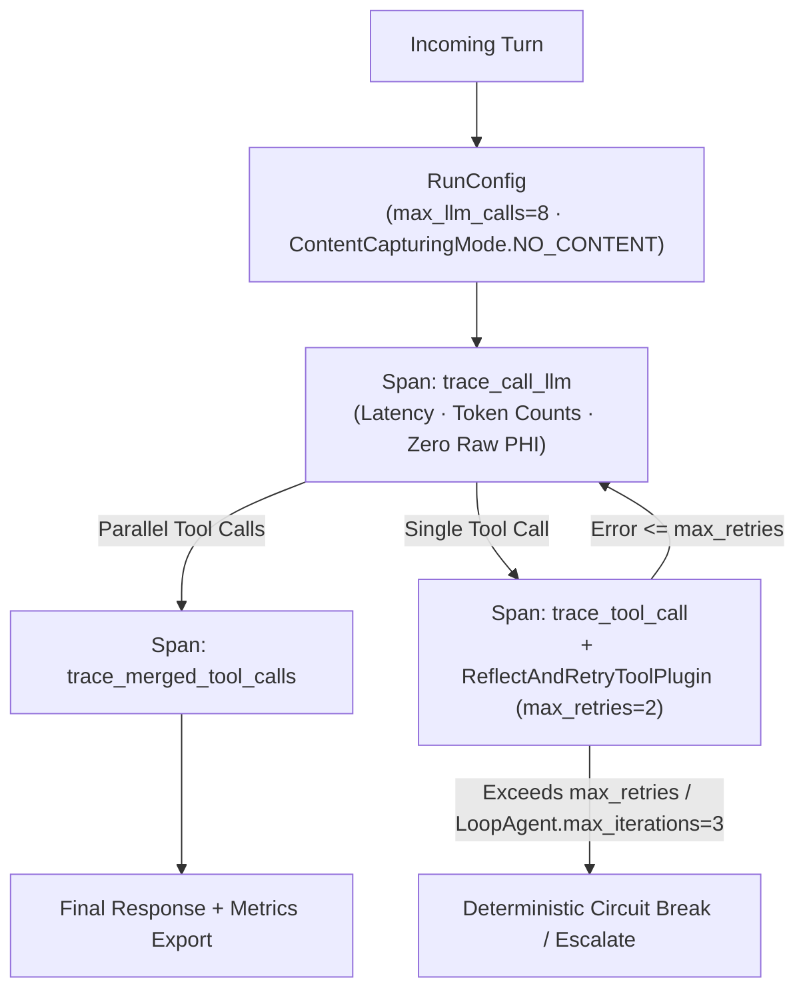

# Lab 15 — Observability, Loop Guardrails & HIPAA-Safe Telemetry

**Exam section:** 4.2 Deploying and scaling production workloads (~22% of the exam)
**Objectives covered:** 4.2 (Troubleshooting agent issues — drift, tool invocation latency, agent reasoning loops, system failures; monitoring and optimizing agents for performance, reliability, and cost)
**Time:** ~30 minutes · **Cost:** Free offline / ~$0.05 live

---

> **Personal study repo — not affiliated with Google Cloud.** Official guidance: [cloud.google.com/learn/certification/agentic-architect](https://cloud.google.com/learn/certification/agentic-architect) · [Disclaimer](../../../DISCLAIMER.md)

## 1. Exam objectives covered

> Quoted verbatim from the official exam guide:
> - "Troubleshooting agent issues (drift, tool invocation latency, agent reasoning loops, system failures)"
> - "Monitoring and optimizing agents for performance, reliability, and cost"

## 2. Explain it simply

A traditional HTTP dashboard only tells you *"POST `/run` returned `200 OK` in 18 seconds."* For an autonomous agent, 18 seconds could mean three completely different emergencies requiring opposite fixes:
1. **Tool Invocation Latency (`trace_tool_call`):** The LLM responded in 400 ms, while a downstream SQL or ERP API hung for 17 seconds — or the agent called five independent tools sequentially instead of batching them in parallel (`trace_merged_tool_calls`).
2. **LLM Generation Latency (`trace_call_llm`):** Tool calls took 200 ms, while the LLM spent 17 seconds prefilling 400,000 uncompacted conversation tokens or running an over-provisioned Pro reasoning model on a trivial routing turn.
3. **Agent Reasoning Loop:** Both the LLM and tool are fast, yet the tool keeps returning a recoverable schema error and the agent retries it 25 times in a row, burning tokens until the gateway times out.

In **HIPAA and PCI-regulated environments**, turning on naive debug logging creates a second crisis: raw patient PHI (names, SSNs, diagnoses) gets written directly into Cloud Trace span attributes and Cloud Logging! ADK 2.9.0 solves both problems with **structured OpenTelemetry spans**, **hard loop-termination caps**, and **`ContentCapturingMode.NO_CONTENT`**.

## 3. How it works



### Core ADK 2.9.0 Observability, Loop & Optimization Controls

1. **OpenTelemetry Span Hierarchy (`google.adk.telemetry`):**
   - `trace_call_llm`: Records model latency, `gen_ai.usage.input_tokens`, and `gen_ai.usage.output_tokens`.
   - `trace_tool_call` & `trace_merged_tool_calls`: Separates single tool execution from concurrent parallel tool fan-out.
   - Exported automatically on Cloud Run / Agent Runtime with `--otel_to_cloud` or `adk telemetry enable`.
2. **Three Layered Loop-Breaker Controls:**
   - **`RunConfig(max_llm_calls=8)`**: Hard ceiling on total LLM calls per invocation — stops runaway ReAct/tool loops regardless of agent topology.
   - **`LoopAgent(..., max_iterations=3)`** *(plus the `exit_loop` tool)*: Caps iterative critic/refinement loops. *(Note: in ADK 2.9.0, `LoopAgent` emits a `DeprecationWarning` in favor of `Workflow`, though it remains necessary when nested as a sub-agent of an `LlmAgent`.)*
   - **`ReflectAndRetryToolPlugin(max_retries=2, throw_exception_if_retry_exceeded=True)`**: Intercepts malformed tool invocations, feeds structured validation feedback to the LLM for up to `max_retries` self-corrections, and halts cleanly instead of looping forever.
3. **HIPAA / Regulated PII Telemetry Redaction (`TelemetryConfig`):**
   - `ContentCapturingMode` offers four levels: `NO_CONTENT`, `EVENT_ONLY`, `SPAN_ONLY`, and `SPAN_AND_EVENT`.
   - Production HIPAA/financial deployments **must** set `TelemetryConfig(capture_message_content=ContentCapturingMode.NO_CONTENT)` (or pair upstream **Model Armor SDP de-identification** templates) so Cloud Trace records latencies, error codes, and token counts *without* storing Protected Health Information in span payloads.
4. **Prompt Optimization (`adk optimize`) & Regression Replay (`adk conformance`):**
   - **`adk optimize`**: Runs ADK's **GEPA optimizer** (`google.adk.optimization.gepa_root_agent_prompt_optimizer`) against an `.evalset.json` to systematically refine root agent instructions for accuracy and token efficiency.
   - **`adk conformance record` / `adk conformance test`**: Records real multi-step trajectories and replays them deterministically in CI to detect behavioral drift.
5. **Least-Privilege Observability IAM:**
   - Grant the runtime Service Account **only** `roles/cloudtrace.agent`, `roles/logging.logWriter`, and `roles/monitoring.metricWriter` — never `roles/editor` or `roles/logging.admin`.

## 4. The decision that matters

| Production Symptom / Requirement | Exact Architectural Fix | Why the Distractor Fails |
| :--- | :--- | :--- |
| Turn takes 16s; Cloud Trace shows `trace_call_llm` = 0.6s and `trace_tool_call` = 15.2s | **Add downstream API timeouts, connection pooling, Redis caching, or parallel `trace_merged_tool_calls`** | Switching to a smaller LLM (`gemini-3.5-flash-lite`) saves <0.2s because 95% of latency is inside the external tool API. |
| Turn takes 16s; Cloud Trace shows `trace_call_llm` = 15.5s with 450,000 `input_tokens` | **Enable `App(events_compaction_config=..., context_cache_config=...)` and route simple subtasks to Flash-Lite** | Optimizing backend database indexes does nothing when prompt prefill tokens dominate TTFT. |
| Agent silently burns $4 in tokens per request retrying a broken SQL query 30 times | **Combine `RunConfig(max_llm_calls=8)` + `ReflectAndRetryToolPlugin(max_retries=2)`** | Increasing HTTP gateway timeout from 60s to 300s only lets the runaway loop spend 5x more tokens! |
| Healthcare compliance audit flags patient symptoms and MRNs visible inside Cloud Trace Explorer | **Set `TelemetryConfig(capture_message_content=ContentCapturingMode.NO_CONTENT)`** | Deleting `roles/cloudtrace.agent` blinds SREs to latency outages; `NO_CONTENT` preserves span timing & token metrics with zero PHI leakage. |
| Automatically improving root agent prompt instructions against a golden `.evalset.json` without manual prompt guesswork | **Run `adk optimize` (GEPA optimizer)** | Manual trial-and-error lacks systematic evalset hill-climbing. |

## 5. Hands-on A — offline (free)

```bash
./tracks/04_evaluate_and_deploy/lab_15_observability_and_troubleshooting/run_lab.sh
```

The offline runner verifies ADK 2.9.0's `trace_call_llm`, `trace_tool_call`, and `trace_merged_tool_calls` hooks, classifies three synthetic OpenTelemetry traces (`agent_reasoning_loop`, `tool_invocation_latency`, `llm_generation_latency`), instantiates `RunConfig(max_llm_calls=8, telemetry=TelemetryConfig(capture_message_content=ContentCapturingMode.NO_CONTENT))` + `ReflectAndRetryToolPlugin` + `LoopAgent`, and audits least-privilege observability IAM roles.

## 6. Hands-on B — live on Google Cloud (opt-in)

```bash
export GOOGLE_CLOUD_PROJECT="your-project-id"
export GOOGLE_CLOUD_LOCATION="us-central1"

# Check telemetry status and deploy with Cloud Trace / Cloud Logging export:
adk telemetry status
./tracks/04_evaluate_and_deploy/lab_15_observability_and_troubleshooting/run_lab.sh --live
```

> [!WARNING]
> Cost note: Cloud Trace and Cloud Monitoring ingestion for a single test session costs less than $0.05.

## 7. Verify it worked

1. Confirm `diagnose_trace_bottleneck` separates slow external tools (`tool_invocation_latency`), bloated context generation (`llm_generation_latency`), and repeated failing retries (`agent_reasoning_loop`).
2. Confirm `hipaa_run_cfg.telemetry.capture_message_content == ContentCapturingMode.NO_CONTENT`.
3. Confirm `audit_observability_iam_roles` accepts `{roles/cloudtrace.agent, roles/logging.logWriter, roles/monitoring.metricWriter}` and rejects `roles/editor`.

## 8. Troubleshooting

| Symptom | Cause | Fix |
| :--- | :--- | :--- |
| `--otel_to_cloud` is enabled on Cloud Run, yet zero spans appear in Cloud Trace | Runtime Service Account lacks Trace write permission. | Grant `roles/cloudtrace.agent` (plus `roles/logging.logWriter` and `roles/monitoring.metricWriter`) to the dedicated runtime SA. |
| Cloud Trace shows spans and durations, yet prompt/response text fields are blank during local debugging | `ContentCapturingMode.NO_CONTENT` is active. | Keep `NO_CONTENT` in production; switch to `SPAN_AND_EVENT` **only** in isolated non-PHI dev projects. |
| Agent throws `MaxLlmCallsExceeded` on legitimate 10-step research workflows | `RunConfig.max_llm_calls` was set below the workflow's normal step count. | Inspect p99 healthy span counts in Cloud Trace first, then set `max_llm_calls` ~1.5x above normal multi-step depth. |

## 9. Clean up

```bash
./tracks/04_evaluate_and_deploy/lab_15_observability_and_troubleshooting/cleanup.sh
adk telemetry disable
```

## 10. Exam traps

- **Always Inspect Cloud Trace *Before* Changing Models:** When an exam question says *"An agent takes 20 seconds per turn; what should you do FIRST?"*, the right first step is **inspecting distributed OpenTelemetry spans in Cloud Trace** (`trace_call_llm` vs `trace_tool_call`), NOT blindly downgrading models or adding GPUs.
- **HIPAA Telemetry != Turning Off Observability:** Never disable Cloud Trace or Cloud Monitoring to pass a HIPAA audit. Keep distributed tracing enabled with **`ContentCapturingMode.NO_CONTENT`** (and VPC-SC + CMEK log buckets where required) so SREs retain full latency/error visibility without storing PHI.
- **Cloud Trace vs. Cloud Monitoring:** Use **Cloud Trace** to debug per-request span causality and loops; use **Cloud Monitoring** (metrics) for fleet-wide p95 latency, token burn rate, and quota alerting (because traces may be sampled).

## 11. Check yourself

<details>
<summary>1. Cloud Trace shows a single turn containing 14 sequential pairs of `trace_call_llm` (350 ms) and `trace_tool_call` (`ERROR`, 150 ms). What is happening, and which ADK classes stop it?</summary>
The agent is stuck in a tool-error reasoning loop. Configure `ReflectAndRetryToolPlugin(max_retries=2)` to bound tool self-correction retries and `RunConfig(max_llm_calls=...)` (or `LoopAgent(max_iterations=...)`) as a hard circuit breaker.
</details>

<details>
<summary>2. How do you preserve OpenTelemetry latency and token-count spans in a HIPAA healthcare agent while preventing patient PHI from being stored in Cloud Trace or Cloud Logging?</summary>
Configure `RunConfig(telemetry=TelemetryConfig(capture_message_content=ContentCapturingMode.NO_CONTENT))` so ADK exports span durations, status codes, and token counters without capturing raw message or tool payloads.
</details>

<details>
<summary>3. Which exact three IAM roles follow least privilege for exporting ADK OpenTelemetry traces, logs, and metrics from a dedicated runtime Service Account?</summary>
`roles/cloudtrace.agent`, `roles/logging.logWriter`, and `roles/monitoring.metricWriter`.
</details>
