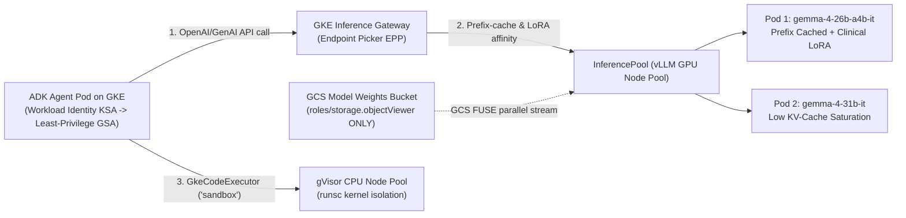

# Lab 19 — Regulated GKE Open-Weight SLMs (`Gemma 4`), Inference Gateway & Agent Sandbox

**Exam section:** 4.2 Deploying and scaling production workloads (~22% of the exam) & 3.1 Model selection
**Objectives covered:** 3.1 (Selecting and configuring LLM vs. SLM, self-hosted vs. SaaS, OSS vs. proprietary considering cost, security, and agent architecture), 4.2 (Selecting optimal deployment runtime — Agent Runtime, Cloud Run, GKE), 2.1 (Using coding agents in secure sandboxes on GKE)
**Time:** ~30 minutes · **Cost:** Free offline / ~$1.50 live (GKE GPU node pool)

---

> **Personal study repo — not affiliated with Google Cloud.** Official guidance: [cloud.google.com/learn/certification/agentic-architect](https://cloud.google.com/learn/certification/agentic-architect) · [Disclaimer](../../../DISCLAIMER.md)

## 1. Exam objectives covered

> Quoted verbatim from the official exam guide:
> - "Selecting and configuring the appropriate language model (LLM vs. SLM, self-hosted vs. SaaS, OSS vs. proprietary) considering cost, security, and agent architecture"
> - "Selecting optimal deployment runtime based on use case, requirements, and cost (Agent Runtime, Cloud Run, GKE)"
> - "Using coding agents in secure sandboxes (e.g., Google Kubernetes Engine [GKE], Cloud Workstations, and Antigravity)"

## 2. Explain it simply

On the exam, **Agent Runtime (`adk deploy agent_engine`) is the default managed answer** for standard enterprise agents calling Vertex AI Gemini models (even for many HIPAA workloads covered by a Google Cloud BAA + VPC-SC + CMEK). You only choose **GKE (`adk deploy gke`)** when a scenario introduces one of three explicit architectural constraints that managed Agent Runtime cannot satisfy:

1. **Strict Air-Gapped / Zero-SaaS Data Residency with Self-Hosted Open-Weight SLMs (`Gemma 4`):** Policy forbids prompts containing regulated clinical PHI or sovereign defense data from leaving customer-managed VPC GPU nodes, or you need fine-tuned open-weight SLMs (`gemma-4-26b-a4b-it` MoE for low-latency active parameters, `gemma-4-31b-it` dense for accuracy) served on dedicated NVIDIA L4/A100/H100 GPUs.
2. **LLM-Aware GPU Routing (`GKE Inference Gateway`):** Standard HTTP round-robin load balancers ignore GPU KV-cache state, forcing GPUs to recompute 50,000-token agent system/history prefixes on every turn. **GKE Inference Gateway (`InferencePool`)** routes turns to the exact GPU pod holding the cached prefix and LoRA adapter while shedding low-priority batch jobs during saturation spikes.
3. **Kernel-Isolated Code Sandboxing (`GkeCodeExecutor(executor_type="sandbox")`):** Runs untrusted agent-generated Python inside a **GKE Sandbox (`gVisor` `runsc`)** pod rather than a standard Linux container sharing the host kernel (`executor_type="job"`).

## 3. How it works



### Architectural Pillars for Regulated GKE Deployments

1. **Self-Hosted Open-Weight SLMs & Failover Postures (`FallbackModel`):**
   - **Hybrid Cloud Posture (Non-Air-Gapped):** Chains self-hosted `Gemma(model="gemma-4-26b-a4b-it")` -> `gemma-4-31b-it` -> managed SaaS `gemini-3.7-flash` for burst elasticity.
   - **Strict Air-Gapped / Zero-SaaS HIPAA Posture:** Chains **only** self-hosted open-weight models inside the private GKE cluster (`gemma-4-26b-a4b-it` -> `gemma-4-31b-it`). Appending a public SaaS model to `FallbackModel` in an air-gapped scenario is a critical compliance violation during GPU outages!
2. **GKE Workload Identity Federation (Least-Privilege IAM):**
   - Never let vLLM or ADK pods inherit the GKE node's default Compute Engine Service Account (`<PROJECT_NUMBER>-compute@developer.gserviceaccount.com`).
   - Annotate the Kubernetes Service Account (`iam.gke.io/gcp-service-account`) to impersonate a dedicated Google Service Account granted **bucket-scoped `roles/storage.objectViewer`** (never `roles/storage.admin` or `roles/editor`) to stream weights via Cloud Storage FUSE (`gcsfuse`).
3. **GKE Inference Gateway (`InferencePool` & `InferenceModel`):**
   - Scrapes real-time vLLM metrics (`kv_cache_usage_perc`, queue depth, active LoRA adapters) and protects `Critical` interactive clinical/customer turns by shedding `Sheddable` offline batch evaluations above saturation thresholds.
4. **Separate Node Pools for GPUs and `gVisor` Sandboxes:**
   - GKE does not support hardware GPUs and `--sandbox="type=gvisor"` on the same node pool. Provision one **GPU node pool** (`g2-standard` L4 / `a2-highgpu` A100) for vLLM `InferencePool` pods and a separate **`gVisor` CPU node pool** for `GkeCodeExecutor(executor_type="sandbox")`.

## 4. The decision that matters

| Architectural Requirement | Best Choice | Why Alternatives Fail |
| :--- | :--- | :--- |
| Managed HIPAA customer-support agent calling Vertex AI Gemini APIs under a Google Cloud BAA with minimal ops | **Agent Runtime (`adk deploy agent_engine`) + VPC-SC + CMEK** | GKE GPU clusters add heavy operational and idle-GPU cost when SaaS Gemini under BAA + VPC-SC already satisfies compliance. |
| Sovereign / air-gapped clinical agent forbidden from sending PHI to any multi-tenant SaaS endpoint, needing low-latency 4B-active-parameter SLM serving | **GKE (`adk deploy gke`) + `gemma-4-26b-a4b-it` (MoE) + GKE Inference Gateway** | Agent Runtime cannot host custom vLLM GPU node pools; `FallbackModel` must exclude SaaS endpoints. |
| Executing untrusted Python scripts generated by a coding agent inside GKE without risking host Linux kernel escape | **`GkeCodeExecutor(executor_type="sandbox")` on a `gVisor` node pool** | `executor_type="job"` shares the host node's Linux kernel; `UnsafeLocalCodeExecutor` runs inside the agent process itself. |
| Streaming 60 GB `Gemma 4` weights from Cloud Storage into GKE vLLM pods with least privilege | **GKE Workload Identity Federation + bucket-level `roles/storage.objectViewer`** | Baking 60 GB weights into Docker images slows cold starts; using the node's default Compute SA or JSON keys violates IAM least privilege. |

## 5. Hands-on A — offline (free)

```bash
./tracks/04_evaluate_and_deploy/lab_19_gke_inference_gateway_and_gpus/run_lab.sh
```

The offline runner validates ADK 2.9.0's `GkeCodeExecutor` (`sandbox` vs `job`), compares hybrid vs. strict air-gapped `FallbackModel` chains (`gemma-4-26b-a4b-it` MoE + `gemma-4-31b-it` dense), audits GKE Workload Identity IAM bindings, and simulates GKE Inference Gateway prefix-cache routing and `Sheddable` batch load shedding.

## 6. Hands-on B — live on Google Cloud (opt-in)

```bash
export GOOGLE_CLOUD_PROJECT="your-project-id"
export GOOGLE_CLOUD_LOCATION="us-central1"

gcloud container clusters create agentic-gke-cluster \
  --project="$GOOGLE_CLOUD_PROJECT" \
  --location="$GOOGLE_CLOUD_LOCATION" \
  --workload-pool="${GOOGLE_CLOUD_PROJECT}.svc.id.goog" \
  --machine-type=e2-standard-4 --num-nodes=2

gcloud container node-pools create gvisor-sandbox-pool \
  --cluster=agentic-gke-cluster \
  --location="$GOOGLE_CLOUD_LOCATION" \
  --sandbox="type=gvisor" --num-nodes=1

./tracks/04_evaluate_and_deploy/lab_19_gke_inference_gateway_and_gpus/run_lab.sh --live
```

> [!WARNING]
> Cost note: GKE clusters with L4 GPU node pools (`g2-standard-8`) cost ~$0.85–$1.50/hour. Delete clusters immediately after testing.

## 7. Verify it worked

1. Confirm `evaluate_runtime_choice()` returns `"agent_engine"` by default and switches to `"gke"` only when open-weight GPUs, air-gapped residency, `InferencePool`, or `gVisor` sandboxing are required.
2. Confirm `build_airgapped_hipaa_fallback_chain()` contains only open-weight `Gemma 4` models and excludes `gemini-3.7-flash`.
3. Confirm `audit_gke_workload_identity_iam()` accepts `roles/storage.objectViewer` via Workload Identity and rejects default Compute Engine service accounts.

## 8. Troubleshooting

| Symptom | Cause | Fix |
| :--- | :--- | :--- |
| `ImportError` importing `GkeCodeExecutor` | Missing `extensions` extra on `google-adk`. | Run `pip install "google-adk[extensions]"`. |
| High TTFT on multi-turn vLLM conversations | Standard K8s `Service` round-robins turns across GPU pods, missing cached prefixes. | Route through **GKE Inference Gateway (`InferencePool`)** for prefix-cache affinity. |
| `gVisor` sandbox pods stuck in `Pending` | GPU node pools cannot enable `--sandbox="type=gvisor"` on the same nodes. | Provision a dedicated CPU node pool with `--sandbox="type=gvisor"` alongside the GPU node pool. |
| vLLM pod gets `403 AccessDenied` reading weights from GCS despite node IAM roles | Workload Identity Federation is enabled on the cluster, blocking node SA metadata fallback, and KSA lacks annotation. | Bind KSA to GSA with `roles/iam.workloadIdentityUser` and grant bucket `roles/storage.objectViewer` to the GSA. |

## 9. Clean up

```bash
./tracks/04_evaluate_and_deploy/lab_19_gke_inference_gateway_and_gpus/cleanup.sh
```

If you created a live GKE cluster:
```bash
gcloud container clusters delete agentic-gke-cluster \
  --project="$GOOGLE_CLOUD_PROJECT" \
  --location="$GOOGLE_CLOUD_LOCATION" --quiet
```

## 10. Exam traps

- **Don't Over-Engineer onto GKE When Agent Runtime Fits:** Only pick GKE when the prompt explicitly demands self-hosted open-weight models (`Gemma 4`), custom GPU/KV-cache routing (`InferencePool`), strict no-SaaS air-gapped residency, or custom K8s `gVisor` sandboxes. Otherwise, **Agent Runtime (`adk deploy agent_engine`)** wins on operational simplicity.
- **Air-Gapped `FallbackModel` Leak Trap:** Never configure a SaaS model (`gemini-3.7-flash`) as the final fallback in `FallbackModel` if regulatory policy prohibits data leaving private VPC GPUs — a GPU OOM would silently spill sensitive prompts to the SaaS endpoint!
- **Scale vLLM on KV-Cache Metrics, Never CPU %:** GPU inference pods saturate VRAM KV-cache while host CPU sits below 15%. Always autoscale HPA on `vllm:gpu_cache_usage_perc` or `vllm:num_requests_waiting`.

## 11. Check yourself

<details>
<summary>1. Why should a strict air-gapped healthcare GKE deployment avoid adding `gemini-3.7-flash` to its `FallbackModel` list?</summary>
During a local vLLM pod restart or GPU saturation event, `FallbackModel` automatically forwards the prompt to the next model in the chain, which would transmit Protected Health Information outside the air-gapped VPC to a multi-tenant SaaS endpoint.
</details>

<details>
<summary>2. Why is `gemma-4-26b-a4b-it` preferred over `gemma-4-31b-it` for high-concurrency interactive customer-support agents on L4 GPUs?</summary>
`gemma-4-26b-a4b-it` uses a Mixture-of-Experts (MoE) architecture activating only ~4B parameters per token (out of 26B total), delivering substantially lower token latency and higher requests-per-second per GPU than the dense 31B model.
</details>

<details>
<summary>3. How should a GKE vLLM pod authenticate to Cloud Storage to stream open-weight model checkpoints?</summary>
Use GKE Workload Identity Federation (`iam.gke.io/gcp-service-account`) mapped to a dedicated Google Service Account with bucket-scoped `roles/storage.objectViewer` — never static JSON keys or the default Compute Engine node service account.
</details>
