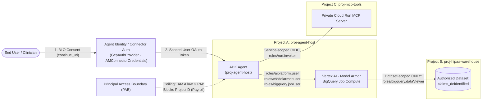

# Lab 16 — IAM Least-Privilege, Agent Identity, Connector Auth & PAB

**Exam section:** 5.1 Configuring agent security and governance & 3.2 Agent permissions (~15% direct Section 5 weight + 30–35% cross-cutting IAM across the exam)
**Objectives covered:** 5.1 ("Implementing authentication and secure tool execution [agent-to-tool API calls using OAuth 2.0]", "Configuring principal access boundary [PAB] policies using Agent Identity"), 3.2 ("Configuring agent permissions [e.g., Agent Identity]")
**Time:** ~30 minutes · **Cost:** Free offline / ~$0.00 live

---

> **Personal study repo — not affiliated with Google Cloud.** Official guidance: [cloud.google.com/learn/certification/agentic-architect](https://cloud.google.com/learn/certification/agentic-architect) · [Disclaimer](../../../DISCLAIMER.md)

## 1. Exam objectives covered

> Quoted verbatim from the official exam guide:
> - "Implementing authentication and secure tool execution (agent-to-tool API calls using OAuth 2.0)"
> - "Configuring principal access boundary (PAB) policies using Agent Identity"
> - "Configuring agent permissions (e.g., Agent Identity)"

## 2. Explain it simply

IAM, credential provisioning, connector authentication, and cross-project blast-radius control show up in **roughly one out of every three questions across the entire exam**. Every scenario tests four non-negotiable security distinctions:

1. **Zero Static Credentials (`Agent Identity` & Workload Identity):** Never export a Service Account JSON key (`key.json`) or bake API keys into container environment variables. Provision short-lived tokens dynamically via **Agent Identity** (`GcpAuthProvider`, `GcpAuthProviderScheme`, `AuthProviderCredentialsServiceClient`) and resource-scoped Secret Manager (`roles/secretmanager.secretAccessor`).
2. **Workload Identity vs. 3LO User-Delegated OAuth 2.0 / Connector Auth:** If an agent calls an internal microservice as *itself*, use short-lived **Workload / Agent Identity OIDC tokens**. If an agent reads a human user's Google Drive, Jira tickets, or ServiceNow HIPAA incidents, a shared Service Account would bypass per-user permissions — you **must** use **3-Legged OAuth 2.0 (3LO)** via ADK Auth Manager (`OAuth2Auth` / `GcpAuthProviderScheme`) or **Gemini Enterprise Connector Auth** (`IAMConnectorCredentialsServiceClient`).
3. **Cross-Project Least-Privilege Predefined Roles:** Never grant `roles/owner`, `roles/editor`, `roles/bigquery.admin`, or project-wide `roles/bigquery.dataViewer`. Grant narrow predefined roles at the **smallest resource hierarchy node** (dataset, Cloud Run service, or individual secret).
4. **Principal Access Boundary (PAB):** Even if someone accidentally grants an over-broad IAM role at the Organization or Folder level, a **PAB policy** bound to the Agent Identity acts as an absolute ceiling: **`Effective Access = IAM Allow ∩ PAB Eligible Resources`**.

## 3. How it works



### The Exam-Critical Cross-Project Least-Privilege Role Table

| Target Service & Project | Exact Predefined IAM Role | Mandatory Resource Scope | Exam Anti-Pattern Distractor to Eliminate |
| :--- | :--- | :--- | :--- |
| **Vertex AI Gemini / Agent Runtime / Memory Bank** (`proj-agent-host`) | `roles/aiplatform.user` | Host Project | `roles/aiplatform.admin` or `roles/editor` |
| **Model Armor Prompt/Response Screening** (`proj-agent-host`) | `roles/modelarmor.user` | Host Project / Template | `roles/securitycenter.admin` |
| **Agent Search / Discovery Engine RAG** (`proj-enterprise-rag`) | `roles/discoveryengine.viewer` | Data Store / RAG Project | `roles/discoveryengine.admin` |
| **Cross-Project BigQuery Analytics** (`proj-agent-host` -> `proj-hipaa-warehouse`) | **`roles/bigquery.jobUser`** on `proj-agent-host` **+** **`roles/bigquery.dataViewer`** on the specific **Dataset** in `proj-hipaa-warehouse` | Host Project (jobs) + **Target Dataset** (data) | `roles/bigquery.admin`, project-wide `roles/bigquery.dataViewer` on the data project, or running jobs inside the restricted data project |
| **Private Cloud Run MCP / A2A Endpoint** (`proj-mcp-tools`) | `roles/run.invoker` | **Specific Cloud Run Service** | Project-wide `roles/run.invoker` or `--allow-unauthenticated` |
| **Third-Party Webhook HMAC / API Secret** (`proj-agent-host`) | `roles/secretmanager.secretAccessor` | **Individual Secret Resource** | Plaintext `ENV` vars in `Dockerfile` or project-wide `roles/secretmanager.admin` |

### Agent Identity (`agentidentitycredentials_v1`) vs. Connector Auth (`iamconnectorcredentials_v1alpha`)

- **`GcpAuthProvider` + `GcpAuthProviderScheme` (`google.adk.integrations.agent_identity`):**
  - Backed by `google.cloud.agentidentitycredentials_v1.AuthProviderCredentialsServiceClient` (`RetrieveCredentialsRequest` / `FinalizeCredentialsRequest`).
  - Provisions managed tokens for ADK tools (`AuthConfig(auth_scheme=scheme)`) without storing client secrets in agent code.
- **Gemini Enterprise Connector Auth (`google.cloud.iamconnectorcredentials_v1alpha.IAMConnectorCredentialsServiceClient`):**
  - Powers first-party and third-party enterprise connectors (Jira, ServiceNow, Salesforce, Workday, Google Workspace) in Gemini Enterprise.
  - When a user invokes a connector tool for the first time, `RetrieveCredentialsRequest(connector=..., user_id=..., scopes=..., continue_uri=...)` initiates a **3LO consent redirect**, then securely vaults and refreshes per-user tokens so the agent can only read records that specific user owns.

## 4. The decision that matters

| Exam Scenario | Select This Design | Why Alternatives Fail |
| :--- | :--- | :--- |
| Agent in `proj-agent-host` must run SQL queries against one HIPAA-deidentified dataset in `proj-hipaa-warehouse` without seeing 20 other sensitive datasets in `proj-hipaa-warehouse` | Grant **`roles/bigquery.jobUser` on `proj-agent-host`** and **dataset-level `roles/bigquery.dataViewer`** on that single dataset in `proj-hipaa-warehouse` | Project-level `roles/bigquery.dataViewer` exposes all 21 datasets; omitting `roles/bigquery.jobUser` causes `Access Denied: bigquery.jobs.create`. |
| Customer-support agent needs to create Jira tickets and read Google Drive files strictly under the logged-in employee's permissions | **3LO OAuth 2.0 via Connector Auth (`IAMConnectorCredentialsServiceClient`) or ADK `GcpAuthProviderScheme` / `OAuth2Auth` (PKCE `S256`)** | A shared Service Account acts with uniform privileges across all employees, causing confused-deputy data leaks. |
| Security team wants an org-wide guarantee that even if a project admin mistakenly grants an agent `roles/storage.admin` on `proj-prod-payroll`, the agent still cannot touch `proj-prod-payroll` | Bind a **Principal Access Boundary (PAB)** policy to the Agent Identity listing only approved sandbox/data projects | IAM Allow roles are additive; only a PAB enforces an identity-centric ceiling (`Effective Access = IAM Allow ∩ PAB`). |
| Agent deployed on Cloud Run calls a third-party REST API requiring a static vendor token | Store the token in **Secret Manager** and grant secret-scoped **`roles/secretmanager.secretAccessor`** to the dedicated runtime SA | Hardcoding tokens in `Dockerfile` `ENV` or downloading a Service Account JSON key violates key-rotation and secret-hygiene controls. |

## 5. Hands-on A — offline (free)

```bash
./tracks/05_secure_and_govern/lab_16_agent_identity_and_auth/run_lab.sh
```

The offline runner instantiates ADK 2.9.0's `GcpAuthProvider`, `GcpAuthProviderScheme`, `OAuth2Auth`, `agentidentitycredentials_v1.RetrieveCredentialsRequest`, and `iamconnectorcredentials_v1alpha.RetrieveCredentialsRequest`, executes the deterministic **Cross-Project Least-Privilege IAM Auditor** across compliant vs. over-privileged blueprints, and verifies PAB set intersection (`IAM Allow ∩ PAB`).

## 6. Hands-on B — live on Google Cloud (opt-in)

```bash
export GOOGLE_CLOUD_PROJECT="your-project-id"
export GOOGLE_CLOUD_LOCATION="us-central1"

gcloud services enable iam.googleapis.com cloudresourcemanager.googleapis.com \
  --project="$GOOGLE_CLOUD_PROJECT"

# Create an Organization-level Principal Access Boundary (PAB) policy:
gcloud iam principal-access-boundary-policies create agent-sandbox-ceiling \
  --organization="YOUR_ORG_ID" \
  --location=global \
  --display-name="Restrict Agent Identity to Approved Projects" \
  --details-rules="description=Approved projects only,effect=ALLOW,resources=//cloudresourcemanager.googleapis.com/projects/${GOOGLE_CLOUD_PROJECT}"

./tracks/05_secure_and_govern/lab_16_agent_identity_and_auth/run_lab.sh --live
```

> [!WARNING]
> Cost note: IAM role bindings and Principal Access Boundary policies incur **$0.00** in Google Cloud charges. Note that PAB policies require Organization-level IAM admin permissions.

## 7. Verify it worked

1. Confirm `GcpAuthProviderScheme` reports `type_ == "gcpAuthProviderScheme"` and pairs cleanly with `AuthConfig`.
2. Confirm `audit_cross_project_iam_bindings` approves host-project `roles/bigquery.jobUser` + dataset-scoped `roles/bigquery.dataViewer` while rejecting `roles/editor`, `roles/bigquery.admin`, and project-wide `roles/run.invoker`.
3. Confirm `evaluate_pab_effective_access` drops `proj-prod-payroll-restricted` even when present in `iam_allowed_resources`.

## 8. Troubleshooting

| Symptom | Cause | Fix |
| :--- | :--- | :--- |
| `ImportError: cannot import name 'GcpAuthProvider'` | Missing the `agent-identity` extra on `google-adk`. | Run `pip install "google-adk[agent-identity]"`. |
| `403 Access Denied: User does not have bigquery.jobs.create permission` on cross-project query | Agent was granted dataset `roles/bigquery.dataViewer` on Project B, but lacked `roles/bigquery.jobUser` on Project A. | Grant `roles/bigquery.jobUser` to the agent's identity on its host/billing project (`proj-agent-host`). |
| Agent has `roles/storage.objectViewer` on Bucket X, yet receives `PERMISSION_DENIED` | A Principal Access Boundary (PAB) bound to the principal excludes Bucket X's parent project. | Verify PAB bindings via `gcloud iam principal-access-boundary-policies` — PAB overrides IAM Allow grants. |

## 9. Clean up

```bash
./tracks/05_secure_and_govern/lab_16_agent_identity_and_auth/cleanup.sh
```

If you created a live PAB policy:
```bash
gcloud iam principal-access-boundary-policies delete agent-sandbox-ceiling \
  --organization="YOUR_ORG_ID" --location=global --quiet
```

## 10. Exam traps

- **PAB Grants ZERO Permissions on Its Own:** If a PAB allows Project A, and the Agent Identity has *no IAM Allow role* on Project A, access is **DENIED**. Effective access is strictly **`IAM Allow ∩ PAB`**.
- **Static SA Keys (`JSON`) Are Always Wrong on GCP:** Any exam option proposing `gcloud iam service-accounts keys create key.json` for an agent running on Agent Runtime, Cloud Run, or GKE (or via Workload Identity Federation from AWS/GitHub Actions) is an immediate distractor.
- **Cross-Project BigQuery Split-Role Pattern:** Remember the exact split: **`roles/bigquery.jobUser`** on the **agent's host project** + **dataset-scoped `roles/bigquery.dataViewer`** on the **data project**.
- **Confused Deputy via Service Account:** Never use an agent's Service Account to query user-scoped SaaS/Drive/Jira data on behalf of end users; use **3LO OAuth 2.0 (`OAuth2Auth` / Connector Auth)** or propagate the user's OAuth token.

## 11. Check yourself

<details>
<summary>1. An agent hosted in `proj-agent` must read table `claims` inside dataset `hipaa_clean` in `proj-warehouse`, without accessing any other datasets in `proj-warehouse`. What exact IAM roles should be granted and where?</summary>
Grant `roles/bigquery.jobUser` to the agent's identity on `proj-agent` (so it can run query jobs in its own project) and grant `roles/bigquery.dataViewer` scoped strictly to the `hipaa_clean` dataset (or `claims` table) in `proj-warehouse`.
</details>

<details>
<summary>2. When should an architect choose Gemini Enterprise Connector Auth (`IAMConnectorCredentialsServiceClient`) or ADK `OAuth2Auth` over a Google Cloud Service Account?</summary>
Whenever the agent executes tool calls **on behalf of an individual human user** against systems with per-user ACLs (such as Salesforce, ServiceNow, Jira, or Google Workspace), requiring a 3-legged OAuth (3LO) user consent flow and per-user token isolation.
</details>

<details>
<summary>3. A developer accidentally grants an agent's identity `roles/editor` at the Folder level containing 15 projects, while a Principal Access Boundary (PAB) bound to that identity lists only `projects/sandbox-01`. Which projects can the agent access?</summary>
Only `projects/sandbox-01`. Effective permissions equal the intersection of IAM Allow policies and PAB eligible resources (`IAM Allow ∩ PAB`), blocking the other 14 projects immediately.
</details>
