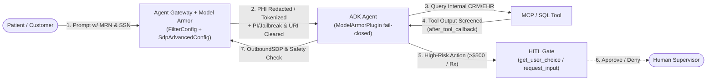

# Lab 17 — Model Armor with Sensitive Data Protection (SDP), Gateway Pattern & HITL

**Exam section:** 5.1 & 5.2 Implementing secure agent behavior and execution (~15% direct Section 5 weight + heavily tested across HIPAA/enterprise scenarios)
**Objectives covered:** 5.1 ("Designing and configuring agentic governance and policy enforcement [e.g., Agent Registry and Model Armor]"), 5.2 ("Designing appropriate safety frameworks and guardrails [e.g., Agent Gateway, Model Armor, and human-in-the-loop (HITL)]")
**Time:** ~30 minutes · **Cost:** Free offline / ~$0.01 live

---

> **Personal study repo — not affiliated with Google Cloud.** Official guidance: [cloud.google.com/learn/certification/agentic-architect](https://cloud.google.com/learn/certification/agentic-architect) · [Disclaimer](../../../DISCLAIMER.md)

## 1. Exam objectives covered

> Quoted verbatim from the official exam guide:
> - "Designing and configuring agentic governance and policy enforcement (e.g., Agent Registry and Model Armor)"
> - "Designing appropriate safety frameworks and guardrails (e.g., Agent Gateway, Model Armor, and human-in-the-loop [HITL])"

## 2. Explain it simply

Imagine a patient messages a hospital's customer-support agent: *"Hi, my name is Jane Roe, my Medical Record Number is MRN-482910, and my SSN is 123-45-6789. Can you check my insulin refill and issue a $1,200 billing refund?"*

Three things must happen cleanly on that single turn — and **this exact combination (`Model Armor + SDP + Gateway Pattern + HITL`) is directly tested on the exam**:
1. **Model Armor with Sensitive Data Protection (`SdpAdvancedConfig`):** If you use **SDP Basic (`SdpBasicConfig`)**, Model Armor simply *blocks* the entire message whenever it sees an SSN/MRN, making it impossible for patients to get help! Instead, **SDP Advanced (`SdpAdvancedConfig`)** links custom **Cloud Sensitive Data Protection (SDP)** `inspect_template` + `deidentify_template` resources to **redact, mask, or cryptographically tokenize** `MRN-482910` and `123-45-6789` *before* the prompt ever reaches the LLM or observability logs.
2. **Gateway Perimeter Pattern vs. In-Agent `ModelArmorPlugin`:** Enforcing Model Armor at the centralized **Agent Gateway** guarantees every prompt/response across *all* teams and frameworks is sanitized at the perimeter, while attaching ADK's **`ModelArmorPlugin` (`block_on_screening_failure=True`)** inside the agent additionally screens **internal MCP/database tool outputs (`after_tool_callback`)** for indirect prompt injections that never cross the external gateway.
3. **Human-in-the-Loop (HITL) Gate (`request_input` / `get_user_choice`):** Model Armor inspects text safety, *not* business authorization thresholds. Issuing a $1,200 refund or cancelling a clinical prescription must pause execution via ADK's HITL tools until a human supervisor approves.

## 3. How it works



### Deep Comparison: `SdpBasicConfig` vs. `SdpAdvancedConfig` in `google.cloud.modelarmor_v1`

| Feature | `SdpBasicConfig` (`sdp_settings.basic_config`) | `SdpAdvancedConfig` (`sdp_settings.advanced_config`) |
| :--- | :--- | :--- |
| **Protobuf Configuration** | `SdpBasicConfig(filter_enforcement=ENABLED)` | `SdpAdvancedConfig(inspect_template="projects/.../inspectTemplates/...", deidentify_template="projects/.../deidentifyTemplates/...")` |
| **Runtime Behavior on Sensitive Data** | **Detect & Block (`MATCH_FOUND`)** — rejects the prompt/response when default sensitive infoTypes appear. | **Inspect & De-identify Inline** — masks (`***`), replaces (`[REDACTED_HIPAA_MRN]`), or format-preserving-encrypts (`FPE` / surrogate tokens) sensitive spans and forwards sanitized text! |
| **Custom InfoTypes (HIPAA MRNs, Internal Account IDs)** | Not customizable beyond built-in defaults. | Full **Cloud SDP (`google-cloud-dlp`)** custom regex/dictionary `infoTypes` and hotword context rules. |
| **When to Pick on the Exam** | Quick zero-config blocking when users must never submit sensitive strings at all. | **HIPAA / PCI / Financial customer support** where callers naturally type PHI/PII and prompts must be sanitized *before* hitting the LLM or logs. |

### Centralized Agent Gateway Pattern vs. In-Agent `ModelArmorPlugin`

- **Model Armor at the Agent Gateway (Centralized Perimeter Pattern):**
  - Security platform team configures `SanitizeUserPrompt` and `SanitizeModelResponse` (with `FilterConfig`: `PiAndJailbreakFilterSettings`, `MaliciousUriFilterSettings`, `RaiFilterSettings`, `SdpFilterSettings`) once at the ingress/egress **Agent Gateway** (e.g., Apigee / Envoy ext_proc / Cloud Run proxy).
  - **Why it wins org-wide:** Application developers cannot forget or disable `ModelArmorPlugin` in code, and non-ADK agents (LangChain, custom microservices, third-party models) get identical protection.
- **In-Agent `ModelArmorPlugin` (`google.adk.integrations.model_armor`):**
  - Hooks directly into ADK's internal runner callbacks (`on_user_message_callback`, `before_model_callback`, `after_tool_callback`, `after_model_callback`).
  - **Why you still need it alongside a Gateway:** When an agent calls an internal database or MCP tool inside the VPC, that tool's output does *not* pass back through the external ingress gateway. `ModelArmorPlugin`'s `after_tool_callback` catches **indirect prompt injections** hidden inside internal tickets or emails before the LLM reasons over them!
  - Set `ModelArmorConfig(block_on_screening_failure=True)` so any transient `503` or quota failure **fails closed** rather than leaking unscreened PHI.

## 4. The decision that matters

| Exam Scenario | Select This Guardrail Architecture | Why the Distractors Fail |
| :--- | :--- | :--- |
| Healthcare support chatbot must accept patient chat messages containing SSNs and Medical Record Numbers, strip the PHI before calling Gemini or writing logs, and still answer general shipping questions | **Model Armor `FilterConfig` with `SdpFilterSettings(advanced_config=SdpAdvancedConfig(inspect_template=..., deidentify_template=...))`** | `SdpBasicConfig` blocks the patient's entire turn instead of redacting PHI; system-prompt instructions ("please ignore SSNs") still transmit raw PHI to the LLM and logs. |
| CISO mandates uniform prompt-injection, malicious-URI, and SDP enforcement across 40 agents built in ADK, LangGraph, and Go without trusting individual app teams to wire SDK plugins | **Model Armor enforced at the centralized Agent Gateway** | Per-repo SDK plugins can be omitted or misconfigured (`block_on_screening_failure=False`) by individual teams. |
| Preventing indirect prompt injection hidden inside internal Postgres/Jira records fetched mid-turn by an ADK tool | **ADK `ModelArmorPlugin` (`after_tool_callback` / `before_model_callback`) with `block_on_screening_failure=True`** | External ingress gateways only inspect the user's initial HTTP request and final HTTP response, missing mid-turn internal tool payloads. |
| Stopping an autonomous support agent from issuing refunds over $500 or cancelling active clinical prescriptions without supervisor sign-off | **HITL gate (`get_user_choice` / `request_input` / `before_tool_callback`)** | A valid tool call `issue_refund(amount=2500)` contains zero toxicity, PII, or prompt injection, so Model Armor allows it 100% of the time. |

## 5. Hands-on A — offline (free)

```bash
./tracks/05_secure_and_govern/lab_17_model_armor_and_hitl/run_lab.sh
```

The offline runner constructs real `google.cloud.modelarmor_v1` `FilterConfig` objects with `PiAndJailbreakFilterSettings`, `MaliciousUriFilterSettings`, and both `SdpBasicConfig` and `SdpAdvancedConfig(inspect_template=..., deidentify_template=...)`, initializes ADK's fail-closed `ModelArmorPlugin`, compares Gateway vs. Plugin enforcement, and tests HITL thresholds on customer refunds and clinical prescription tools.

## 6. Hands-on B — live on Google Cloud (opt-in)

```bash
export GOOGLE_CLOUD_PROJECT="your-project-id"
export GOOGLE_CLOUD_LOCATION="us-central1"

gcloud services enable modelarmor.googleapis.com dlp.googleapis.com \
  --project="$GOOGLE_CLOUD_PROJECT"

# Grant least-privilege Model Armor screening role to the agent / gateway SA:
# gcloud projects add-iam-policy-binding "$GOOGLE_CLOUD_PROJECT" \
#   --member="serviceAccount:agent-gateway-sa@${GOOGLE_CLOUD_PROJECT}.iam.gserviceaccount.com" \
#   --role="roles/modelarmor.user"

./tracks/05_secure_and_govern/lab_17_model_armor_and_hitl/run_lab.sh --live
```

> [!WARNING]
> Cost note: Model Armor and Cloud Sensitive Data Protection bill per character inspected/de-identified (fractions of a cent for lab-sized prompts).

## 7. Verify it worked

1. Confirm `SdpAdvancedConfig` exposes both `inspect_template` and `deidentify_template` resource names on `FilterConfig.sdp_settings.advanced_config`.
2. Confirm `ModelArmorConfig.block_on_screening_failure` is `True` (fail-closed).
3. Confirm the HITL gate auto-approves a $45 refund while pausing a $1,200 refund and clinical prescription cancellation until human approval.

## 8. Troubleshooting

| Symptom | Cause | Fix |
| :--- | :--- | :--- |
| `ImportError: cannot import name 'ModelArmorPlugin'` | Missing `gcp` extra on `google-adk`. | Run `pip install "google-adk[gcp]"`. |
| Legitimate patient support turns get completely rejected whenever a patient mentions their phone number or MRN | Template uses `SdpBasicConfig` (block mode) instead of `SdpAdvancedConfig` de-identification. | Switch `sdp_settings` to `SdpAdvancedConfig` with a Cloud SDP `deidentify_template` that masks/tokenizes PHI inline. |
| Model Armor call fails with `403 PERMISSION_DENIED` on `SanitizeUserPrompt` | Runtime or Gateway SA lacks Model Armor invoke permission or SDP template read access. | Grant `roles/modelarmor.user` (and SDP template reader/user roles for `SdpAdvancedConfig`) to the dedicated SA. |
| Unscreened prompts slip through when a regional endpoint times out | `block_on_screening_failure` was left `False` (fail-open). | Set `block_on_screening_failure=True` for regulated HIPAA/PCI workloads. |

## 9. Clean up

```bash
./tracks/05_secure_and_govern/lab_17_model_armor_and_hitl/cleanup.sh
```

## 10. Exam traps

- **`SdpBasicConfig` vs. `SdpAdvancedConfig`:** Whenever an exam question asks to **redact, mask, or tokenize PII/PHI before sending prompts to Gemini**, the answer is **Model Armor configured with `SdpAdvancedConfig` (`inspect_template` + `deidentify_template`)** — `SdpBasicConfig` cannot transform/redact text!
- **Gateway Pattern vs. SDK Plugin:** Use **Agent Gateway + Model Armor** for centralized, language-agnostic perimeter enforcement; add **`ModelArmorPlugin`** inside ADK when you also need mid-turn `after_tool_callback` screening of internal tool outputs.
- **Fail-Closed (`block_on_screening_failure=True`) vs. Fail-Open (`False`):** Regulated healthcare and banking workloads always require **fail-closed (`True`)**.
- **Model Armor Cannot Replace HITL:** Model Armor detects malicious language and sensitive data; **HITL (`get_user_choice` / `request_input`)** governs high-impact business state mutations (`refund > $500`, `DROP TABLE`, clinical order changes).

## 11. Check yourself

<details>
<summary>1. Why would a HIPAA healthcare chatbot use `SdpAdvancedConfig` instead of `SdpBasicConfig` inside its Model Armor template?</summary>
`SdpBasicConfig` simply blocks prompts containing sensitive data, preventing patients who include an MRN or SSN from getting help. `SdpAdvancedConfig` links Cloud Sensitive Data Protection `inspect_template` and `deidentify_template` resources to redact, mask, or tokenize PHI inline before the prompt reaches the LLM or logs.
</details>

<details>
<summary>2. What is the advantage of enforcing Model Armor at the Agent Gateway AND keeping `ModelArmorPlugin` inside ADK?</summary>
The Agent Gateway enforces non-bypassable org-wide perimeter screening and SDP de-identification across all external client and peer A2A traffic, while ADK's `ModelArmorPlugin` (`after_tool_callback`) screens internal VPC database/MCP tool outputs for indirect prompt injection before the model reasons over them.
</details>

<details>
<summary>3. Which IAM role follows least privilege for a service account that invokes Model Armor prompt and response sanitization?</summary>
`roles/modelarmor.user`.
</details>
