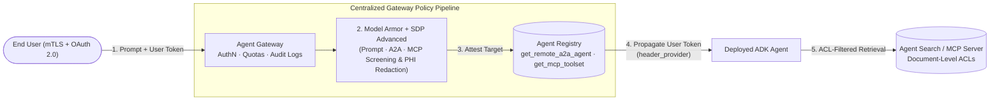

# Lab 18 — Agent Governance: Agent Gateway + Model Armor Perimeter & Agent Registry

**Exam section:** 5.1 & 5.2 Configuring agent security, governance, and identity propagation (~15% direct weight + cross-cutting architecture)
**Objectives covered:** 5.1 ("Configuring Agent Gateway to monitor traffic and track agents", "Designing and configuring agentic governance and policy enforcement [e.g., Agent Registry and Model Armor]"), 5.2 ("Designing appropriate safety frameworks and guardrails [Agent Gateway, Model Armor, HITL]", "Configuring secure access to data and identity propagation [Agent Gateway and Agent Registry]")
**Time:** ~30 minutes · **Cost:** Free offline / ~$0.00 live

---

> **Personal study repo — not affiliated with Google Cloud.** Official guidance: [cloud.google.com/learn/certification/agentic-architect](https://cloud.google.com/learn/certification/agentic-architect) · [Disclaimer](../../../DISCLAIMER.md)

## 1. Exam objectives covered

> Quoted verbatim from the official exam guide:
> - "Configuring Agent Gateway to monitor traffic and track agents"
> - "Designing and configuring agentic governance and policy enforcement (e.g., Agent Registry and Model Armor)"
> - "Configuring secure access to data and identity propagation (e.g., Agent Gateway and Agent Registry)"

## 2. Explain it simply

When an organization scales from one prototype agent to dozens of cross-department A2A agents and MCP tool servers, per-agent security code collapses into "shadow AI" sprawl. Enterprise governance separates **catalog attestation** from **runtime traffic enforcement**:

1. **Agent Registry (`AgentRegistry`):** The **control-plane catalog**. Developers publish approved agents (`list_agents`, `get_remote_a2a_agent`) and MCP servers (`list_mcp_servers`, `get_mcp_toolset`) here. Any unapproved "shadow" A2A URL or rogue MCP server missing from `AgentRegistry` is rejected before a connection is opened.
2. **Agent Gateway + Model Armor Perimeter Pattern:** The **data-plane chokepoint** sitting in front of agents, A2A peers, and MCP servers. Every request passes through five mandatory gateway checks:
   - **mTLS & OAuth 2.0 Validation** (rejecting unauthenticated callers with `401`)
   - **Per-Agent Rate & Token Quotas** (stopping noisy-neighbor cost spikes with `429`)
   - **Centralized Model Armor + SDP De-identification** (screening user prompts, peer A2A tasks, and MCP tool responses for prompt injection, malicious URIs, and redacting HIPAA PHI via `SdpAdvancedConfig`)
   - **`AgentRegistry` Endpoint Attestation** (blocking unapproved shadow MCP/A2A targets)
   - **End-User Identity Propagation** (`header_provider` forwarding the caller's verified OAuth token so Agent Search / Discovery Engine enforces **Document-Level ACLs** for *that specific user*, preventing confused-deputy leaks).

## 3. How it works



### How `AgentRegistry` Connects Governance, A2A, MCP & Identity Propagation

In ADK 2.9.0, `google.adk.integrations.agent_registry.AgentRegistry` accepts `AgentRegistry(project_id, location, header_provider=...)`:
- **Dynamic Discovery Instead of Hardcoded URLs:** Call `get_remote_a2a_agent()` to build a governed remote A2A peer or `get_mcp_toolset()` to build an attested `MCPToolset` directly from the registry.
- **Identity Propagation via `header_provider`:** Supplying `header_provider` injects the end-user's verified `Authorization: Bearer ...` header from the Agent Gateway into outbound A2A/MCP requests so downstream data stores evaluate the *human user's* Document-Level ACLs rather than the agent's broad workload Service Account.

> [!NOTE]
> **Architectural Note on Agent Gateway:** On Google Cloud, the **Agent Gateway** architectural plane (centralized ingress/egress policy proxy for user-to-agent, A2A, and agent-to-MCP traffic) is implemented using managed gateway infrastructure such as **Apigee API Management** (with Model Armor & LLM token-quota policies) or Envoy-based Cloud Service Mesh / Cloud Run proxies, paired with **`AgentRegistry`** in ADK.

## 4. The decision that matters

| Exam Scenario | Choose This Architecture | Why Alternatives Fail |
| :--- | :--- | :--- |
| Preventing shadow AI teams from connecting agents to unvetted external MCP servers or rogue A2A endpoints | **`AgentRegistry` catalog allowlisting + Agent Gateway egress enforcement** | Hardcoding URLs in `.env` files bypasses security review and breaks during endpoint rotation. |
| Enforcing uniform prompt-injection screening, HIPAA SDP PHI redaction, and per-department token quotas across 25 polyglot agents | **Agent Gateway + Model Armor Gateway Pattern (`FilterConfig` + `SdpAdvancedConfig`)** | Asking 25 separate engineering teams to maintain custom regexes and rate limiters inside application code guarantees drift and bypasses. |
| Tier-1 support rep asks a shared HR/Clinical RAG agent a question, and must NEVER receive executive M&A or restricted clinical files stored in the same Agent Search data store | **Propagate the end-user's OAuth 2.0 identity through Agent Gateway -> `AgentRegistry(header_provider=...)` -> ACL-aware `VertexAiSearchTool`** | Authenticating Agent Search solely with the agent's Service Account (`roles/discoveryengine.viewer`) returns every document the *agent* can read (confused-deputy vulnerability). |
| Distinguish GKE Inference Gateway from Agent Gateway | **Agent Gateway** governs *who can call which agent/MCP tool, OAuth propagation, and Model Armor safety*; **GKE Inference Gateway** optimizes *GPU vLLM KV-cache and LoRA routing* | Confusing the two gateways is a classic exam distractor! |

## 5. Hands-on A — offline (free)

```bash
./tracks/05_secure_and_govern/lab_18_governance_gateway_registry/run_lab.sh
```

The offline runner instantiates ADK 2.9.0's real `AgentRegistry` with a custom `header_provider`, builds a Gateway `modelarmor_v1.FilterConfig` with `SdpAdvancedConfig`, and simulates five live gateway scenarios: Tier-1 rep inline MRN redaction + Document-Level ACL filtering, executive ACL visibility, `429` RPM quota throttling, `403` shadow MCP blocking, and `403` A2A prompt-injection blocking.

## 6. Hands-on B — live on Google Cloud (opt-in)

```bash
export GOOGLE_CLOUD_PROJECT="your-project-id"
export GOOGLE_CLOUD_LOCATION="us-central1"

./tracks/05_secure_and_govern/lab_18_governance_gateway_registry/run_lab.sh --live
```

> [!WARNING]
> Cost note: Running the verification script incurs $0.00 in charges; full production Apigee gateway provisioning is omitted to protect sandbox budgets.

## 7. Verify it worked

1. Confirm `AgentRegistry` exposes `list_agents`, `get_remote_a2a_agent`, `list_mcp_servers`, `get_mcp_toolset`, and `list_endpoints`.
2. Confirm the gateway simulation redacts `MRN-774120` to `[SDP_REDACTED_MRN]` and restricts `support_tier1` to `("doc_public_formulary.pdf",)` while granting `exec_leadership` access to `doc_board_ma_strategy.pdf`.
3. Confirm unregistered MCP URLs and A2A prompt injections are rejected with HTTP `403`.

## 8. Troubleshooting

| Symptom | Cause | Fix |
| :--- | :--- | :--- |
| `ImportError: cannot import name 'AgentRegistry'` | Missing `agent-identity` extra or `mcp` package. | Run `pip install "google-adk[agent-identity]" mcp`. |
| RAG search returns confidential documents to unauthorized employees | Agent Search is queried using the agent's workload SA instead of the propagated end-user OAuth token. | Enable Data Store ACLs in Agent Search and propagate the caller's OAuth token via Agent Gateway + `header_provider`. |
| Legitimate internal MCP server rejected at runtime with `403` | MCP server endpoint was deployed to Cloud Run without registering in `AgentRegistry`. | Register and attest the MCP server in `AgentRegistry` before referencing it via `get_mcp_toolset()`. |

## 9. Clean up

```bash
./tracks/05_secure_and_govern/lab_18_governance_gateway_registry/cleanup.sh
```

## 10. Exam traps

- **Agent Registry != Runtime Proxy:** `AgentRegistry` is the **catalog/discovery plane** (`get_mcp_toolset`, `get_remote_a2a_agent`); **Agent Gateway** is the **inline traffic proxy** (mTLS/OAuth validation, quotas, centralized Model Armor + SDP screening, audit logging).
- **Agent Gateway != GKE Inference Gateway:** **Agent Gateway** secures and governs *agent, A2A, and MCP API traffic*. **GKE Inference Gateway (`InferencePool`)** load-balances *self-hosted GPU model-serving pods* using KV-cache and LoRA metrics.
- **Service Account + PAB Does NOT Solve Per-User RAG ACLs:** Principal Access Boundaries cap *which GCP projects* the agent's workload identity can touch, whereas **Identity Propagation** ensures User A cannot read User B's documents *inside the same authorized RAG data store*.

## 11. Check yourself

<details>
<summary>1. Which two methods on ADK's `AgentRegistry` dynamically construct governed A2A peers and MCP toolsets without hardcoding endpoint URLs?</summary>
`get_remote_a2a_agent()` and `get_mcp_toolset()`.
</details>

<details>
<summary>2. How does the Agent Gateway + Model Armor Gateway Pattern protect heterogeneous non-ADK and ADK agents simultaneously?</summary>
By terminating all ingress/egress agent, A2A, and MCP traffic at a centralized proxy that validates OAuth/mTLS, enforces RPM/token quotas, and invokes Model Armor (`FilterConfig` + `SdpAdvancedConfig`) before requests reach any backend agent code.
</details>

<details>
<summary>3. Why must an Agent Gateway propagate the end-user's OAuth 2.0 token down to `AgentRegistry` / Agent Search?</summary>
So downstream search engines and MCP tools evaluate Document-Level and Row-Level ACLs against the human requester's identity rather than the agent's privileged workload Service Account.
</details>
